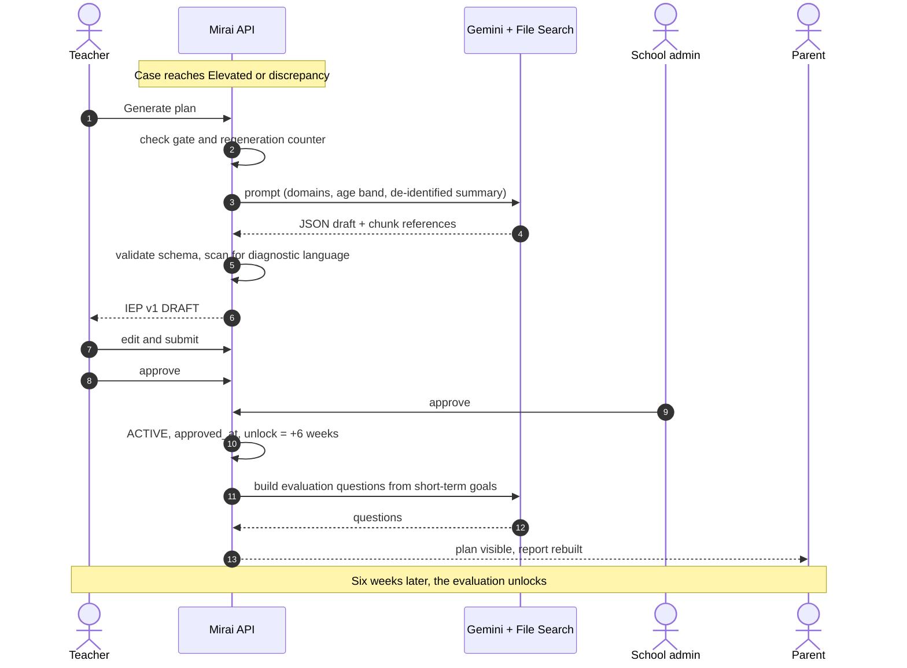
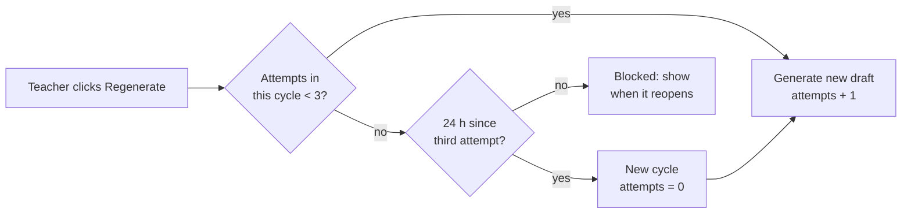

# IEP and Evaluation Generation

<p class="mi-lead">From an Elevated result to an approved, curriculum-grounded classroom plan, and six weeks later, to questions that check whether it is working.</p>

## End-to-end flow



## When generation is allowed

| Condition | Result |
| --- | --- |
| Any domain `combined_score >= 2.00` | Allowed |
| Any domain discrepancy at or above the threshold | Allowed |
| Neither | `400 GENERATION_NOT_ALLOWED`; case is `NO_CONCERN_IDENTIFIED` |
| Regeneration limit reached | `429 REGENERATION_COOLDOWN` with the time the cooldown ends |
| AI service unavailable | `503` with a neutral message; teacher can retry or write the plan manually |

## The plan structure

The generated IEP identifies the domain(s) that triggered it and stays editable by the initiating teacher.

```json
{
  "triggering_domains": ["DYSLEXIA"],
  "age_band": "6-9",
  "summary": "Short, strengths-first description of what the classroom observations show.",
  "strengths": ["Enjoys being read to", "Strong verbal recall"],
  "focus_areas": ["Letter-sound matching", "Reading short words aloud"],
  "strategies": [
    "Seat near the front and use large-print word cards",
    "Pair reading tasks with picture prompts"
  ],
  "short_term_goals": [
    "Match 10 common letter sounds with picture support",
    "Read 5 three-letter words aloud with one prompt"
  ],
  "long_term_goals": ["Read a short CBC-level passage with support"],
  "classroom_accommodations": ["Extra time on reading tasks", "Oral responses accepted"],
  "home_link": "One sentence on how home activities connect to the goals.",
  "references": ["<file search chunk id>", "<file search chunk id>"],
  "disclaimer": "This is a support plan, not a diagnosis."
}
```

| Field | Stored in |
| --- | --- |
| Whole plan rendered as markdown | `iep.generated_content` |
| `short_term_goals` | `iep.short_term_goals` (source of the evaluation questions) |
| `strategies` | `iep.strategies` |
| `references` | `iep.rag_file_references` |

The example values above are illustrative only.

## Prompt contract

The prompt is assembled server-side from a versioned template. The model is told what it may and may not do.

```text
SYSTEM
You write classroom support plans for early-years teachers in Kenya.
Ground every strategy in the retrieved KICD CBC inclusive-education guidance.
Never diagnose. Never name a condition as something the child "has".
Use plain, strengths-first language. Activities must need only common
classroom or household materials. Return JSON matching the schema.

USER
Triggering domains: {domains_with_levels}
Age band: {age_band}   Grade band: {grade_band}
Observed areas that scored high: {deidentified_item_summary}
Teacher request (regeneration only): {sanitised_teacher_note}
```

## Review, approval and versions

| Step | Who | Effect |
| --- | --- | --- |
| Draft created | System | `iep.status = DRAFT`, `version_number = n` |
| Edit | Initiating teacher only | Content, goals and strategies updated; edit recorded |
| Submit | Teacher | `PENDING_APPROVAL`; case `IEP_PENDING_APPROVAL`; school admins notified |
| Approve | Teacher and school admin (same school) | When both are true: `ACTIVE`, `approved_at` set, `evaluation_unlock_date = approved_at + 6 weeks`, parent can view |
| Reject | Teacher or school admin, reason required | `REJECTED`; teacher creates a new version; old version `SUPERSEDED` |

The school administrator can read the draft and the three domain scores while approving. They cannot read raw answers, and cannot rewrite the teacher's content.

## Regeneration limits



- The counter is stored **per case**, not per session or device.
- The UI shows remaining attempts and a cooldown timer.
- Every attempt is audited as `GENERATE`.

## Six-week evaluation questions

When an IEP becomes active, the AI service turns each short-term goal into one monitoring question, stored in `iep_evaluation_question` with a `position`.

| Short-term goal | Generated question |
| --- | --- |
| Match 10 common letter sounds with picture support | Since the plan started, how has matching letter sounds with pictures changed? |
| Read 5 three-letter words aloud with one prompt | How has reading short words aloud changed? |

Teacher and parent each answer every question on the same scale:

| Score | -2 | -1 | 0 | 1 | 2 |
| --- | --- | --- | --- | --- | --- |
| Label | Much harder | A little harder | No change | A little better | Much better |

Questions are visible only after `evaluation_unlock_date`; before that, the screen shows a lock with the opening date and progress ("Week 2 of 6"). The case becomes `COMPLETED` when both informants have answered every question, and the outcome is kept on the child's record.

## Failure handling

| Failure | Behaviour |
| --- | --- |
| Timeout or 5xx from Gemini | Retry with backoff; then show a neutral error with Retry |
| Invalid JSON | Retry once with a stricter instruction; then fail safely |
| Diagnostic language detected | Draft discarded and regenerated (counts as an attempt) |
| Retrieval returns nothing | Fail safely; never generate without grounding |
| Evaluation question generation fails | Teacher can enter the questions manually from the goals |

## Tests

- Gate cannot be bypassed by calling the endpoint directly (AI-01, AI-12).
- Mocked Gemini in unit and integration tests; no live calls in CI.
- Limiter: three attempts, then cooldown, then reset (AI-08, AI-09).
- Approval transitions and cross-school denial.
- Output guard rejects diagnostic phrasing (AI-05).
- Home activities match the triggering domain and use household materials (AI-06, AI-13).
