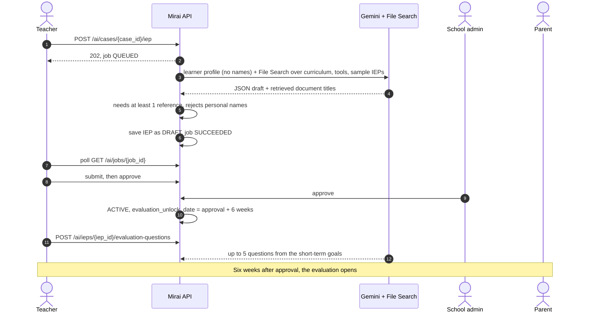

# IEP and Evaluation Generation

<p class="mi-lead">From a scored case to an approved, curriculum-grounded classroom plan, and six weeks later, to questions that check whether it is working. All of this lives in <code>prism-backend/services/ai.py</code>.</p>

## End-to-end flow



## When generation is allowed

| Condition | Result | Evidence |
| --- | --- | --- |
| Caller is the case's teacher | Job queued (`202`) | `services/ai.py` (`_case_for_teacher`) |
| Another job of the same kind is queued or running | `409` | `_reject_duplicate` |
| A plan for the case is already awaiting approval | Job fails with "Reject it before generating a new one" | `generate_iep_for_case` |
| AI settings missing | Job fails with "The AI service is not configured yet" | `GeminiProvider.__init__` |
| Gemini error | Job fails with a neutral message | `run_job` |

!!! warning "Planned, not built"

    The score gate (generate only when a domain is Elevated), the regeneration limit (3 attempts, then a 24-hour cooldown, [D-09](../reference/decision-log.md#decisions)) and the teacher's 1–5 quality rating are designed but not in the code. Today any teacher of the case can start a generation at any time, subject only to the checks above.

## What the model returns

| Kind | Output fields (`schemas/ai.py`) | Stored in |
| --- | --- | --- |
| IEP | `content_markdown`, `short_term_goals`, `strategies` | `iep.generated_content`, `iep.short_term_goals`, `iep.strategies`; the retrieved document titles go to `iep.rag_file_references` |
| Recommendation | `message`, `home_activities` (each `title`, `steps`) | `recommendation` |
| Evaluation questions | `questions` (up to 5) | `iep_evaluation_question` |

Generated lists are de-duplicated and trimmed (`_tidy`), and IEPs are saved with `generated_by` set to the AI value.

## Prompt contract

The system instruction sent with every request (`SYSTEM_PROMPT`):

```text
You support teachers and parents of children who may need extra learning support,
in Kenya. Never write the name of the child or of any person: say 'the learner'.
Never diagnose, and never name a medical or developmental condition.
Use plain, kind language. Before writing anything, you must search the provided
reference documents with the file search tool, and base your answer only on what
you find there. If the documents do not cover something, leave it out instead of
guessing.
```

The request then carries the learner profile (age, grade, home language and the areas of concern, built by `build_profile`) and asks for JSON matching the output schema. Temperature is `0.3`. Each kind searches only its own documents:

| Kind | File Search filter |
| --- | --- |
| IEP | `Curriculum`, `Screening tools`, `Sample IEPs` |
| Recommendation | `Parent recommendations`, `Screening tools` |
| Evaluation questions | `Sample IEPs`, `Screening tools` |

## Safety checks

| Check | Behaviour | Evidence |
| --- | --- | --- |
| Grounding | A draft with no retrieved reference is regenerated once; if it still has none, nothing is saved | `_with_evidence` |
| Personal names | Output containing a name or part of a name from the case is rejected (IEP, evaluation questions) or retried once with feedback (recommendation) | `assert_no_names`; `tests/test_ai.py` |
| Invalid output | Recommendation output that fails validation is retried once with the validation message as feedback | `generate_recommendation_for_case` |
| Condition words | Recommendations that name autism, ADHD or dyslexia, or mention a diagnosis, fail validation. IEP text is not checked yet | `schemas/recommendation.py` |
| Draft only | An IEP is saved as `DRAFT` and becomes visible to the parent only once `ACTIVE` | `services/iep.py` |

## Review, approval and versions

| Step | Who | Effect |
| --- | --- | --- |
| Draft created | System | `iep.status = DRAFT` |
| Edit | Teacher | Content, goals and strategies updated while `DRAFT`, `PENDING_APPROVAL` or `REJECTED` |
| Submit | Teacher | `PENDING_APPROVAL` |
| Approve | Teacher and school admin | When both have approved: `ACTIVE`, `evaluation_unlock_date = approval + 6 weeks` |
| Reject | Teacher or school admin, reason required | `REJECTED`, with `rejection_reason` |

!!! danger "Approval is not yet checked against the caller"

    `POST /ieps/{iep_id}/approve` takes the approver's id from the request body and the route has no authentication. See [Security gaps](../reference/implementation-status.md#security-gaps).

## Six-week evaluation questions

Once an IEP is `ACTIVE`, the teacher requests questions (`POST /ai/ieps/{iep_id}/evaluation-questions`). The AI writes up to five questions covering the short-term goals, about observable behaviour only.

Teacher and parent each answer every question on the same scale:

| Score | -2 | -1 | 0 | 1 | 2 |
| --- | --- | --- | --- | --- | --- |
| Label | Much worse | A little worse | No change | A little better | Much better |

Questions open exactly six weeks after approval; before that the screen shows the opening date and progress ("Week 2 of 6"). Evidence: `services/iep_evaluation_question.py` (`evaluation_window`), `tests/test_iep_evaluation_window.py`.

## Tests

| Area | File |
| --- | --- |
| Job lifecycle, duplicate jobs, plan-awaiting-approval block, names rejected and retried | `tests/test_ai.py` |
| Evaluation questions | `tests/test_ai_evaluation_questions.py` |
| Approval and the six-week unlock | `tests/test_iep.py`, `tests/test_iep_evaluation_window.py` |

Gemini is replaced by a fake in tests (`fake_ai` fixture); no live calls are made.
