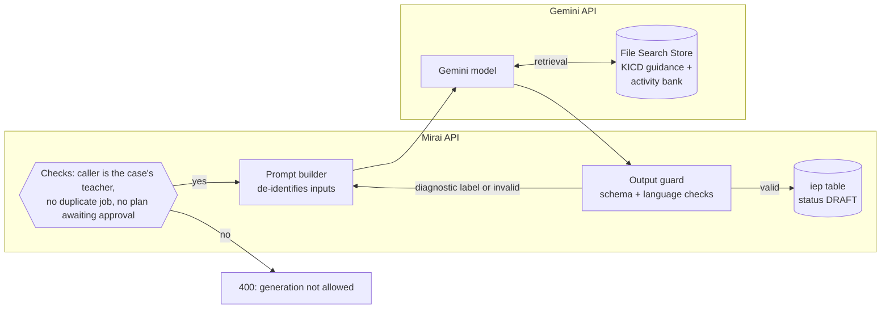

# AI

Mirai uses generative AI for one job: drafting support material once a result already exists. It never scores, never classifies and never decides.

## Where AI is used, and where it is not

:material-robot-happy-outline:
### AI drafts
- **IEP blueprints** for the teacher, grounded in KICD CBC inclusive-education guidance
- **Six-week evaluation questions**, built from the approved IEP's short-term goals
- **Home activities** for the parent, matched to the triggering domain(s) *(see note below)*

Every output is a **draft** until a human approves it.

:material-robot-off-outline:
### AI never touches
- Which questions are asked (stored questions, opened by anchor answers)
- Domain scores and levels (deterministic engine)
- Whether a case is Elevated or No Concern Identified
- The report's numbers and meaning text (looked up, not generated)
- Who can see what (RBAC)

!!! note "Home activities: current and target"

    The code generates home activities and the parent message with Gemini, retrieving from the *Parent recommendations* and *Screening tools* documents in the File Search store (`generate_recommendation_for_case`). There is no `recommendation_template` table. Whether activities should instead come from fixed templates is open ([Q-09](../reference/decision-log.md#open-questions)).

## Architecture

| Element | Detail |
| --- | --- |
| Model | Gemini through the Gemini API; the code reads the model id from `GEMINI_MODEL` (`services/ai.py`). Which model production uses is open ([Q-08](../reference/decision-log.md#open-questions)) |
| Retrieval | Gemini **File Search Tool**, a fully managed RAG service. Google handles chunking, embedding, indexing and semantic retrieval at query time, so Mirai runs no vector database. |
| Store contents | Current KICD CBC inclusive-education guidelines and the specialist-curated home-activity bank. **No child data is ever uploaded.** |
| Grounding record | References to the retrieved chunks are saved on the IEP in `rag_file_references`. |
| Isolation | Gemini is called only from `services/ai.py`, by AI jobs. The scoring rules in `services/screening_rules.py` do not import it |

## Preparing the File Search Store

The store is built once and refreshed when KICD publishes new guidance.

1. **Collect** the current KICD CBC inclusive-education guidelines and the activity bank from approved sources.
2. **Clean** the PDFs: remove headers, footers and page numbers; fix broken tables; keep section headings.
3. **Normalise the activity bank** to consistent fields: `domain`, `age_band`, `materials`, `steps`, `duration`. Drop anything that needs non-household materials.
4. **Upload** to the persistent File Search Store; record the store id in `FILE_SEARCH_STORE_ID`.
5. **Version** the source set (date and file list) so an IEP's references can be traced to the exact guidance used.

## What goes into a prompt

Only what the model needs to write a classroom plan, and nothing that identifies a child.

| Included | Never included |
| --- | --- |
| Triggering domain(s) and level(s) | Child's name, date of birth, admission number |
| Age band (4 to 5 or 6 to 9) | Parent name, phone, email |
| De-identified summary of which observed areas scored high | School name, location, teacher name |
| Grade band (Grade 1 to 3) | Raw answers tied to an identity |
| Teacher's edit request on regeneration (free text is checked first) | Any previous case history |

## Guardrails

| Guardrail | How |
| --- | --- |
| Server-side checks | The teacher of the case only; no duplicate running job; no plan already awaiting approval. A score gate is *planned* |
| Structured output | Gemini is asked for JSON matching a Pydantic schema and the answer is validated against it (`GeminiProvider._run`) |
| Non-diagnostic language | The system prompt forbids diagnoses and condition names. Recommendations naming a condition (autism, ADHD, dyslexia, diagnose) fail validation and are retried once (`schemas/recommendation.py`). IEP text is not scanned yet |
| Human in the loop | Draft until the teacher **and** the school administrator approve |
| Regeneration limit | *Planned:* 3 attempts per case per cycle, then a 24-hour cooldown |
| Safe failure | Any AI error leaves the case in a safe draft state; scores and alerts are untouched; the teacher may write the plan manually |
| Job record | Every generation is an `ai_job` row with its status, result and error. Audit rows (`GENERATE`) are *planned* |

## Measuring AI quality

| Metric | Source |
| --- | --- |
| AI output quality | IEPs approved with zero regenerations |
| Teacher-rated IEP quality | *Planned:* 1 to 5 rating submitted after review |
| IEP regeneration rate | Regenerated IEPs ÷ IEPs generated |

These appear on the system administrator dashboard as *Thumbs up*, *Thumbs down* and *Regenerate*.

## In this section

- [IEP and Evaluation Generation](iep-generation.md): triggers, prompt contract, output schema, regeneration and evaluation questions
