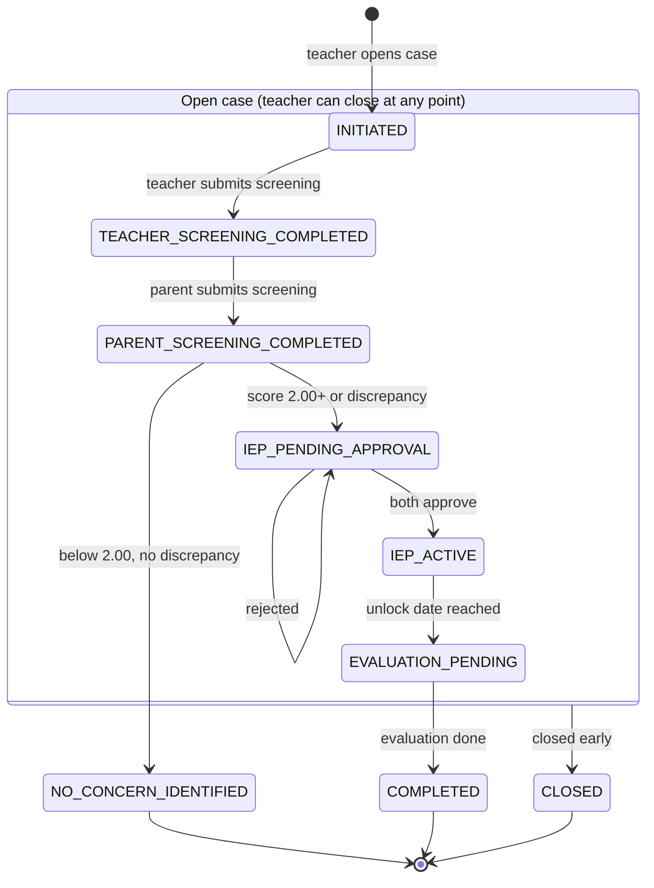
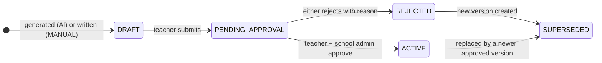
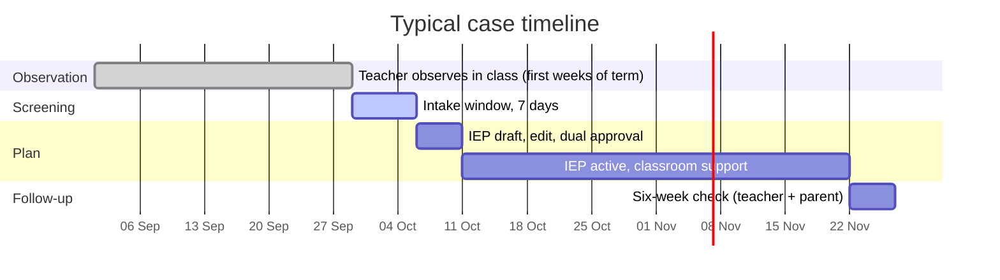

# Case Lifecycle

The case is the centre of Mirai's workflow. A student can have many cases over the years, but only one unfinished case at a time.

## Case states

| Status | Meaning | Terminal |
| --- | --- | :---: |
| `INITIATED` | Case created; screening not finished | |
| `TEACHER_SCREENING_COMPLETED` | Teacher's assessment is complete; parent notified | |
| `PARENT_SCREENING_COMPLETED` | Parent's assessment is complete; scoring runs | |
| `IEP_PENDING_APPROVAL` | IEP submitted and waiting for both approvals | |
| `IEP_ACTIVE` | IEP approved and in use; parent can view it | |
| `EVALUATION_PENDING` | The six-week evaluation is open for answers | |
| `NO_CONCERN_IDENTIFIED` | Highest domain score below 2.00 and no qualifying discrepancy; no IEP | :material-check: |
| `CLOSED` | Teacher ended the case early (`closed_at`, `closed_reason` set) | :material-check: |
| `COMPLETED` | Six-week evaluation answered by both; outcome kept on the record | :material-check: |

!!! info "One unfinished case per student"

    Enforced in the database with a partial unique index:
    `UNIQUE (student_id) WHERE status NOT IN ('COMPLETED', 'NO_CONCERN_IDENTIFIED', 'CLOSED')`.
    Two simultaneous "open case" requests cannot both succeed.

## Transitions and guards

| From | To | Triggered by | Guard (checked server-side) |
| --- | --- | --- | --- |
| *(none)* | `INITIATED` | Teacher | Caller is the student's teacher; parent linked and consent recorded; student aged 4 to 9; no unfinished case |
| `INITIATED` | `TEACHER_SCREENING_COMPLETED` | Teacher | Every scored question in the routed instruments answered; inside the intake window |
| `TEACHER_SCREENING_COMPLETED` | `PARENT_SCREENING_COMPLETED` | Parent | Caller is the linked parent; every question answered; inside the window |
| `PARENT_SCREENING_COMPLETED` | `NO_CONCERN_IDENTIFIED` | System | `domain_density_score < 2.00` and no domain discrepancy |
| `PARENT_SCREENING_COMPLETED` | `IEP_PENDING_APPROVAL` | System, then teacher | Score of 2.00 or more, or discrepancy; IEP draft created, edited and submitted by the teacher |
| `IEP_PENDING_APPROVAL` | `IEP_ACTIVE` | Teacher + school admin | Both `teacher_approved` and `admin_approved` are true on the current version |
| `IEP_ACTIVE` | `EVALUATION_PENDING` | System (scheduled or on read) | `now >= evaluation_unlock_date` |
| `EVALUATION_PENDING` | `COMPLETED` | System | One teacher and one parent answer for every evaluation question |
| any non-terminal | `CLOSED` | Teacher | Reason chosen; optional short note |

Every transition writes an audit row with the old and new status in `details` and no personal content.

## IEP versions

A case can have many IEP versions, but only one is `ACTIVE`.

- `version_number` starts at 1 and is unique per case.
- When a newer version is created, the older one gets `superseded_at`.
- Automatic regeneration is limited to **three attempts per case per generation cycle**, then a **24-hour cooldown**, stored per case (not per session). See [IEP and Evaluation Generation](../ai/iep-generation.md#regeneration-limits).

## Timing rules

| Rule | Value |
| --- | --- |
| Observation before opening a case | A persistent concern over roughly the first four weeks of term |
| Intake window | Fixed **7 days** per case; responses lock at the close |
| Evaluation unlock | `approved_at + 6 weeks` (both approvals recorded) |
| Evaluation scale | Integers **-2 to 2** per question, one teacher and one parent answer each |
| Regeneration | 3 attempts per cycle, then 24-hour cooldown |

## Edge cases

| Situation | Behaviour |
| --- | --- |
| Teacher and parent screening finished, scores computed | Report built immediately; rebuilt in place when the IEP becomes active |
| Only one side completes before the window closes | Open decision. Interim proposal: score the completed side, mark discrepancy not applicable, still allow Elevated; if neither completes, close as incomplete. confirm |
| Response arrives after the window (offline queue) | Rejected as an in-window submission; the client shows that the window has closed |
| Child has a birthday during an open case | Interim rule: age is completed years on the day the case opens; no re-routing. confirm |
| Parent withdraws consent | Open decision; interim proposal locks the case, blocks new observations and disables export. confirm |
| Teacher leaves the school | School admin revokes access; sessions end; the student's record stays with the student, not the teacher |
| AI service unavailable | Scores and alerts are unaffected; the IEP stays in a safe draft state and the teacher can retry or write it manually (`generated_by = MANUAL`) |

All open items are tracked in the [Decision Log](../reference/decision-log.md).
