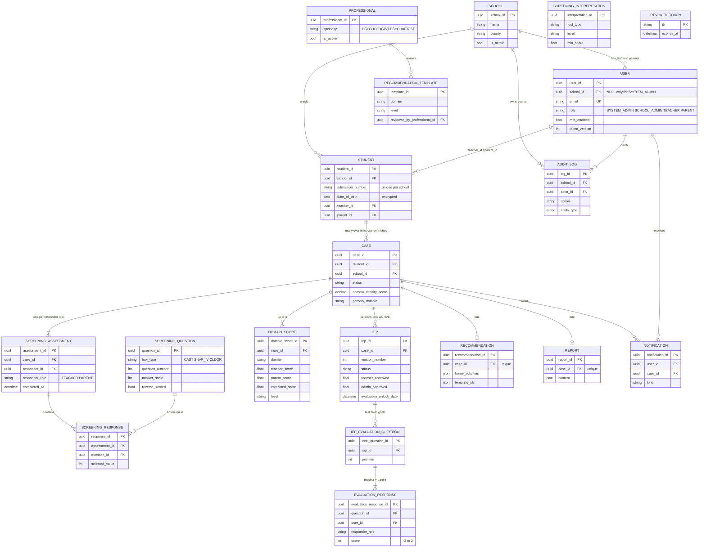

# Data Model

Nineteen PostgreSQL tables in five groups: users and roles, workflow and case management, screenings and scoring, IEP and evaluation, and reference and system tables.

## Conventions

| Convention | Rule |
| --- | --- |
| Primary keys | UUID (v4), named `<table>_id` (`school_id`, `user_id`, `case_id`, `iep_id`) |
| Types | Python types used by FastAPI and Pydantic, mapped to PostgreSQL: `UUID` to `uuid`, `str (max N)` to `varchar(N)`, `str` to `text`, `int` to `integer`, `float`/`Decimal` to `numeric`, `bool` to `boolean`, `datetime` to `timestamp`, `date` to `date`, `Enum` to `enum`, JSON model to `jsonb` |
| Optional fields | Written as the type followed by `| None` |
| Timestamps | UTC |
| Tenancy | `school_id` on `user`, `student` and `case`; all other records are reached through the student, so every query is scoped to the signed-in user's school |
| Encrypted fields | Today only the TOTP secret is encrypted (`user.mfa_secret_enc`, Fernet). *Planned:* child name and date of birth, parent phone and email encrypted before storage (`BYTEA`) with a `key_version`; see [Implementation Status](../reference/implementation-status.md#planned) |

## Entity relationship diagram

!!! warning "Design and code differ in four tables"

    `DOMAIN_SCORE` and `RECOMMENDATION_TEMPLATE` are designed but are not tables in the code: scores are stored on `case`, and recommendations are generated by AI. The code has two tables the diagram does not show: `ai_job` and `link_token` (both described in the data dictionary below). Source of truth: `prism-backend/models/`.

`SCREENING_INTERPRETATION` and `RECOMMENDATION_TEMPLATE` are matched by tool or domain and level, not linked by a foreign key. `REVOKED_TOKEN` stands alone.

## Cardinality rules

| From | To | Cardinality | Rule |
| --- | --- | --- | --- |
| School | User | 1 : N | School administrators, teachers and parents. The system administrator has no school. |
| School | Student | 1 : N | A school has many students. |
| User (teacher / parent) | Student | 1 : N | A student belongs to one teacher and one parent profile. |
| Student | Case | 1 : N | Many cases over time; only one unfinished. |
| Case | ScreeningAssessment | 1 : 2 | Exactly one teacher and one parent assessment. |
| ScreeningAssessment | ScreeningResponse | 1 : N | One answer per question. |
| Case | DomainScore | 1 : 3 | One per domain (Dyslexia not scored for ages 4 to 5). |
| Case | IEP | 1 : N | Many versions; one `ACTIVE`. |
| IEP | IEPEvaluationQuestion | 1 : N | Built from the short-term goals. |
| IEPEvaluationQuestion | EvaluationResponse | 1 : 2 | One teacher and one parent score. |
| Case | Recommendation | 1 : 1 | Created once both screenings are finished. |
| Case | Report | 1 : 1 | One saved report; regenerating replaces it. |
| User | AuditLog | 1 : N | Empty actor for system actions and failed sign-ins. Rows are only added. |

## Data dictionary

### Users and roles

=== "school"

    One row per school. Created by the system administrator together with the first school administrator.

    | Field | Type | Constraint | Description |
    | --- | --- | --- | --- |
    | `school_id` | UUID | PK | Unique school |
    | `name` | str (max 150) | NOT NULL | School name |
    | `county` | str (max 60) | NOT NULL | County |
    | `is_active` | bool | NOT NULL, default True | False blocks sign-in for every user of the school |
    | `created_at` | datetime | NOT NULL | Creation time |

=== "user"

    Everyone who signs in. The system administrator is seeded at start-up and creates each school with its first school administrator; a school administrator creates teachers; a teacher creates parents.

    | Field | Type | Constraint | Description |
    | --- | --- | --- | --- |
    | `user_id` | UUID | PK | Unique user |
    | `school_id` | UUID | FK, NULL only for `SYSTEM_ADMIN` | The user's school |
    | `email` | str (max 255) | UNIQUE | Login email |
    | `password_hash` | str (max 255) | NOT NULL | Argon2id / bcrypt hash; the password is never stored |
    | `first_name`, `last_name` | str (max 100) | NOT NULL | Name |
    | `phone` | str (max 30) \| None | | Phone number (verified for parents) |
    | `role` | UserRole | NOT NULL | `SYSTEM_ADMIN`, `SCHOOL_ADMIN`, `TEACHER`, `PARENT` |
    | `must_change_password` | bool | default True | Forces a new password at first sign-in |
    | `mfa_secret_enc` | str \| None | | Authenticator secret, encrypted |
    | `mfa_enabled` | bool | default False | Authenticator set up |
    | `last_totp_step` | int | default 0 | Last code time-step used, so a code works once |
    | `token_version` | int | default 0 | Raised on password change or reset; ends older sessions |
    | `failed_login_attempts` | int | default 0 | Consecutive failures; 5 locks the account for 15 minutes |
    | `locked_until` | datetime \| None | | Lock expiry |
    | `is_active` | bool | default True | False blocks sign-in (staff revocation) |
    | `created_by` | UUID \| None | FK to user | Who created the account |
    | `last_login_at` | datetime \| None | | Last successful sign-in |
    | `created_at` | datetime | NOT NULL | Creation time |

    **Check:** `(role = 'SYSTEM_ADMIN' AND school_id IS NULL) OR (role <> 'SYSTEM_ADMIN' AND school_id IS NOT NULL)`

=== "student"

    The child being screened. Entered by the teacher; the parent must already be onboarded.

    | Field | Type | Constraint | Description |
    | --- | --- | --- | --- |
    | `student_id` | UUID | PK | Unique student |
    | `school_id` | UUID | FK | The student's school |
    | `first_name`, `last_name` | str (max 100) | NOT NULL, encrypted | Name |
    | `date_of_birth` | date | NOT NULL, encrypted | Gives the age for the age gate |
    | `gender` | enum | NOT NULL | Male or Female |
    | `admission_number` | str (max 50) | NOT NULL, UNIQUE (`school_id`, `admission_number`) | School's identification number |
    | `teacher_id` | UUID | FK to user | Class teacher |
    | `parent_id` | UUID | FK to user | Parent or guardian |
    | `is_active` | bool | default True | False hides the student from lists |
    | `created_at` | datetime | NOT NULL | Creation time |

### Workflow and case management

=== "case"

    The centre of the workflow. See [Case Lifecycle](case-lifecycle.md) for statuses.

    | Field | Type | Constraint | Description |
    | --- | --- | --- | --- |
    | `case_id` | UUID | PK | Unique case |
    | `student_id` | UUID | FK | The student |
    | `school_id` | UUID | FK, NOT NULL | The student's school |
    | `initiated_by` | UUID | FK to user | Teacher who opened it |
    | `status` | CaseStatus | NOT NULL | One of nine statuses |
    | `autism_score` | Decimal(5,2) \| None | CHECK 0 to 3 | Combined CAST score |
    | `adhd_score` | Decimal(5,2) \| None | CHECK 0 to 3 | Combined ADHD score |
    | `dyslexia_score` | Decimal(5,2) \| None | CHECK 0 to 3 | Combined CLDQ-R score (NULL for ages 4 to 5) |
    | `primary_domain` | str \| None | CHECK IN (`AUTISM`, `ADHD`, `DYSLEXIA`) | Domain with the highest score |
    | `domain_density_score` | Decimal \| None | | Highest of the three domain scores |
    | `closed_at` | datetime \| None | | When the case ended early |
    | `closed_reason` | str (max 255) \| None | | Short reason |
    | `created_at`, `updated_at` | datetime | NOT NULL | Timestamps |

    **Partial unique index:** `UNIQUE (student_id) WHERE status NOT IN ('COMPLETED','NO_CONCERN_IDENTIFIED','CLOSED')`

=== "notification"

    In-app messages, for example telling the parent it is their turn.

    | Field | Type | Constraint | Description |
    | --- | --- | --- | --- |
    | `notification_id` | UUID | PK | Unique notification |
    | `user_id` | UUID | FK, NOT NULL | Recipient |
    | `case_id` | UUID \| None | FK | Related case |
    | `kind` | str (max 40) | NOT NULL | For example `PARENT_TURN` |
    | `message` | str | NOT NULL | Text shown |
    | `read_at` | datetime \| None | | When read |
    | `created_at` | datetime | NOT NULL | Creation time |

### Screenings and scoring

=== "screening_question"

    The question bank. Loaded in advance from the instruments; only the system administrator can add or edit.

    | Field | Type | Constraint | Description |
    | --- | --- | --- | --- |
    | `question_id` | UUID | PK | Unique question |
    | `tool_type` | ToolType | NOT NULL | `CAST`, `SNAP_IV`, `CLDQR` (plus the ADHD RS-IV Preschool set) |
    | `target_neurodivergence` | Enum | NOT NULL | `AUTISM`, `ADHD`, `DYSLEXIA` |
    | `question_number` | int | NOT NULL, UNIQUE (`tool_type`, `question_number`) | Order within the tool |
    | `question_text` | str | NOT NULL | The question |
    | `answer_scale` | int | NOT NULL | Number of options; values run 0 to `answer_scale - 1` |
    | `answer_labels` | list[str] (JSON) | NOT NULL | Label for each option |
    | `is_scored` | bool | default True | False for items that do not count |
    | `reverse_scored` | bool | default False | True when the lowest option scores highest |
    | `subscale` | str (max 40) \| None | | Subscale name, if any |
    | `is_text_verified` | bool | default False | Wording checked against the official instrument |
    | `is_active` | bool | default True | False removes it from new screenings |
    | `created_at` | datetime | NOT NULL | Creation time |

=== "screening_assessment"

    One responder's submission for one case.

    | Field | Type | Constraint | Description |
    | --- | --- | --- | --- |
    | `assessment_id` | UUID | PK | Unique assessment |
    | `case_id` | UUID | FK | The case |
    | `responder_id` | UUID | FK to user | Teacher or parent |
    | `responder_role` | ResponderRole | NOT NULL, UNIQUE (`case_id`, `responder_role`) | `TEACHER` or `PARENT` |
    | `started_at` | datetime | NOT NULL | When they started |
    | `completed_at` | datetime \| None | | NULL until finished |

=== "screening_response"

    One answer to one question. Stored as given; interpreted only by the scoring engine.

    | Field | Type | Constraint | Description |
    | --- | --- | --- | --- |
    | `response_id` | UUID | PK | Unique answer |
    | `assessment_id` | UUID | FK | The assessment |
    | `question_id` | UUID | FK | The question |
    | `selected_value` | int | NOT NULL, UNIQUE (`assessment_id`, `question_id`) | Option picked, 0 to `answer_scale - 1` |

=== "domain_score"

    *Planned table, not in the code.* Today the scores are columns on `case` and the per-domain breakdown is returned by `GET /domain-scores/case/{case_id}`. Designed as: one score per domain per case, kept so the report can explain each domain.

    | Field | Type | Constraint | Description |
    | --- | --- | --- | --- |
    | `domain_score_id` | UUID | PK | Unique score |
    | `case_id` | UUID | FK, UNIQUE (`case_id`, `domain`) | The case |
    | `domain` | Domain | NOT NULL | `AUTISM`, `ADHD`, `DYSLEXIA` |
    | `tool_type` | ToolType | NOT NULL | Instrument used |
    | `teacher_raw`, `parent_raw` | int | NOT NULL | Raw totals |
    | `min_possible`, `max_possible` | int | NOT NULL | Bounds used in the formula |
    | `teacher_score`, `parent_score`, `combined_score` | float | NOT NULL | Scores 0 to 3 |
    | `level` | Level | NOT NULL | `LOW`, `MODERATE`, `HIGH` (shown as Low, Medium, Elevated) |
    | `computed_at` | datetime | NOT NULL | Calculation time |

=== "screening_interpretation"

    What a 0 to 3 score means for each tool. Stored and looked up, never generated.

    | Field | Type | Constraint | Description |
    | --- | --- | --- | --- |
    | `interpretation_id` | UUID | PK | Unique interpretation |
    | `tool_type` | ToolType | NOT NULL, UNIQUE (`tool_type`, `level`) | Tool |
    | `level` | Level | NOT NULL | `LOW`, `MODERATE`, `HIGH` |
    | `band_label` | str (max 100) | NOT NULL | Short band name |
    | `min_score` | float | NOT NULL | Lowest score in the band |
    | `meaning_text` | str | NOT NULL | Plain-language meaning shown in the report |
    | `clinically_reviewed` | bool | default False | Signed off by the consulting psychiatrist |

### IEP and evaluation

=== "iep"

    The support plan. Generated by the AI step (or written by the teacher, `generated_by = MANUAL`), then approved by the teacher and the school administrator.

    | Field | Type | Constraint | Description |
    | --- | --- | --- | --- |
    | `iep_id` | UUID | PK | Unique plan version |
    | `case_id` | UUID | FK | The case |
    | `version_number` | int | NOT NULL, UNIQUE (`case_id`, `version_number`) | Starts at 1 |
    | `status` | IEPStatus | NOT NULL | `DRAFT`, `PENDING_APPROVAL`, `ACTIVE`, `REJECTED`, `SUPERSEDED` |
    | `generated_content` | str | NOT NULL | The plan, as markdown |
    | `short_term_goals` | list[str] (JSON) | NOT NULL | Goals the evaluation questions are built from |
    | `strategies` | list[str] (JSON) | default empty | Support strategies |
    | `rag_file_references` | list[str] (JSON) | default empty | File Search chunks used |
    | `generated_by` | str | default `MANUAL` | `MANUAL` or `AI` |
    | `teacher_approved`, `admin_approved` | bool | default False | Approval flags |
    | `teacher_approved_by`, `admin_approved_by` | UUID \| None | FK to user | Who approved |
    | `rejection_reason` | str \| None | | Why it was sent back |
    | `approved_at` | datetime \| None | | When both approvals were recorded |
    | `evaluation_unlock_date` | datetime \| None | | `approved_at` + 6 weeks |
    | `created_by` | UUID | FK, NOT NULL | Author of this version |
    | `created_at` | datetime | NOT NULL | Creation time |
    | `superseded_at` | datetime \| None | | When replaced |

=== "iep_evaluation_question"

    | Field | Type | Constraint | Description |
    | --- | --- | --- | --- |
    | `eval_question_id` | UUID | PK | Unique question |
    | `iep_id` | UUID | FK, NOT NULL | The IEP |
    | `position` | int | NOT NULL | Order |
    | `question_text` | str | NOT NULL | Built from one short-term goal |
    | `created_at` | datetime | NOT NULL | Creation time |

=== "evaluation_response"

    | Field | Type | Constraint | Description |
    | --- | --- | --- | --- |
    | `evaluation_response_id` | UUID | PK | Unique answer |
    | `question_id` | UUID | FK to `iep_evaluation_question` | Question answered |
    | `user_id` | UUID | FK | Teacher or parent |
    | `responder_role` | ResponderRole | NOT NULL, UNIQUE (`question_id`, `responder_role`) | `TEACHER` or `PARENT` |
    | `score` | smallint | CHECK (`score BETWEEN -2 AND 2`) | Progress rating |
    | `submitted_at` | datetime | NOT NULL | Submission time |

### Reference and system

=== "professional"

    Psychologists and psychiatrists a family may choose to contact. Maintained by the system administrator.

    | Field | Type | Constraint | Description |
    | --- | --- | --- | --- |
    | `professional_id` | UUID | PK | Unique professional |
    | `first_name`, `last_name` | str (max 150) | NOT NULL | Name |
    | `specialty` | Specialty | NOT NULL | `PSYCHOLOGIST` or `PSYCHIATRIST` |
    | `contact_details` | str (max 255) | NOT NULL | How to contact them |
    | `location_address` | str | NOT NULL | Address |
    | `is_active` | bool | default True | False hides from lists |
    | `created_at` | datetime | NOT NULL | Creation time |

=== "recommendation_template"

    *Planned table, not in the code* ([Q-09](../reference/decision-log.md#open-questions)). Designed as: psychiatrist-informed general advice, picked by domain and level.

    | Field | Type | Constraint | Description |
    | --- | --- | --- | --- |
    | `template_id` | UUID | PK | Unique template |
    | `domain` | str | CHECK IN (`AUTISM`,`ADHD`,`DYSLEXIA`,`GENERAL`), UNIQUE (`domain`, `level`) | Area |
    | `level` | Level | NOT NULL | `LOW`, `MODERATE`, `HIGH` |
    | `title` | str (max 200) | NOT NULL | Short title |
    | `message` | str | NOT NULL | Plain-language guidance |
    | `home_activities` | list[str] (JSON) | NOT NULL | Home activities |
    | `reviewed_by_professional_id` | UUID \| None | FK to professional | Reviewer |
    | `clinically_reviewed` | bool | default False | Signed off |
    | `is_active` | bool | default True | False stops it being used |

=== "recommendation"

    | Field | Type | Constraint | Description |
    | --- | --- | --- | --- |
    | `recommendation_id` | UUID | PK | Unique recommendation |
    | `case_id` | UUID | FK, UNIQUE, NOT NULL | The case |
    | `template_ids` | list[str] (JSON) | NOT NULL | Templates used |
    | `home_activities` | list[dict] (JSON) | | Activities, each with title and steps |
    | `message` | str | NOT NULL | Guidance shown to the parent |
    | `created_at` | datetime | NOT NULL | Creation time |

=== "report"

    | Field | Type | Constraint | Description |
    | --- | --- | --- | --- |
    | `report_id` | UUID | PK | Unique report |
    | `case_id` | UUID | FK, UNIQUE, NOT NULL | The case |
    | `content` | dict (JSON) | NOT NULL | Disclaimer, child, domain scores with meaning, recommendation, IEP, professionals |
    | `generated_at` | datetime | NOT NULL | Built when the parent finishes; rebuilt when the IEP becomes active |

=== "audit_log"

    Append-only. The database role used by the API has `INSERT` but not `UPDATE` or `DELETE` on this table.

    | Field | Type | Constraint | Description |
    | --- | --- | --- | --- |
    | `log_id` | UUID | PK | Unique event |
    | `school_id` | UUID \| None | FK | Empty for events before sign-in |
    | `actor_id` | UUID \| None | FK to user | Empty for system actions and failed sign-ins |
    | `actor_role` | UserRole \| None | | Role at the time |
    | `action` | AuditAction | NOT NULL | `LOGIN`, `LOGIN_FAILED`, `LOGOUT`, `CREATE`, `VIEW`, `UPDATE`, `DELETE`, `SUBMIT`, `APPROVE`, `REJECT`, `GENERATE`, `EXPORT` |
    | `entity_type` | str (max 50) | NOT NULL | Table acted on |
    | `entity_id` | UUID \| None | | Record acted on |
    | `ip_address` | IPvAnyAddress \| None | | Request origin |
    | `details` | dict \| None (JSON) | | Short non-personal notes, never names, dates of birth or answers |
    | `created_at` | datetime | NOT NULL | Event time |

=== "revoked_token"

    | Field | Type | Constraint | Description |
    | --- | --- | --- | --- |
    | `jti` | str (max 64) | PK | Token id |
    | `expires_at` | datetime | NOT NULL | Original expiry; expired rows deleted at start-up |
    | `revoked_at` | datetime | NOT NULL | When revoked |

=== "ai_job"

    One row per AI generation request (`models/ai.py`).

    | Field | Type | Constraint | Description |
    | --- | --- | --- | --- |
    | `job_id` | UUID | PK | Job id |
    | `case_id` | UUID | FK → `case`, NOT NULL | Case the job is for |
    | `kind` | str (max 30) | NOT NULL | `IEP`, `RECOMMENDATION` or `EVAL_QUESTIONS` |
    | `status` | str (max 20) | NOT NULL, default `QUEUED` | `QUEUED`, `RUNNING`, `SUCCEEDED` or `FAILED` |
    | `requested_by` | UUID \| None | FK → `user` | Teacher who started it |
    | `result_id` | UUID \| None | | Id of the IEP or recommendation created |
    | `error` | str \| None | | Safe error message |
    | `created_at`, `finished_at` | datetime | | Timestamps |

=== "link_token"

    Hashed one-time links for invitations and password resets (`models/link_token.py`).

    | Field | Type | Constraint | Description |
    | --- | --- | --- | --- |
    | `token_hash` | str (max 64) | PK | SHA-256 of the token; the raw token is only in the email |
    | `user_id` | UUID | FK → `user`, NOT NULL, cascade delete | Account the link is for |
    | `purpose` | str (max 20) | NOT NULL | What the link does (invitation or reset) |
    | `expires_at` | datetime | NOT NULL | Expiry |
    | `used_at` | datetime \| None | | Set when used; a used link is rejected |
    | `created_at` | datetime | NOT NULL | Created |

## Entities required but not yet modelled

The Technical Requirements name three entities that do not have tables yet. They are tracked as [Q-11](../reference/decision-log.md#open-questions) and listed on [Implementation Status](../reference/implementation-status.md).

| Entity | Requirement | Status |
| --- | --- | --- |
| Consent record | A signed parental consent must exist before a child profile is created (KDPA 2019) | Partial: consent is recorded as an `audit_log` row when a parent accepts an invitation (`services/student.py`); no table yet |
| Referral packet | De-identified content, export timestamp, exporting party | Planned |
| Longitudinal record | Append-only history of every term outcome, independent of staff account | Planned (derivable from completed cases per student) |
