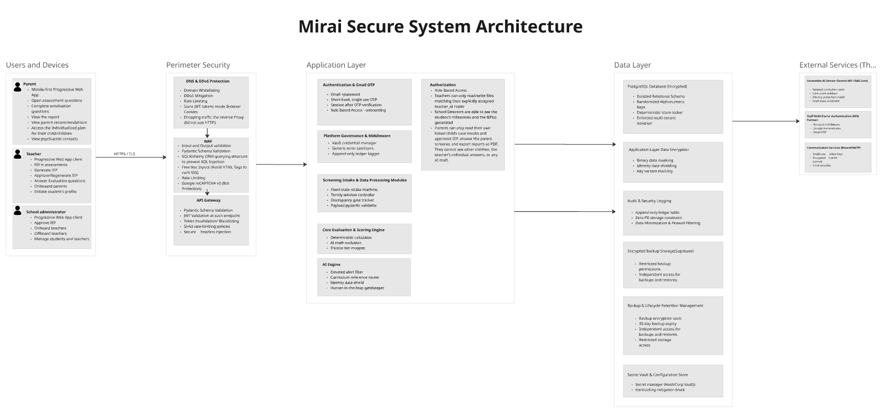
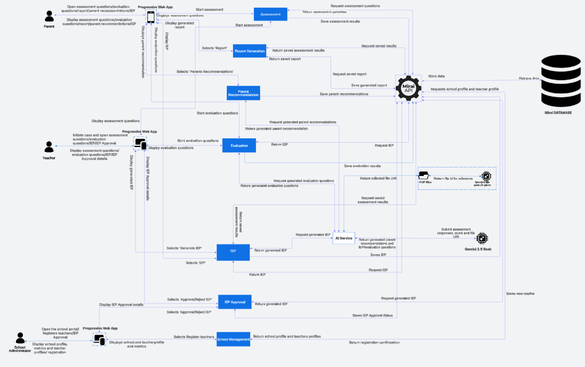

# Architecture

Mirai is a layered web system: one Progressive Web App for every role, a single FastAPI service that owns all business rules, a school-scoped PostgreSQL database and a strictly fenced-off AI service.

## Secure system architecture

{ .zoomable }

Click any diagram to open it full screen.

The architecture is read left to right as five layers. Every request crosses all of them in order; nothing reaches the data layer except through the Mirai API.

:material-cellphone-link:
### 1. Users and devices
Parents, teachers and school administrators use the same mobile-first PWA over **HTTPS/TLS**. Parents open assessments, read their child's report and plan, and see professional contacts. Teachers fill in screenings, generate and approve IEPs, answer evaluations, onboard parents and create student profiles. School administrators approve IEPs and onboard or offboard teachers.

:material-wall-fire:
### 2. Perimeter security
**DNS and DDoS protection** (domain whitelisting, rate limiting, dropping non-HTTPS traffic), a **WAF** (input and output validation, Pydantic schemas, SQLAlchemy ORM against SQL injection, HTML stripping against XSS, reCAPTCHA v3) and an **API gateway** (JWT validation on every endpoint, token blacklisting, strict rate limits, secure headers).

:material-api:
### 3. Application layer (Mirai API)
Authentication and email OTP, role-based authorisation, platform governance middleware, screening intake modules, the **core evaluation and scoring engine** and the **AI engine**, each a separate module with its own boundary.

:material-database-lock-outline:
### 4. Data layer
Encrypted PostgreSQL with an isolated relational schema and random UUID keys, application-layer field encryption with key versioning, an append-only audit table, encrypted backups on Supabase with 30-day expiry, and HashiCorp Vault for secrets.

:material-cloud-outline:
### 5. External services
**Gemini API with File Search** (curriculum store only, no identity data, draft-state constraint), **staff MFA** (Google Authenticator, email OTP) and **communication services** (Resend / SMTP with single-use tokens).

## Functional architecture

The second diagram shows the same system as functional modules and the messages between them. Each role's PWA talks only to the Mirai API; the API talks to the database and, for generation only, to the AI service.

{ .zoomable }

## Components

!!! note "Progressive Web App (client)"

    - **Technology:** Next.js PWA, mobile-first with desktop layouts for the same screens
    - **Serves:** parent, teacher, school administrator and system administrator interfaces with role-aware routing
    - **Offline:** a service-worker queue stores answers locally and replays them when the connection returns
    - **Talks to:** the Mirai API only, over HTTPS
    - **Never does:** compute scores, decide alert levels or call the AI service

!!! note "Mirai API (FastAPI)"

    - **Technology:** Python, FastAPI, Pydantic, SQLAlchemy
    - **Owns:** authentication, RBAC, school scoping, case workflow, intake state machine, scoring, report building, approval workflow, audit logging
    - **Modules:** Assessment, Report Generation, Parent Recommendations, Evaluation, IEP, IEP Approval, School Management, AI Service client
    - **Is the only component** that reads or writes the database

!!! note "Scoring engine"

    - **Lives inside:** the Mirai API as a pure, dependency-free package
    - **Does:** age-gate routing, per-domain normalised scores (0.00 to 3.00), Low / Medium / Elevated classification, discrepancy check
    - **Rule:** must not import any AI client; enforced by a lint test. See [Scoring Engine](../backend/scoring-engine.md)

!!! note "AI service"

    - **Technology:** Gemini 3.5 Flash through the Gemini API, with a managed File Search Store
    - **Store holds:** KICD CBC inclusive-education guidance and the specialist-curated home-activity bank, never child data
    - **Generates:** IEP drafts, home-activity suggestions and six-week evaluation questions
    - **Reachable only when:** a persisted score shows Elevated or a qualifying discrepancy. See [AI](../ai/index.md)

!!! note "PostgreSQL database"

    - **Schema:** shared, multi-tenant; `school_id` on users, students and cases; everything else reached through the student
    - **Protects:** child name, date of birth, parent phone and email with application-layer encryption (`BYTEA` + `key_version`)
    - **Constraints:** one unfinished case per student (partial unique index), one assessment per responder role per case, append-only audit log. See [Data Model](data-model.md)

!!! note "Supporting services"

    - **Resend / SMTP:** invitations, account verification and single-use codes
    - **Google Authenticator:** TOTP second factor for staff, verified server-side
    - **Google reCAPTCHA v3:** bot protection on sign-in and sensitive actions
    - **HashiCorp Vault:** runtime secrets and encryption keys
    - **Supabase storage:** encrypted backups with restricted access

## Key architectural decisions

| Decision | Choice | Why |
| --- | --- | --- |
| Client delivery | One PWA for every role | No app store install, near-zero storage on entry-level phones, one codebase |
| Scoring | Embedded deterministic rules engine in the API | Same input always gives the same, explainable output; zero arithmetic hallucination |
| Intake | Finite state machine per instrument | Question order is fixed and auditable; no model interprets free text |
| Instruments | Interface-bound, swappable module with versioned question banks | Cultural validity is contested, so a Kenya-validated tool must drop in without a rewrite |
| Offline | Service-worker queue with idempotency keys | Teachers switch data off; the 7-day window tolerates asynchronous submission |
| Tenancy | Shared schema, school-scoped queries | Cost must scale linearly with schools on a fixed, low subscription price |
| Generation | Gemini File Search (managed RAG) | No self-hosted vector database to run; chunking, embedding and retrieval are managed |
| Human control | Dual approval (teacher + school admin) before an IEP is active | AI output is a draft until people who know the child sign off |

## Requirements traceability

Every major requirement traces back to a research finding.

| Research finding | Technical requirement |
| --- | --- |
| Delay comes from training gaps, stigma and referral bottlenecks, not tool absence alone | Scope is limited to structured observation, scoring and documentation. No diagnostic or treatment logic. |
| No structured instrument is in school-level use | The age-gated instrument set is the **mandatory** intake path, not an optional add-on. |
| The KISE pathway works once triggered but has no proactive reach | Referral-ready output is generated automatically once an Elevated result is confirmed. |
| Cost is staged; free is not affordable | Parent messaging never presents cost as resolved after the referral export. |
| Cultural bias of instruments is contested | Instruments are interface-bound and swappable. |
| Discreet, non-labelling accommodation is existing practice | A flagged status is visible only to the child's teacher, parent, school admin (for approval and the report) and, after export, the receiving clinical body. A hard access rule, not a default. |
| Adoption depends on trust and a legitimacy signal | A configurable institutional or regulatory affiliation marker appears on school and parent screens. |
| Institutional memory depends on staff tenure | A per-child longitudinal record readable by any currently whitelisted teacher at the school. |

## Non-functional requirements

| Category | Requirement |
| --- | --- |
| Availability under low connectivity | Teacher and parent intake stays usable on intermittent connections and syncs automatically. |
| Device support | Runs on entry-level smartphones without app store installation or significant storage. |
| Determinism and auditability | Scoring is rule-based and inspectable; identical inputs give identical, explainable scores. |
| Data protection | Compliance with the Kenya Data Protection Act, 2019: minimisation, correction rights, controlled retention. |
| Access segregation | Distinct role boundaries; no role sees data outside its documented scope. |
| Cost predictability | Operating cost scales predictably with the number of schools. |
| Multi-tenancy | Many schools on one platform with no cross-tenant visibility. |

## In this section

- [System Context](system-context.md): actors, trust boundaries, external services and request flows
- [Case Lifecycle](case-lifecycle.md): every case status and what moves a case between them
- [Data Model](data-model.md): entity relationships, tables and constraints
- [User Flows](user-flows.md): teacher, parent, school administrator and AI flows
