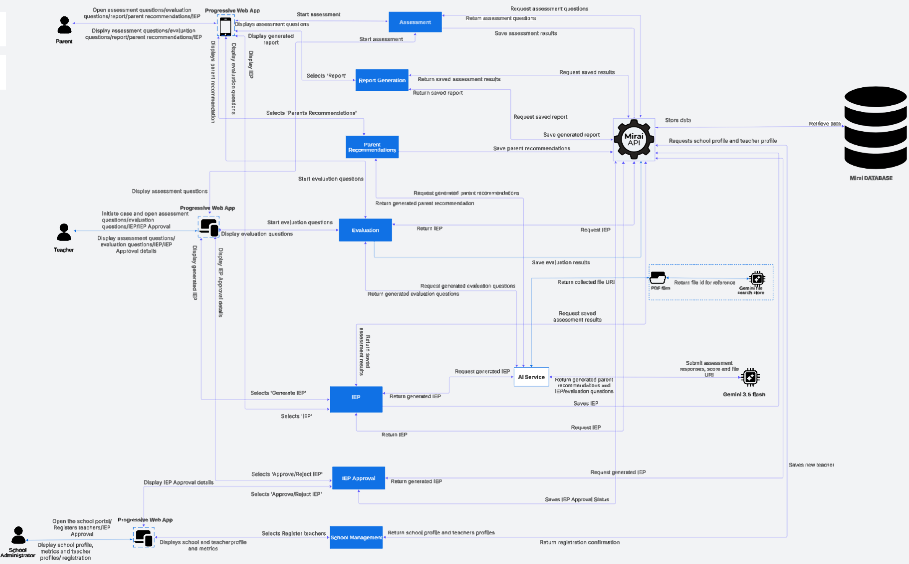

# Architecture

Mirai is a layered web system: a Progressive Web App for teachers and parents, a web dashboard for school and system administrators, a single FastAPI service that owns all business rules, a school-scoped PostgreSQL database and a strictly fenced-off AI service.

## Secure system architecture

<figure class="mi-figure" markdown>

{ .zoomable loading=lazy width="1782" height="820" }

<figcaption>
Five layers, read left to right. Every request crosses them in order.
<a class="mi-figure__open" href="../assets/architecture/secure-system-architecture@3x.webp" target="_blank" rel="noopener">Open full size &#8599;</a>
</figcaption>
</figure>

Tap a diagram to open it full screen, then pinch to zoom in on any box. You can also swipe sideways to pan.

<nav class="mi-legend" aria-label="Jump to a layer">
<a class="mi-legend__item" href="#layer-1">1 Users and devices</a>
<a class="mi-legend__item" href="#layer-2">2 Perimeter security</a>
<a class="mi-legend__item" href="#layer-3">3 Application layer</a>
<a class="mi-legend__item" href="#layer-4">4 Data layer</a>
<a class="mi-legend__item" href="#layer-5">5 External services</a>
</nav>

The diagram shows the target design. Some parts of it (the WAF, reCAPTCHA, email OTP, Vault and Supabase backups) are not built yet; the cards below mark them *Planned*, and [Implementation Status](../reference/implementation-status.md) lists them. The architecture is read left to right as five layers. Every request crosses all of them in order; nothing reaches the data layer except through the Mirai API. Use the chips above to jump to a layer.

:material-cellphone-link:
### 1. Users and devices
Parents and teachers use the mobile-first PWA (`prism-frontend`); school and system administrators use the web dashboard (`prism-dashboard`). Both talk to the API over **HTTPS/TLS**. Parents open assessments, read their child's report and plan, and see professional contacts. Teachers fill in screenings, generate and approve IEPs, answer evaluations, onboard parents and create student profiles. School administrators approve IEPs and onboard or offboard teachers.

:material-wall-fire:
### 2. Perimeter security
*Planned:* **DNS and DDoS protection** and a **WAF** in front of the API, with reCAPTCHA v3 on sign-in. *In the API today:* Pydantic validation, SQLAlchemy ORM (no string-built SQL), JWT validation on routes that declare it, token revocation, rate limits on sign-in and reset, and secure headers. See [Implementation Status](../reference/implementation-status.md).

:material-api:
### 3. Application layer (Mirai API)
Authentication with TOTP, role-based authorisation, platform governance middleware, screening intake modules, the **core evaluation and scoring engine** and the **AI engine**, each a separate module with its own boundary.

:material-database-lock-outline:
### 4. Data layer
PostgreSQL with random UUID keys and an audit table that the application cannot update or delete. *Planned:* application-layer field encryption with key versioning, encrypted backups on Supabase with 30-day expiry, and HashiCorp Vault for secrets.

:material-cloud-outline:
### 5. External services
**Gemini API with File Search** (reference documents only, no names sent, drafts only), **authenticator apps** for TOTP, and **SMTP** email with single-use links.

## Functional architecture

The second diagram shows the same system as functional modules and the messages between them. Each role's PWA talks only to the Mirai API; the API talks to the database and, for generation only, to the AI service.

<figure class="mi-figure" markdown>

{ .zoomable loading=lazy width="1468" height="912" }

<figcaption>
Each role's PWA talks only to the Mirai API; the API alone talks to the database and, for generation, to the AI service.
<a class="mi-figure__open" href="../assets/architecture/system-architecture@3x.webp" target="_blank" rel="noopener">Open full size &#8599;</a>
</figcaption>
</figure>

??? info "Reading the functional diagram"

    - **Left:** the parent, teacher and school administrator PWAs. They never talk to each other or to the database.
    - **Middle:** the Mirai API modules: Assessment, Report Generation, Parent Recommendations, Evaluation, IEP, IEP Approval and School Management.
    - **Right:** PostgreSQL, reached only through the API, and the AI service, called only to generate drafts.
    - Each module is described under [Components](#components).

## Components { #components }

!!! note "Progressive Web App (client)"

    - **Technology:** two Next.js apps. `prism-frontend` is the mobile-first PWA for teachers and parents; `prism-dashboard` is the desktop dashboard for school and system administrators
    - **Serves:** role-aware routing in each app (`RequireRole`, `AuthGuard`)
    - **Offline:** the service worker serves cached pages and an offline page. *Planned:* a queue that stores answers and replays them
    - **Talks to:** the Mirai API only, over HTTPS
    - **Never does:** call the AI service. *Rule:* it should not compute scores or levels either; today the screening screens still do (see [Implementation Status](../reference/implementation-status.md#partial))

!!! note "Mirai API (FastAPI)"

    - **Technology:** Python, FastAPI, Pydantic, SQLAlchemy
    - **Owns:** authentication, RBAC, school scoping, case workflow, intake state machine, scoring, report building, approval workflow, audit logging
    - **Modules:** Assessment, Report Generation, Parent Recommendations, Evaluation, IEP, IEP Approval, School Management, AI Service client
    - **Is the only component** that reads or writes the database

!!! note "Scoring engine"

    - **Lives inside:** the Mirai API, in `services/screening_rules.py` (pure functions) and `services/domain_score.py`
    - **Does:** age-gate routing, per-domain scores scaled 0.00 to 3.00, `LOW` / `MODERATE` / `HIGH` bands from the interpretation table, teacher and parent scores averaged
    - **Rule:** must not import any AI client. Not yet enforced by a test. See [Scoring Engine](../backend/scoring-engine.md)

!!! note "AI service"

    - **Technology:** Gemini through the Gemini API (model set by `GEMINI_MODEL`; production value open, [Q-08](../reference/decision-log.md#open-questions)), with a managed File Search Store
    - **Store holds:** KICD CBC inclusive-education guidance and the specialist-curated home-activity bank, never child data
    - **Generates:** IEP drafts, home-activity suggestions and six-week evaluation questions
    - **Reachable only when:** a persisted score shows Elevated or a qualifying discrepancy. See [AI](../ai/index.md)

!!! note "PostgreSQL database"

    - **Schema:** shared, multi-tenant; `school_id` on users, students and cases; everything else reached through the student
    - **Protects:** TOTP secrets are encrypted in the application. *Planned:* encryption of child name, date of birth, parent phone and email (`BYTEA` + `key_version`)
    - **Constraints:** one unfinished case per student (partial unique index), one assessment per responder role per case, append-only audit log. See [Data Model](data-model.md)

!!! note "Supporting services"

    - **SMTP:** invitations, parent email verification and password resets
    - **Authenticator app (TOTP):** second factor for every role, verified server-side
    - *Planned:* **Google reCAPTCHA v3** on sign-in, **HashiCorp Vault** for secrets, **Supabase storage** for encrypted backups

## Key architectural decisions

| Decision | Choice | Why |
| --- | --- | --- |
| Client delivery | One PWA for teachers and parents; a separate web dashboard for administrators | No app store install, near-zero storage on entry-level phones; administrators work at a desk |
| Scoring | Embedded deterministic rules engine in the API | Same input always gives the same, explainable output; zero arithmetic hallucination |
| Intake | Finite state machine per instrument | Question order is fixed and auditable; no model interprets free text |
| Instruments | Interface-bound, swappable module with versioned question banks | Cultural validity is contested, so a Kenya-validated tool must drop in without a rewrite |
| Offline | Service-worker queue with idempotency keys (*planned*; today cached pages and an offline page) | Teachers switch data off; the 7-day window tolerates asynchronous submission |
| Tenancy | Shared schema, school-scoped queries | Cost must scale linearly with schools on a fixed, low subscription price |
| Generation | Gemini File Search (managed RAG) | No self-hosted vector database to run; chunking, embedding and retrieval are managed |
| Human control | Dual approval (teacher + school admin) before an IEP is active | AI output is a draft until people who know the child sign off |

## Requirements traceability

Every major requirement traces back to a research finding.

| Research finding | Technical requirement |
| --- | --- |
| Delay comes from training gaps, stigma and referral bottlenecks, not tool absence alone | Scope is limited to structured observation, scoring and documentation. No diagnostic or treatment logic. |
| No structured instrument is in school-level use | The age-gated instrument set is the **mandatory** intake path, not an optional add-on. |
| The KISE pathway works once triggered but has no proactive reach | Referral-ready output is generated automatically once an Elevated result is confirmed. |
| Cost is staged; free is not affordable | Parent messaging never presents cost as resolved after the referral export. |
| Cultural bias of instruments is contested | Instruments are interface-bound and swappable. |
| Discreet, non-labelling accommodation is existing practice | A flagged status is visible only to the child's teacher, parent, school admin (for approval and the report) and, after export, the receiving clinical body. A hard access rule, not a default. |
| Adoption depends on trust and a legitimacy signal | A configurable institutional or regulatory affiliation marker appears on school and parent screens. |
| Institutional memory depends on staff tenure | A per-child longitudinal record readable by any currently whitelisted teacher at the school. |

## Non-functional requirements

| Category | Requirement |
| --- | --- |
| Availability under low connectivity | Teacher and parent intake stays usable on intermittent connections and syncs automatically. |
| Device support | Runs on entry-level smartphones without app store installation or significant storage. |
| Determinism and auditability | Scoring is rule-based and inspectable; identical inputs give identical, explainable scores. |
| Data protection | Compliance with the Kenya Data Protection Act, 2019: minimisation, correction rights, controlled retention. |
| Access segregation | Distinct role boundaries; no role sees data outside its documented scope. |
| Cost predictability | Operating cost scales predictably with the number of schools. |
| Multi-tenancy | Many schools on one platform with no cross-tenant visibility. |

## In this section

- [System Context](system-context.md): actors, trust boundaries, external services and request flows
- [Case Lifecycle](case-lifecycle.md): every case status and what moves a case between them
- [Data Model](data-model.md): entity relationships, tables and constraints
- [User Flows](user-flows.md): teacher, parent, school administrator and AI flows