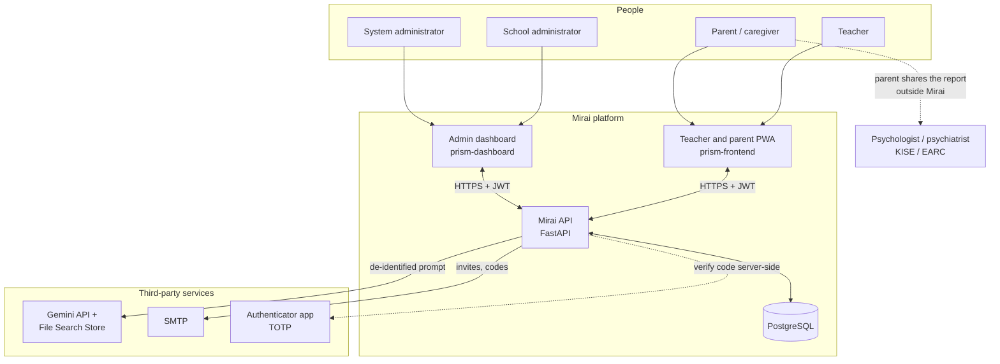
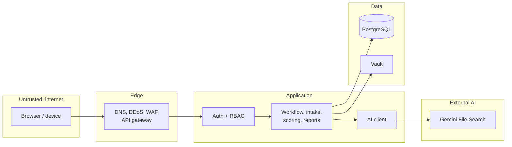
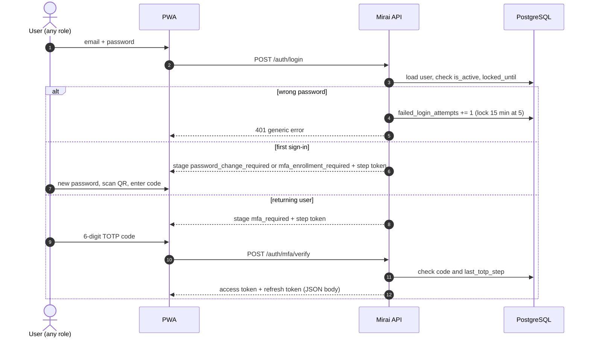
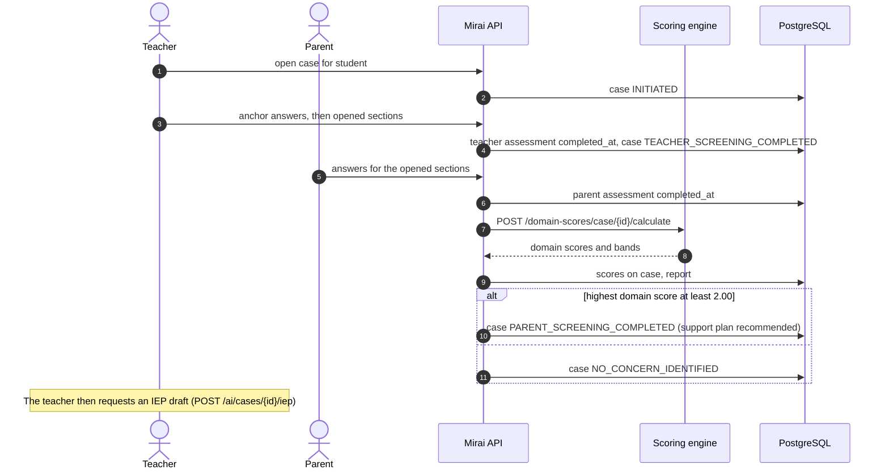
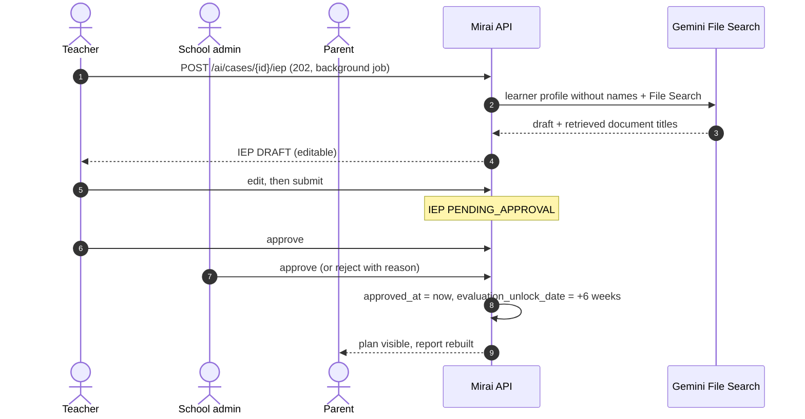
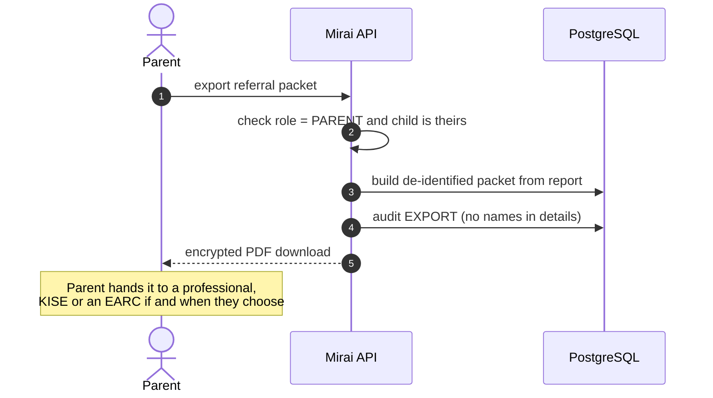

# System Context

Who and what Mirai talks to, where the trust boundaries are, and what crosses them.

## Context diagram

The dashed line to professionals is deliberate: **Mirai never sends anything to a clinic**. The parent decides who to share their child's report with. reCAPTCHA, Vault and Supabase backups are *planned* and not shown ([Implementation Status](../reference/implementation-status.md#planned)).

## Actors

| Actor | Channel | Trust level | Notes |
| --- | --- | --- | --- |
| Teacher | PWA (mobile-first) | Authenticated staff, MFA | Created by their school administrator; scoped to students in their class |
| Parent / caregiver | PWA from an invitation link | Authenticated, bound to their own child | Created by the teacher; no access to other children or institutional data |
| School administrator | PWA (desktop-first) | Authenticated staff, MFA | Created by the system administrator; scoped to one school |
| System administrator | PWA admin console | Highest privilege, MFA | Seeded at start-up; no school; admin screens never show child content |
| Receiving professional | None (offline) | Outside the system | Only sees a packet a parent chose to export |

## Trust boundaries

| Boundary | What is enforced when crossing it |
| --- | --- |
| Internet to API | HTTPS (TLS terminated by the host); rate limits on sign-in, MFA, refresh, reset and invitations; Pydantic validation. *Planned:* edge bot checks |
| Request to handler | JWT signature, expiry, scope, revoked-token and `token_version` checks on routes that declare authentication; role and ownership checks in services. **45 routes declare none yet** ([Security gaps](../reference/implementation-status.md#security-gaps)) |
| Application to data | ORM-parameterised queries only. *Planned:* encrypted identity fields |
| Application to AI | Teacher-requested background job; the learner profile carries age, grade, home language and areas of concern, never names (`build_profile`); output containing a known name is rejected; saved as a draft |

## External services

| Service | Purpose | Data shared | Requirement |
| --- | --- | --- | --- |
| **Gemini API + File Search Store** | Drafts IEPs, home activities and evaluation questions grounded in the stored guidance | Age, grade, home language, areas of concern; approved goals for evaluation questions | No names; contractual no-retention still open ([Q-12](../reference/decision-log.md#open-questions)); cannot influence scores |
| **SMTP** (`EMAIL_BACKEND=smtp`) | Invitations, parent email verification, password resets | Recipient email, short-lived single-use tokens | TLS in transit, minimal scopes, restricted developer access |
| **Authenticator app** | TOTP second factor for every role | Shared secret (encrypted at rest as `mfa_secret_enc`) | Codes verified server-side only; each time-step usable once |
| **Hosting provider** | Application and database hosting | Everything at rest | Backend deploys to Heroku according to the backend README; region and database host open ([Q-10](../reference/decision-log.md#open-questions)) |

## Main request flows

### Sign-in with MFA

### Screening to result

### IEP approval

### Referral export

!!! warning "Planned"

    There is no export endpoint yet. This is the designed flow.

## Notifications

Workflow messages are designed as **in-app notifications** stored in the `notification` table, read through `/notifications`. Email is used only for account messages: invitations and password resets (`core/mailer.py`, `services/student.py`).

*Planned:* the API does not create the notifications below automatically yet; the table and endpoints exist.

| Trigger | Recipient | Kind |
| --- | --- | --- |
| Teacher finishes screening | Parent | `PARENT_TURN` |
| Scoring finishes | Teacher and parent | result ready |
| IEP submitted | School administrators of that school | approval needed |
| IEP approved or rejected | Teacher and parent | plan status |
| Evaluation unlocked | Teacher and parent | six-week check open |
