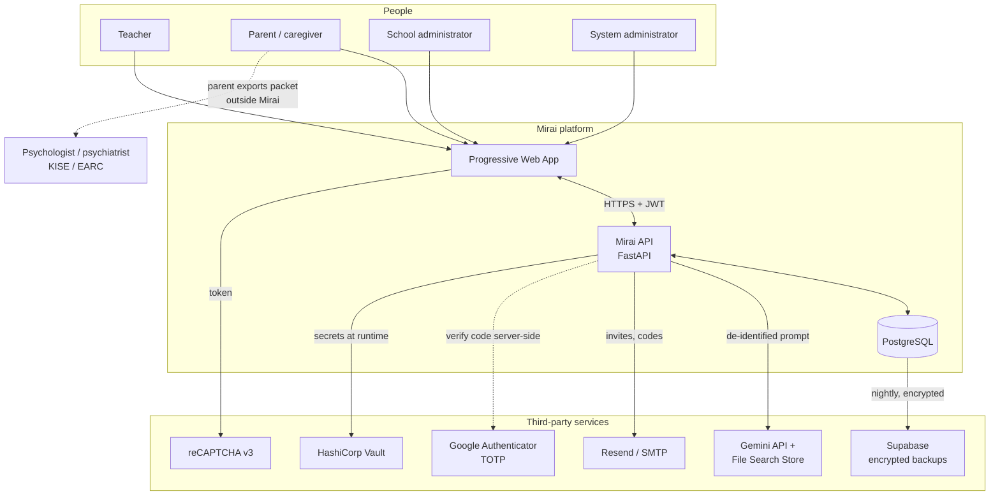
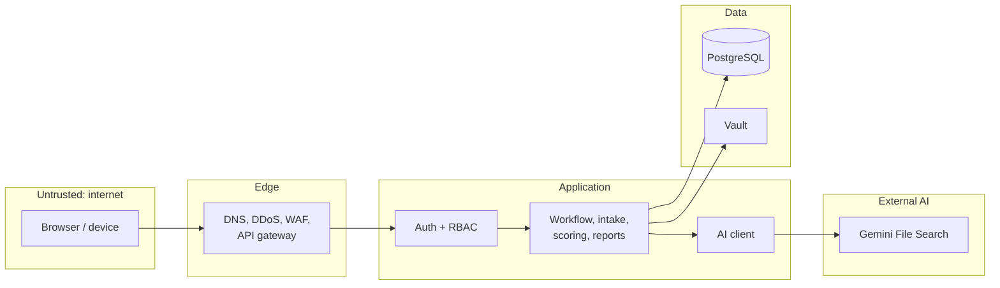
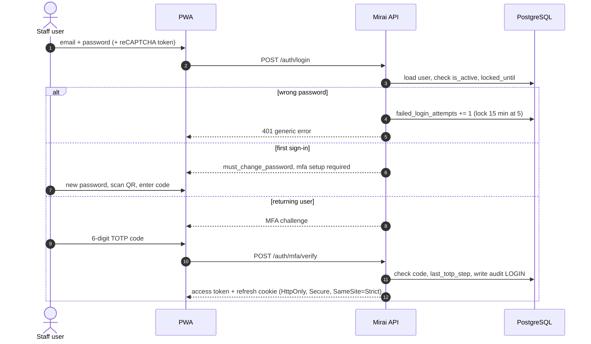
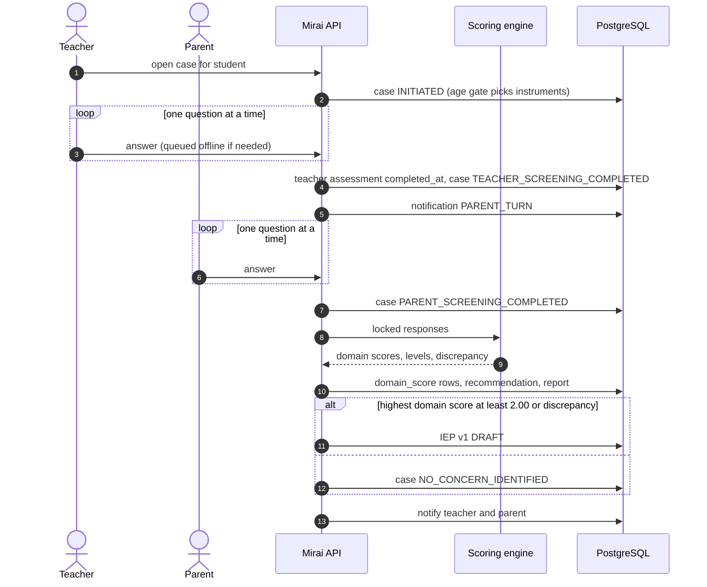
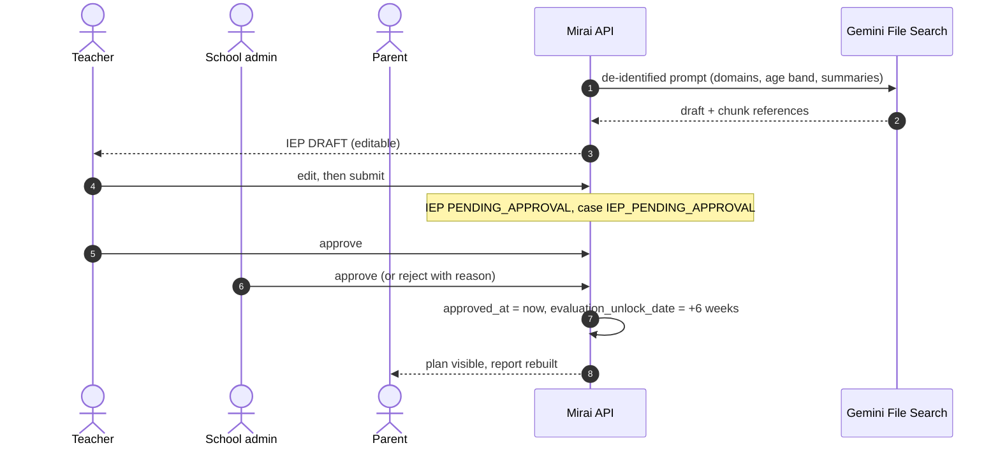
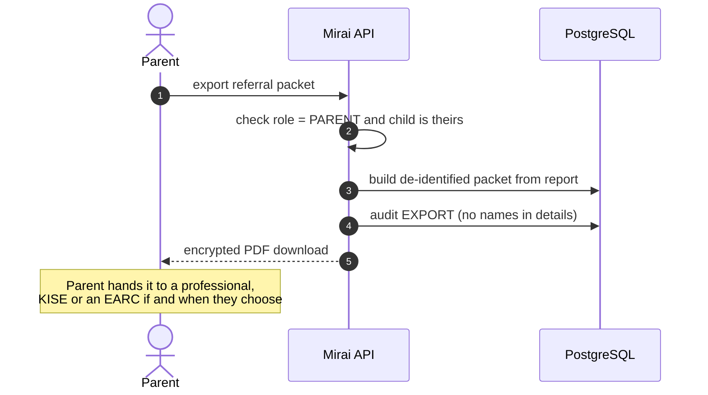

# System Context

Who and what Mirai talks to, where the trust boundaries are, and what crosses them.

## Context diagram

The dashed line to professionals is deliberate: **Mirai never sends anything to a clinic**. The parent downloads the packet and decides who to give it to.

## Actors

| Actor | Channel | Trust level | Notes |
| --- | --- | --- | --- |
| Teacher | PWA (mobile-first) | Authenticated staff, MFA | Created by their school administrator; scoped to students in their class |
| Parent / caregiver | PWA from an invitation link | Authenticated, bound to their own child | Created by the teacher; no access to other children or institutional data |
| School administrator | PWA (desktop-first) | Authenticated staff, MFA | Created by the system administrator; scoped to one school |
| System administrator | PWA admin console | Highest privilege, MFA | Seeded at start-up; no school; admin screens never show child content |
| Receiving professional | None (offline) | Outside the system | Only sees a packet a parent chose to export |

## Trust boundaries

| Boundary | What is enforced when crossing it |
| --- | --- |
| Internet to edge | TLS only (plain HTTP dropped), rate limiting, bot checks, request size and schema validation |
| Edge to application | JWT signature and expiry, revoked-token check, `token_version` check, role and school scope |
| Application to data | ORM-parameterised queries only, school-scoped filters, encrypted identity fields |
| Application to AI | Only reachable after an Elevated or discrepancy result; prompt contains domain, age band and de-identified summaries, never names, dates of birth or school names; output validated and kept as a draft |

## External services

| Service | Purpose | Data shared | Requirement |
| --- | --- | --- | --- |
| **Gemini API + File Search Store** | Drafts IEPs, home activities and evaluation questions grounded in KICD guidance | Domain(s), age band, de-identified score and goal summaries | No child identity data; no retention beyond the request, confirmed contractually; cannot influence scores |
| **Resend / SMTP** | Invitations, verification links, one-time codes, password resets | Recipient email, short-lived single-use tokens | TLS in transit, minimal scopes, restricted developer access |
| **Google Authenticator** | TOTP second factor for staff | Shared secret (encrypted at rest as `mfa_secret_enc`) | Codes verified server-side only; each time-step usable once |
| **Google reCAPTCHA v3** | Bot and brute-force protection | Browser risk signals | No student data; configured for privacy |
| **HashiCorp Vault** | Secrets and encryption keys | Credentials, keys | Never in git; fetched at runtime |
| **Supabase storage** | Encrypted database backups | Encrypted backup files | Restricted, logged access; 30-day expiry |
| **Hosting provider** | Application and database hosting | Everything at rest | Isolated network, disk encryption; region to be confirmed confirm |

## Main request flows

### Sign-in with MFA

### Screening to result

### IEP approval

### Referral export

## Notifications

Workflow messages are **in-app notifications** stored in the `notification` table. Email is used only for account-level messages (invitations, verification, codes, resets).

| Trigger | Recipient | Kind |
| --- | --- | --- |
| Teacher finishes screening | Parent | `PARENT_TURN` |
| Scoring finishes | Teacher and parent | result ready |
| IEP submitted | School administrators of that school | approval needed |
| IEP approved or rejected | Teacher and parent | plan status |
| Evaluation unlocked | Teacher and parent | six-week check open |
