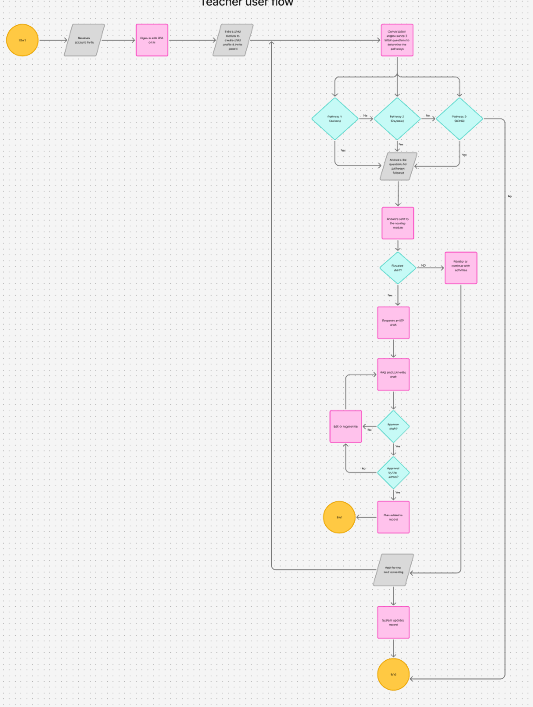
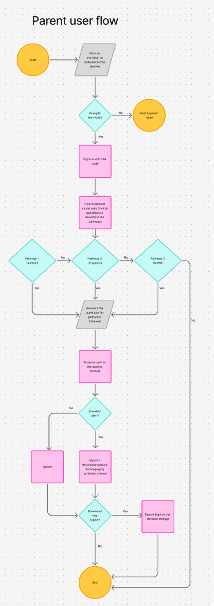
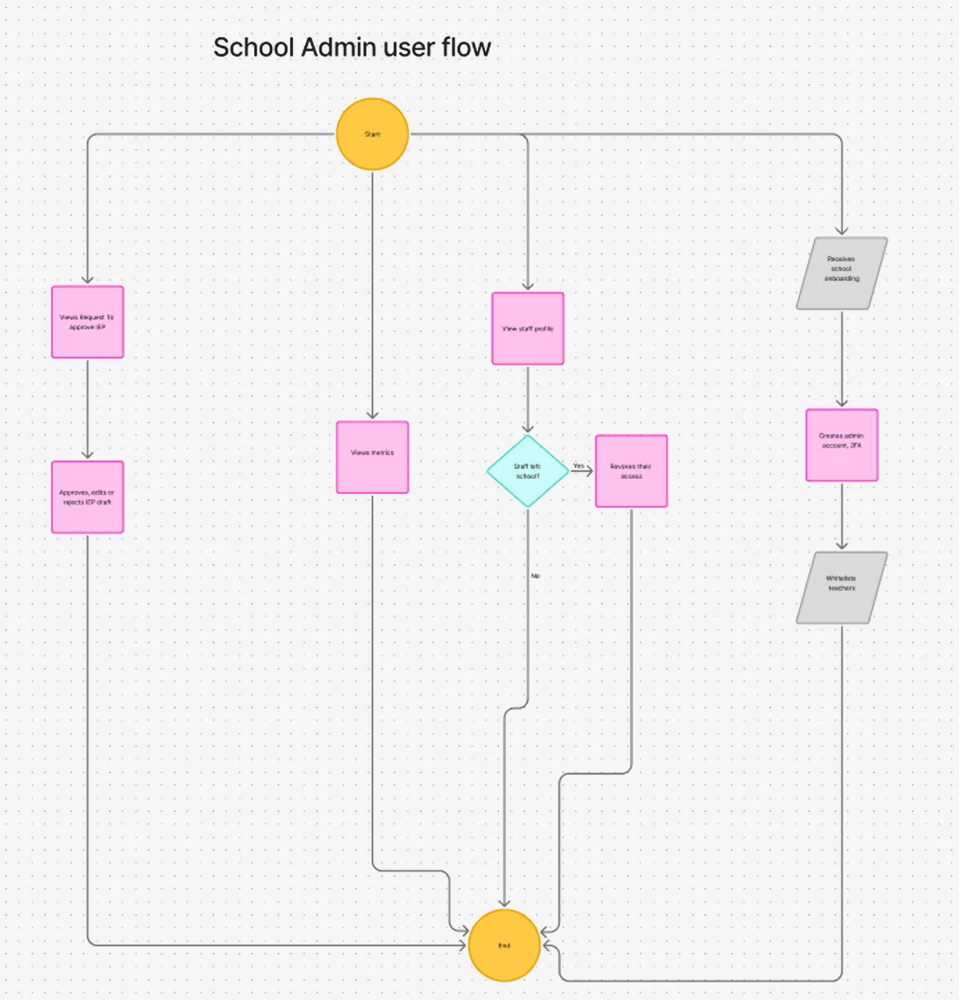
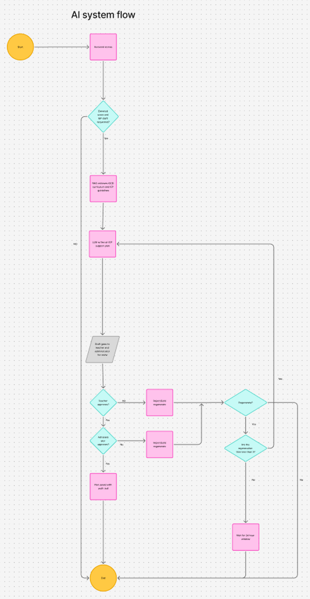
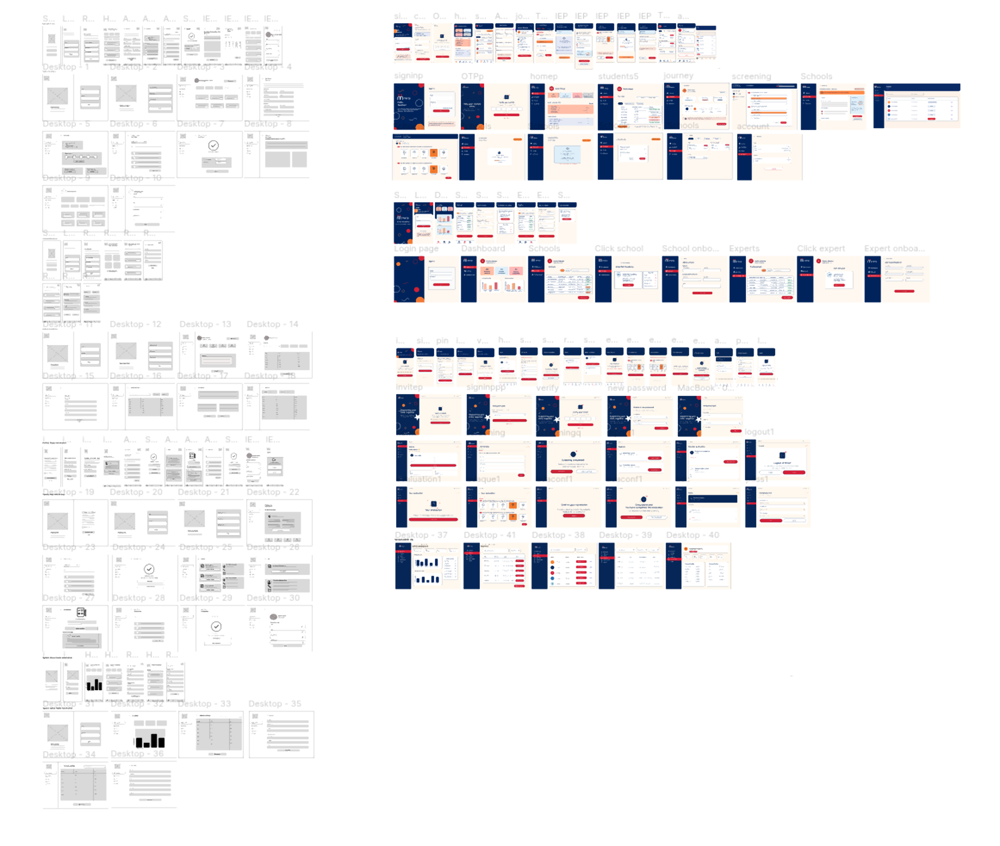

# User Flows

The four flows designed by Team Prism in FigJam, with notes on how each maps to the implementation.

!!! tip "Source"

    The editable boards live in the team's FigJam file *Prism User flows*. Click any image to zoom.

=== "Teacher"

    { .zoomable .mi-w-md }

    | Step | What happens | Implementation note |
    | --- | --- | --- |
    | Receive account | School administrator creates the account with a temporary password | `user.must_change_password = true` |
    | First sign-in | Set a new password and enrol Google Authenticator | TOTP verified server-side; later sign-ins ask for the 6-digit code |
    | Register child, invite parent | Enter the child's details and link or invite the parent | Parent must exist before the student; consent required |
    | Screening | Questions for each pathway (autism, dyslexia, ADHD) routed by age | Anchor questions open each domain's section; one question per screen ([Scoring Engine](../backend/scoring-engine.md#planning-a-screening)) |
    | Scoring | Answers go to the scoring module | Deterministic, server-side only |
    | Elevated? | If not, monitor and continue; if yes, request an IEP draft | The teacher requests the draft; the score gate is *planned* ([IEP Generation](../ai/iep-generation.md#when-generation-is-allowed)) |
    | Review | Approve, edit or regenerate | Regeneration limit *planned* (3, then 24-hour cooldown) |
    | Admin approval | School administrator approves or sends back | Both approvals make the plan active |
    | Plan added to record | Six-week check scheduled | `evaluation_unlock_date = approved_at + 6 weeks` |

=== "Parent"

    { .zoomable .mi-w-sm }

    | Step | What happens | Implementation note |
    | --- | --- | --- |
    | Invitation | Teacher onboards the parent; an invitation arrives by email | Single-use, expiring token via Resend / SMTP |
    | Accept or expire | An expired invitation ends the flow; the teacher can resend | "Resend invite" on the teacher's To do list |
    | Sign in | Password plus a second factor | TOTP authenticator app, enrolled at first sign-in, the same as staff (`services/auth.py`) |
    | Screening | Same questions, non-clinical and non-deficit wording | Starts after the teacher has finished (`PARENT_TURN` notification) |
    | Result | Report, plus recommendations and home activities when a domain is Medium or Elevated | Report built deterministically from stored scores |
    | Download | Parent may download the report or export the referral packet | Parent-only export, audited |

=== "School administrator"

    { .zoomable .mi-w-md }

    | Branch | What happens | Implementation note |
    | --- | --- | --- |
    | Onboarding | Receives the school onboarding from the system administrator, sets up the account with 2FA, whitelists teachers | Teacher accounts created by the school admin only |
    | IEP approvals | Reviews and approves or rejects IEP drafts | Can read the draft and the three domain scores; never raw answers |
    | Metrics | Views school-level, non-identifying metrics | Aggregates only |
    | Staff | Views staff profiles; revokes access when someone leaves | `is_active = false`, `token_version` raised, sessions end |

=== "AI system"

    { .zoomable .mi-w-sm }

    | Step | What happens | Implementation note |
    | --- | --- | --- |
    | Gate | Elevated score or IEP draft requested? | Checked against the stored `domain_score`, not the client |
    | Retrieve | RAG pulls KICD curriculum and IEP guidance | Gemini File Search Store; chunk references saved |
    | Write | LLM drafts the support plan | Output validated against a JSON schema and a diagnostic-language guard |
    | Review | Teacher, then school administrator | Rejection or edit can trigger regeneration |
    | Limit | More than three regenerations in this cycle? | Wait 24 hours |
    | Save | Approved plan saved with an audit trail | `GENERATE` and `APPROVE` audit actions |

## Design artefacts

The wireframes evolved from low-fidelity layouts (left) to the hi-fi Mirai screens (right) for the teacher mobile app, the parent PWA, the school administrator portal and the system administrator console.

{ .zoomable .mi-w-lg }

See [Screens](../frontend/screens.md) for the individual hi-fi screens.
