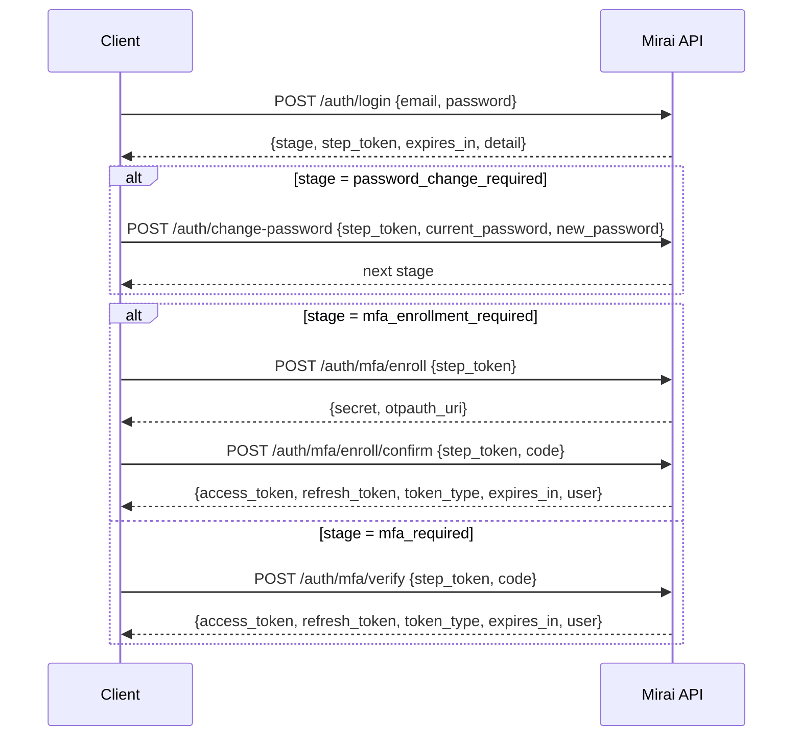

# API Reference

The Mirai API is a FastAPI service. It accepts and returns JSON, and every route is listed in the generated <a href="api-endpoints/">Endpoint List</a>. This page explains the rules that apply to all of them.

!!! info "Source of truth"

    Every statement on this page points to a file in `prism-backend`. The interactive OpenAPI page is served by the backend itself at `/docs` (Swagger UI) and `/openapi.json` while it runs locally.

## Conventions

| Convention | Rule | Evidence |
| --- | --- | --- |
| Base URL | No version prefix. Locally `http://localhost:8000`, so sign-in is `POST http://localhost:8000/auth/login` | `main.py` (routers included without a prefix) |
| IDs | UUIDs in paths | `models/*.py` (`UUID(as_uuid=True)` primary keys) |
| Authentication | `Authorization: Bearer <access token>` header | `dependencies.py` (`HTTPBearer`) |
| Refresh | `POST /auth/refresh` with `{"refresh_token": "..."}` in the body | `routers/auth.py`, `schemas/auth.py` |
| Pagination | `?limit=50&offset=0` on list endpoints; `limit` is 1 to 200 | e.g. `routers/case.py` (`Query(50, ge=1, le=200)`) |
| Errors | FastAPI default body: `{"detail": "message"}`; validation errors return `422` with a list of field problems | `fastapi.HTTPException` throughout `services/` |
| Rate limits | Sign-in, MFA, refresh, password reset and parent invitations are rate limited per IP; `429` when exceeded | `routers/auth.py`, `routers/student.py`, `core/rate_limit.py` |
| Security headers | `nosniff`, `DENY` framing, `no-referrer`, `no-store` on every response; CSP and HSTS in production only | `main.py` (`security_headers`) |

## Signing in

Sign-in is staged. Each stage returns a short-lived **step token** that is only valid for the next step.

| Token | Lifetime (default) | Setting |
| --- | --- | --- |
| Access token | 15 minutes | `ACCESS_TOKEN_EXPIRE_MINUTES` |
| Refresh token | 7 days | `REFRESH_TOKEN_EXPIRE_DAYS` |
| Step token | 10 minutes | `STEP_TOKEN_EXPIRE_MINUTES` |

Every role, parents included, enrols an authenticator app (TOTP) on first sign-in. The stage logic is in `services/auth.py` (`_stage_for`).

## Asynchronous AI jobs

AI generation never blocks a request. The API records a job, answers `202 Accepted`, and runs the job after the response.

| Step | Request | Response |
| --- | --- | --- |
| Start | `POST /ai/cases/{case_id}/iep` (or `/recommendation`, or `/ai/ieps/{iep_id}/evaluation-questions`) | `202` with an `AIJob` whose `status` is `QUEUED` |
| Poll | `GET /ai/jobs/{job_id}` | `status` moves `QUEUED` → `RUNNING` → `SUCCEEDED` or `FAILED` |
| Read | Use `result_id` from the finished job | The new IEP, recommendation or IEP id |

`AIJob` fields: `job_id`, `case_id`, `kind`, `status`, `result_id`, `error`, `created_at`, `finished_at` (`schemas/ai.py`). The web app polls every 3 seconds for up to 3 minutes (`prism-frontend/lib/ai.ts`).

## Main flow, end to end

| Step | Endpoint |
| --- | --- |
| Open a case | `POST /cases` |
| Start a screening | `POST /screening-assessments` |
| Get the questions for this child | `GET /screening-assessments/{assessment_id}/plan` |
| Save answers | `PUT /screening-responses/bulk` |
| Finish the screening | `POST /screening-assessments/{assessment_id}/complete` |
| Score both screenings | `POST /domain-scores/case/{case_id}/calculate` (also builds the report) |
| Read the report | `GET /reports/case/{case_id}` |
| Draft an IEP with AI | `POST /ai/cases/{case_id}/iep`, then poll the job |
| Submit, approve or reject the IEP | `POST /ieps/{iep_id}/submit`, `/approve`, `/reject` |
| Six-week check | `/iep-evaluation-questions` and `/iep-evaluation-responses` |

## In this section

- [Endpoint List](api-endpoints.md): all routes, the authentication on each, and the handler file and line
