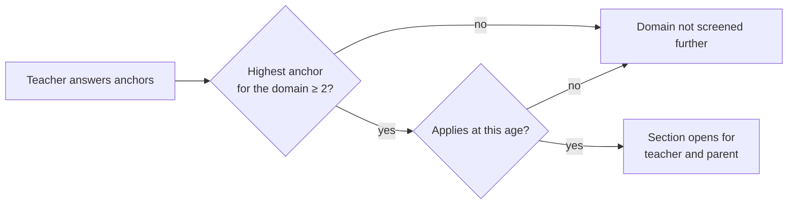

# Screening and Scoring Engine

<p class="mi-lead">The heart of Mirai is deliberately boring: stored questions, fixed rules, fixed formulas. A given set of answers always produces the same, explainable result, and no AI is involved.</p>

!!! info "Where the code lives"

    Pure rules: `prism-backend/services/screening_rules.py`. Planning a screening: `services/screening_assessment.py` (`case_plan`). Calculating and saving scores: `services/domain_score.py`. None of these imports an AI client. A test that fails if one ever does is *planned* ([Implementation Status](../reference/implementation-status.md#partial)).

## Questions are data

Questions, answer scales, reverse-scored items and interpretation bands are rows in the database, not code. A system administrator loads them through `POST /screening-questions/bulk` and `POST /screening-interpretations/bulk`. Each question has a `tool_type` (`ANCHOR`, `CAST`, `SNAP_IV`, `CLDQR`, `ADHD_RS_PRESCHOOL`), a `question_number`, an `answer_scale`, and `is_scored` / `reverse_scored` flags (`models/screening_question.py`).

## Planning a screening

The teacher answers a short set of **anchor** questions first. Each anchor targets one domain. A domain's full section opens only if the teacher's highest anchor answer for that domain is **2 or more** (`ANCHOR_OPEN_AT`).

The child's age, in completed years on the day the case was created, decides which instrument a domain uses and whether it applies at all (`tool_for_domain`, `anchor_applies`):

| Domain | Age under 5 | Age 5 | Age 6 and over |
| --- | --- | --- | --- |
| Autism | CAST | CAST | CAST |
| ADHD | ADHD Rating Scale, Preschool | SNAP-IV | SNAP-IV |
| Dyslexia | Not screened | Not screened | CLDQ-R |



If no anchor questions are loaded, every scoring section opens. The plan for a case is available at `GET /screening-assessments/{assessment_id}/plan`.

!!! warning "Age range"

    The product pages describe Mirai as being for ages 4 to 9. The API accepts a date of birth for ages **3 to 12** (`schemas/student.py`, `MIN_AGE, MAX_AGE = 3, 12`). One of the two needs to change; it is tracked as [Q-13](../reference/decision-log.md#open-questions).

## Answering

| Property | Rule | Evidence |
| --- | --- | --- |
| Separate assessments | One assessment per responder role per case; neither side sees the other's answers | `services/screening_assessment.py` |
| Valid answer | Integer from `0` to `answer_scale - 1`; anything else is rejected | `screening_rules.item_score` |
| Saving | Answers are saved one at a time or in bulk (`PUT /screening-responses/bulk`) | `routers/screening_response.py` |
| Finishing | `POST /screening-assessments/{id}/complete`; the parent cannot finish before the teacher's anchors are answered | `services/screening_assessment.py` (`complete`) |
| Offline queue, 7-day window | *Planned*, not in the code | [Implementation Status](../reference/implementation-status.md#planned) |

## The scoring formula

When both assessments are complete, `POST /domain-scores/case/{case_id}/calculate` computes, for each opened section:

**1. Raw score per informant.** Sum the scored answers. Reverse-scored items are flipped first: `value = (answer_scale - 1) - answer`.

**2. Scaled score per informant (0.00 to 3.00).**

```text
S = (Raw - Min) / (Max - Min) × 3        Min = 0, Max = Σ (answer_scale − 1)
```

**3. Combined domain score.** The average of the two informants:

```text
S_domain = (S_teacher + S_parent) / 2
```

**4. Case score.** `domain_density_score` is the **highest** combined domain score, and `primary_domain` is that domain. Domains are never averaged together.

Each step is rounded half-up to two decimals (`density`, `combine`).

## Bands and the case outcome

| Output | Rule | Evidence |
| --- | --- | --- |
| Band per informant | The interpretation row whose `min_raw`–`max_raw` range contains the informant's raw score gives a `level` (`LOW`, `MODERATE`, `HIGH`), a `band_label` and plain-language `meaning_text` | `band_for_raw`, `models/screening_interpretation.py` |
| Band per domain | The higher of the teacher's and parent's band | `higher` |
| Support plan recommended | `domain_density_score ≥ 2.00` (`IEP_THRESHOLD`). The case moves to `PARENT_SCREENING_COMPLETED` | `services/domain_score.py` (`_summary`) |
| No concern | Otherwise the case moves to `NO_CONCERN_IDENTIFIED` | same |
| Not screened | Domains whose section did not open are listed as `NOT_OPENED` or `TOOL_UNAVAILABLE` | `_compute` |

The parent-facing labels are Low, Medium and Elevated; they map to `LOW`, `MODERATE` and `HIGH` ([C-07](../reference/decision-log.md#conflicts-between-source-documents)).

!!! warning "Discrepancy rule: decided, not built"

    [D-04](../reference/decision-log.md#decisions) says a large teacher–parent gap in a domain should be treated like an Elevated result. The code does not calculate a discrepancy yet: only `domain_density_score ≥ 2.00` recommends a plan. Until it is built, a strong concern from one informant can be averaged below the threshold.

## Worked example

SNAP-IV, 3 scored questions on a 0–3 scale, so `Max = 9`:

| | Teacher | Parent |
| --- | --- | --- |
| Raw | 6 | 6 |
| Scaled | 6 / 9 × 3 = **2.00** | **2.00** |
| Combined | (2.00 + 2.00) / 2 = **2.00** | |
| Outcome | 2.00 ≥ 2.00, so a support plan is recommended | |

This is the case covered by `tests/test_domain_score.py` ("SNAP-IV raw 6 of 9 = 2.0 exactly, in both assessments").

## The code

```python
# prism-backend/services/screening_rules.py
SCALE_TOP = 3.0
IEP_THRESHOLD = 2.0

def item_score(item, value: int) -> int:
    if value < 0 or value > item.answer_scale - 1:
        raise ValueError("answer outside the question's scale")
    return item.answer_scale - 1 - value if item.reverse_scored else value

def density(raw: int, minimum: int, maximum: int) -> float:
    if maximum <= minimum:
        return 0.0
    value = Decimal(raw - minimum) / Decimal(maximum - minimum) * Decimal(str(SCALE_TOP))
    return float(value.quantize(Decimal("0.01"), rounding=ROUND_HALF_UP))

def combine(teacher: float, parent: float) -> float:
    value = (Decimal(str(teacher)) + Decimal(str(parent))) / 2
    return float(value.quantize(Decimal("0.01"), rounding=ROUND_HALF_UP))
```

## What happens after scoring

| Output | Built from | Evidence |
| --- | --- | --- |
| Case scores and status | `autism_score`, `adhd_score`, `dyslexia_score`, `domain_density_score`, `primary_domain` on `case` | `services/domain_score.py` |
| Parent report | Scores, bands, meaning text and the non-diagnosis disclaimer, built without AI | `services/report_builder.py` |
| IEP draft | Requested by the teacher through `POST /ai/cases/{case_id}/iep` | [IEP and Evaluation Generation](../ai/iep-generation.md) |

## Testing the engine

| Area | Tests |
| --- | --- |
| Tool-to-domain mapping, age gates, item scoring, scaling, rounding, combining | `tests/test_screening_rules.py` |
| Calculation over real assessments, the 2.00 threshold, not-screened domains | `tests/test_domain_score.py` |
| Anchors opening sections | Not covered by a test yet |

Full scenarios are listed in [Testing and QA](../developer-guide/testing.md).
