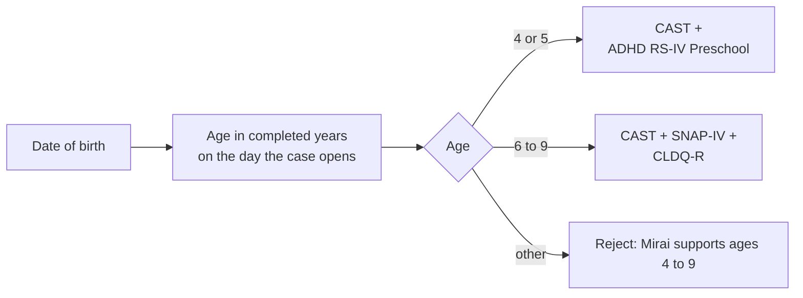
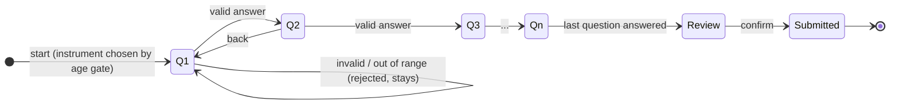

# Screening and Scoring Engine

<p class="mi-lead">The heart of Mirai is deliberately boring: fixed questions, fixed order, fixed formulas. A given set of answers always produces the same, explainable result, and no AI is involved.</p>

!!! danger "Isolation rule"

    The `scoring` package must not import any AI or HTTP client. A lint test fails the build if it does. Generative components can read a finished score; they can never write one, and an AI outage can never change one.

## Instruments and age gating

The child's age is calculated from the date of birth when the case is opened, and selects the instrument set. This is the only age-based branching; the state machine does no further age logic.

| Age | Autism domain | ADHD domain | Dyslexia domain |
| --- | --- | --- | --- |
| **4 to 5** | CAST | ADHD Rating Scale IV, Preschool Version | *Not scored* |
| **6 to 9** | CAST | SNAP-IV | CLDQ-R Dyslexia Subscale |
| Outside 4 to 9 | Case cannot be opened | | |



!!! info "Why no dyslexia score for ages 4 to 5"

    This is intentional, not a gap. The CLDQ-R is validated for school-age children and depends on formal reading instruction having started. There is no meaningful reading signal before that, so no substitute instrument is used.

### Swappable instruments

Every instrument implements the same interface, and its questions, answer labels, reverse-scored items and interpretation bands are **data**, not code. A Kenya-validated instrument can be registered and routed without changing the workflow or the scoring core.

```python
class Instrument(Protocol):
    tool_type: ToolType               # e.g. CAST, SNAP_IV, CLDQR, ADHD_RS_IV_PRESCHOOL
    domain: Domain                    # AUTISM, ADHD or DYSLEXIA
    age_range: tuple[int, int]        # inclusive, e.g. (6, 9)

    def questions(self) -> list[ScreeningQuestion]: ...
    def bounds(self) -> tuple[int, int]: ...   # (min_possible, max_possible)
```

## Intake state machine

Teacher and parent intake are driven by a **finite state machine**, not a chatbot. Each question is a state; a valid answer moves to the next state; nothing interprets free text.



| Property | Rule |
| --- | --- |
| Order | Instruments in a fixed order (autism, ADHD, dyslexia); questions by `question_number` |
| Presentation | One question per screen, with progress ("Part 2 of 3, Question 7 of 24") |
| Valid answer | Integer in `0 .. answer_scale - 1`; anything else is rejected and the state does not advance |
| Resume | Answers save as they go; the next session resumes at the first unanswered question |
| Offline | Answers queue locally with an idempotency key and replay in order when online |
| Determinism | The same sequence of answers always produces the same sequence of questions |
| Independence | Teacher and parent have separate assessments; neither can see or overwrite the other's answers |
| Window | Submissions are accepted only while the 7-day window is open; responses lock at the close |

## The scoring formula

When both assessments are complete, the engine computes, for each routed domain:

**1. Raw score per informant.** Sum the selected values of the scored questions. For reverse-scored items, flip the value first: `value = (answer_scale - 1) - selected_value`.

**2. Normalised score per informant (0.00 to 3.00).**

```text
S = (Raw - Min) / (Max - Min) × 3
```

where `Min = 0` and `Max = Σ (answer_scale − 1)` over the scored questions.

**3. Combined domain score.**

```text
S_domain = (S_teacher + S_parent) / 2
```

**4. Case density score.** `domain_density_score = max(S_autism, S_adhd, S_dyslexia)`, and `primary_domain` is the domain with that maximum.

Domain scores are **never averaged into one number**. Averaging would let a genuine concern in one area be diluted by unrelated areas where nothing is wrong.

## Alert levels

| Score range | Level shown | Stored as | Badge |
| --- | --- | --- | --- |
| 0.00 to 1.00 | Low | `LOW` | <span class="mi-badge mi-badge--low">Low</span> |
| 1.01 to 1.99 | Medium | `MODERATE` | <span class="mi-badge mi-badge--medium">Medium</span> |
| 2.00 to 3.00 | Elevated | `HIGH` | <span class="mi-badge mi-badge--elevated">Elevated</span> |

**Overall result.** A case is **Elevated if any single domain is Elevated**, regardless of the other domains. A case with no Elevated domain and no qualifying discrepancy closes as `NO_CONCERN_IDENTIFIED`, and no IEP is generated.

Scores are rounded to two decimal places after the final calculation <span class="mi-verify">confirm rounding rule</span>. Boundary values 1.00, 1.01, 1.99 and 2.00 are covered by tests.

## Discrepancy handling

Teachers and parents see a child in different settings, and stigma can lead to under-reporting at home. A large disagreement between the two informants is therefore treated as **a signal, not a data-quality problem**.

For each domain:

```text
Δ_domain = | S_teacher − S_parent |
```

If `Δ ≥ DISCREPANCY_THRESHOLD` in any domain, the case is treated **exactly like a confirmed Elevated result in that domain**: IEP generation, home activities and the professional listing all unlock.

| Setting | Value |
| --- | --- |
| Threshold | **1.00** (interim, boundary inclusive) <span class="mi-verify">confirm</span> |
| Missing side | Never treated as zero; handled by the incomplete-intake rule <span class="mi-verify">confirm</span> |
| Enforcement | Server-side only |

!!! note "History of this rule"

    An early product draft forced a *Medium* "dissonance" status at a 1.5 threshold and asked for four more weeks of logging. The Technical Requirements replaced this: a significant disagreement now triggers support, because waiting it out delays help. See the [Decision Log](../reference/decision-log.md).

## Worked examples

Assume a hypothetical ADHD instrument with **18 scored items on a 4-point scale (0 to 3)**, so `Min = 0`, `Max = 54`.

=== "Agreement, Medium"

    | | Raw | Normalised |
    | --- | --- | --- |
    | Teacher | 38 | 38 / 54 × 3 = **2.11** |
    | Parent | 27 | 27 / 54 × 3 = **1.50** |
    | Combined | | (2.11 + 1.50) / 2 = **1.81** <span class="mi-badge mi-badge--medium">Medium</span> |
    | Discrepancy | | \|2.11 − 1.50\| = 0.61, below 1.00 |

    If no other domain is Elevated, the case closes as `NO_CONCERN_IDENTIFIED`. The report still shows a Medium band, and recommendations and professional contacts appear for Medium and Elevated domains.

=== "Disagreement, treated as Elevated"

    | | Raw | Normalised |
    | --- | --- | --- |
    | Teacher | 44 | 44 / 54 × 3 = **2.44** |
    | Parent | 12 | 12 / 54 × 3 = **0.67** |
    | Combined | | (2.44 + 0.67) / 2 = **1.56** <span class="mi-badge mi-badge--medium">Medium</span> |
    | Discrepancy | | \|2.44 − 0.67\| = **1.78**, at or above 1.00 |

    The combined score alone would be Medium, but the discrepancy triggers the Elevated pathway for ADHD. Without this rule, the teacher's strong concern would be cancelled out.

=== "One domain Elevated"

    | Domain | Combined | Level |
    | --- | --- | --- |
    | Autism | 0.62 | <span class="mi-badge mi-badge--low">Low</span> |
    | ADHD | 0.95 | <span class="mi-badge mi-badge--low">Low</span> |
    | Dyslexia | 2.25 | <span class="mi-badge mi-badge--elevated">Elevated</span> |

    `domain_density_score = 2.25`, `primary_domain = DYSLEXIA`. The overall case is Elevated. An average of the three (1.27) would have hidden it, which is exactly why domains are never blended.

## Reference implementation

The scoring core is a set of small, pure functions. This sketch is the specification in code form.

```python
from decimal import Decimal, ROUND_HALF_UP

LOW_MAX, ELEVATED_MIN = Decimal("1.00"), Decimal("2.00")

def raw_score(answers: list[Answer]) -> int:
    total = 0
    for a in answers:
        if not a.question.is_scored:
            continue
        top = a.question.answer_scale - 1
        total += (top - a.selected_value) if a.question.reverse_scored else a.selected_value
    return total

def normalise(raw: int, lo: int, hi: int) -> Decimal:
    return Decimal(raw - lo) / Decimal(hi - lo) * 3

def q2(x: Decimal) -> Decimal:
    return x.quantize(Decimal("0.01"), rounding=ROUND_HALF_UP)

def level(score: Decimal) -> Level:
    if score <= LOW_MAX:
        return Level.LOW
    if score < ELEVATED_MIN:
        return Level.MODERATE
    return Level.HIGH

def score_domain(teacher: list[Answer], parent: list[Answer], lo: int, hi: int,
                 threshold: Decimal) -> DomainResult:
    t = normalise(raw_score(teacher), lo, hi)
    p = normalise(raw_score(parent), lo, hi)
    combined = q2((t + p) / 2)
    return DomainResult(
        teacher_score=q2(t), parent_score=q2(p), combined_score=combined,
        level=level(combined),
        discrepancy=q2(abs(t - p)) >= threshold,
    )

def case_outcome(results: dict[Domain, DomainResult]) -> Outcome:
    elevated = any(r.level is Level.HIGH or r.discrepancy for r in results.values())
    density = max(r.combined_score for r in results.values())
    primary = max(results, key=lambda d: results[d].combined_score)
    return Outcome(elevated=elevated, density=density, primary_domain=primary)
```

## What happens after scoring

| Output | Built from | Who sees it |
| --- | --- | --- |
| `domain_score` rows | The calculation above | System (source for report and gates) |
| Case scores and status | `autism_score`, `adhd_score`, `dyslexia_score`, `domain_density_score`, `primary_domain` | Teacher (status), school admin (three domain scores while approving) |
| Report | Domain scores + `screening_interpretation` meaning text + recommendation + active IEP + professionals + disclaimer | Parent |
| Recommendation | `recommendation_template` for every domain at Medium or Elevated, else `GENERAL` | Parent |
| IEP draft | AI service, only if Elevated or discrepancy | Teacher, then school admin, then parent once active |

## Testing the engine

| Test | Purpose |
| --- | --- |
| Golden files | Fixed inputs must produce identical outputs on every run |
| Boundaries | 1.00 / 1.01 and 1.99 / 2.00 classify correctly; values outside 0 to 3 are rejected |
| Age gate | Ages 4, 5, 6 and 9 route correctly; 3 and 10 are rejected; dyslexia is absent for 4 to 5 |
| Discrepancy | Below, at and above the threshold; missing side not treated as zero |
| Independence | Domains never blended; one Elevated domain makes the case Elevated |
| Isolation | Import-lint fails if `scoring/` imports an AI client; AI outage leaves scores unchanged |

Full scenarios are listed in [Testing and QA](../developer-guide/testing.md).
