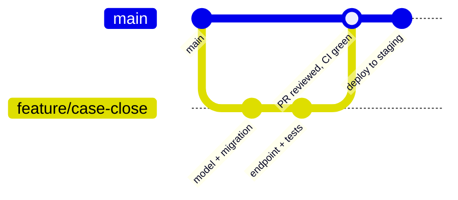

# Developer Guide

Everything a developer needs to work on Mirai safely: where the code lives, how we branch, the rules that must never break and what "done" means.

## Repositories

| Repository | Contents |
| --- | --- |
| Backend | FastAPI service, scoring engine, migrations, tests |
| Frontend | Next.js PWA for all roles |
| `prism-technical-documentation` | This site (MkDocs + Material) |

Ask a maintainer for access to the backend and frontend repositories. Their exact URLs are listed in the team workspace. add links

## Workflow

1. Pick an issue and create a branch: `feature/<short-name>`, `fix/<short-name>` or `docs/<short-name>`.
2. Keep pull requests small and focused on one change.
3. CI must be green: tests, lint, security scans, strict docs build.
4. At least one reviewer approves. Changes to scoring, auth, access control or the AI gate need **two**.
5. Squash-merge into `main`; `main` deploys to staging.

**Commit messages** follow a conventional style: `feat(cases): close a case early`, `fix(scoring): round after averaging`, `docs(api): add evaluation endpoints`.

## Rules that must never break

!!! danger "Non-negotiables"

    1. **No AI import in `scoring/`.** Scores and alerts are deterministic and server-side.
    2. **Every query is school-scoped**, using the school from the token, never from the request.
    3. **No string-built SQL.** Use the ORM.
    4. **Role-specific response models.** Never return a full ORM object to a client.
    5. **No personal data in logs or audit details.** Ids and short notes only.
    6. **No secrets in git.** Use `.env` locally (ignored) and Vault elsewhere.
    7. **No real children's data** outside production. Use synthetic data.
    8. **No diagnostic language** in UI copy, prompts or generated output.
    9. **AI output stays a draft** until both approvals are recorded.
    10. **The referral export is parent-only**, enforced in the API.

## Coding conventions

| Area | Convention |
| --- | --- |
| Python | Type hints everywhere; Ruff for lint and format; Pydantic models for every request and response |
| Database | One Alembic migration per schema change; constraints in the database, not only in code |
| API | Plural resource nouns; UUID paths; documented status codes; idempotency on answer submission |
| TypeScript | Strict mode; generated API types; no `any` in API code |
| UI copy | Teacher and parent wording kept in separate copy files; parent copy reviewed for non-deficit language |
| Tests | Arrange, act, assert; one behaviour per test; test ids reference QA scenario ids where they exist (for example `test_SCR_06_two_is_elevated`) |

## Definition of done

- [ ] Acceptance criteria met and demoed.
- [ ] Unit and API tests written, including at least one wrong-role and one cross-school negative test for new endpoints.
- [ ] Audit events written for sensitive actions.
- [ ] No new Bandit, Safety or pip-audit findings above the threshold.
- [ ] Docs updated (this site and the OpenAPI descriptions).
- [ ] Reviewed and merged with CI green.

## In this section

- [Setup](setup.md): get the backend, frontend and docs running locally
- [Testing and QA](testing.md): test levels, priority scenarios and release criteria
