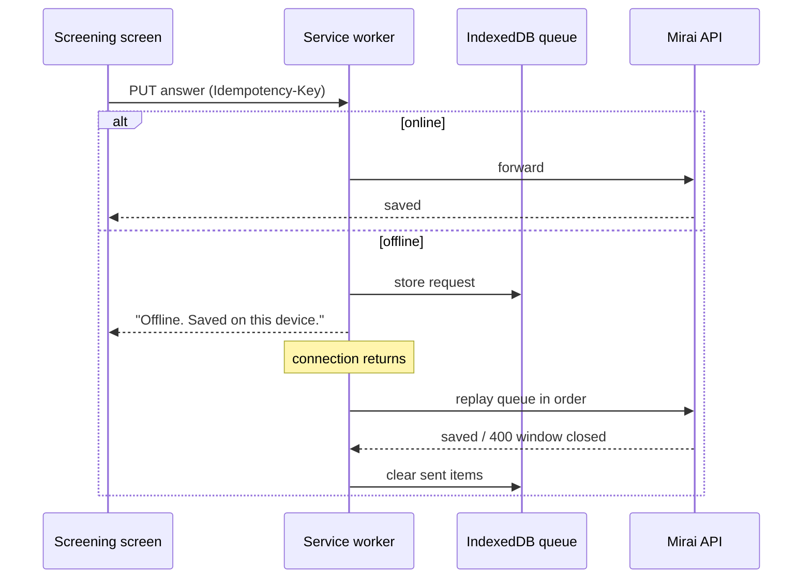

# Frontend

<p class="mi-lead">One Next.js Progressive Web App serves every role. It is mobile-first for teachers and parents, desktop-first for administrators, installable from a browser link and resilient to dropped connections.</p>

## Why a PWA

| Need from research | How the PWA meets it |
| --- | --- |
| Teachers on entry-level phones with full storage | No app store install; the shell is cached, data lives on the server |
| Teachers switch mobile data off in class | Service-worker queue stores answers and replays them later |
| 81% of surveyed parents prefer a browser link | Parents open an invitation link and use the same app |
| One small team | One codebase for four roles, mobile and desktop layouts |

## Stack

| Concern | Choice |
| --- | --- |
| Framework | Next.js (React, TypeScript) |
| Installability | Web app manifest (`app/manifest.ts`) and a hand-written service worker (`public/sw.js`) registered in production |
| Offline | Cached pages and static files, `public/offline.html` when nothing is cached. *Planned:* IndexedDB answer queue with idempotency keys |
| Styling | Design tokens from the [Style Guide](style-guide.md); Quicksand typeface |
| Data fetching | Hand-written typed clients in `lib/*.ts` over one `request()` helper (`lib/api.ts`) |
| Testing | Jest + React Testing Library (`tests/`). No end-to-end suite yet |

## Navigation by role

=== "Teacher (mobile)"

    Bottom navigation: **Home · Students · Cases · To Do · Account**

    | Screen | Purpose |
    | --- | --- |
    | Home | Greeting, counts (students, open cases, active IEPs, unapproved IEPs), *Needs your attention*, latest actions |
    | Students | Class list with search, filters (All, Needs my action, Active IEP) and status chips; **+ Add student** |
    | Student journey | Case started, teacher screening, parent screening, plan made and approved, six-week check |
    | Screening | One question per screen with progress; autosave |
    | IEP | Draft banner, plan, short-term goals, approval status, Approve / Regenerate |
    | Six-week check | Locked until the unlock date; then -2 to 2 per question |
    | To Do | IEPs to review, evaluations and cases to start, parents to re-invite |
    | Account | Profile, change password, sign out |

=== "Parent (mobile)"

    | Screen | Purpose |
    | --- | --- |
    | Invitation | "You're invited", accept and set a password |
    | Screening | Same flow as the teacher, non-clinical wording |
    | Report | Domain bands in plain language, disclaimer, recommendations |
    | Plan | Approved IEP (read-only) and home activities |
    | Professionals | Directory filtered by specialty and location, with a cost-transparency note |
    | Six-week check | Same scale as the teacher |

=== "School administrator (desktop)"

    Sidebar: **Dashboard · Teachers · Cases · Audit Log · School Profile · Logout**

    | Screen | Purpose |
    | --- | --- |
    | Dashboard | Active cases, teachers, six-week checks due; students on IEP by grade; IEP approval time |
    | Teachers | Search, status filter, *Review plan* for pending approvals, **Add a teacher**, revoke access |
    | Cases | Student, teacher, where the case is (status) |
    | Audit Log | When, who, what happened, about; filters by action, person and period |
    | School Profile | Classes, teachers, students, parents, active cases; school and class details |

=== "System administrator (desktop)"

    Sidebar: **Dashboard · Schools · Professionals**

    | Screen | Purpose |
    | --- | --- |
    | Dashboard | Students screened, schools onboarded, experts onboarded; AI output quality; screening stats |
    | Schools | List, onboard a school with its first administrator |
    | Professionals | Add, edit and deactivate directory entries |

## Offline behaviour

!!! warning "Planned"

    The queue below is the design. Today the service worker (`public/sw.js`) caches pages and static files and shows `offline.html`; answers are not queued while offline. See [Implementation Status](../reference/implementation-status.md#planned).



Rules:

- The queue holds **only** screening and evaluation answers, never identity fields.
- Replays are in order and idempotent; the server ignores duplicates.
- A queued answer that arrives after the 7-day window is rejected and the user is told.
- The queue and cached API responses are cleared on sign-out and on session expiry, to protect shared school devices.

## Project structure

### mirAI Frontend: Module Layout

A Next.js App Router PWA with two portals, **teacher** and **parent**. Shared UI lives in a top-level `_components/`, API clients and domain logic live in `lib/`, and each portal keeps its own private `_components/` folder. Route groups split each portal into `(auth)` pages (sign-in flows) and `(portal)` pages (behind `RequireRole`).

## Folder and file layout

```text
frontend/
├── app/                                # Next.js App Router
│   ├── layout.tsx                      # root: Quicksand font, metadata, SessionProvider, ServiceWorker
│   ├── page.tsx                        # landing: "I am a teacher / I am a parent" + HomeRedirect
│   ├── manifest.ts                     # PWA manifest (standalone, icons, theme colours)
│   ├── globals.css · home.css · favicon.ico
│   ├── teacher/
│   │   ├── layout.tsx                  # pass-through
│   │   ├── (auth)/                     # TeacherAuth shell
│   │   │   ├── login/ · verify/ · new-password/
│   │   │   └── forgot-password/ · reset-password/
│   │   ├── (portal)/                   # RequireRole TEACHER + Sidebar
│   │   │   ├── layout.tsx · page.tsx   # dashboard (home)
│   │   │   ├── students/               # StudentsView, [studentId]/ StudentProfile + StudentCase
│   │   │   ├── cases/
│   │   │   │   ├── page.tsx            # cases table
│   │   │   │   └── [caseId]/
│   │   │   │       ├── page.tsx        # case detail
│   │   │   │       ├── screening/      # teacher screening flow (+ done/)
│   │   │   │       ├── report/         # screening report
│   │   │   │       ├── plan/           # IEP view (+ print/)
│   │   │   │       ├── check/          # follow-up evaluation
│   │   │   │       └── close/          # close case
│   │   │   ├── todo/                   # TodoView: pending work by group
│   │   │   └── account/                # profile, edit/, password/, sign-out/
│   │   └── _components/                # teacher-only UI
│   │       ├── Sidebar.tsx             # shared nav (also used by the parent portal)
│   │       ├── cases/                  # CasesTable, CaseDetailModal, StartCaseModal,
│   │       │                           # EditCaseForm, CloseCaseForm
│   │       ├── students/               # AddStudentModal
│   │       └── todo/                   # TodoGroup, TodoTabs
│   └── parent/
│       ├── (auth)/                     # ParentAuth shell
│       │   ├── welcome/                # invite landing: WelcomeStep, InviteEmailForm, ResendHelp
│       │   ├── invite/                 # InviteCard
│       │   ├── set-password/           # ParentInviteForm, InviteAcceptFields (consent)
│       │   └── login/ · verify/ · new-password/ · forgot-password/ · reset-password/
│       ├── (portal)/                   # RequireRole PARENT + ChildProvider + Sidebar + Topbar
│       │   ├── layout.tsx · page.tsx   # home / journey
│       │   ├── reports/                # ReportsOverview, [kind]/ReportView
│       │   ├── school/                 # school + professionals
│       │   ├── evaluation/             # parent follow-up evaluation
│       │   └── account/                # profile, edit/, password/, sign-out/
│       └── _components/
│           ├── ChildProvider.tsx       # loads the parent's children + latest case each
│           ├── ParentTopbar.tsx        # child switcher
│           └── reports/                # useParentReports, useReportCase, ReportDocuments,
│                                       # ProfessionalsList, ReportsHeader, DevReportPicker
├── _components/                        # shared across both portals
│   ├── SessionProvider.tsx             # session context (useSession, useUser)
│   ├── RequireRole.tsx                 # client-side route guard + wrong-account screen
│   ├── HomeRedirect.tsx                # sends signed-in users to their portal home
│   ├── ServiceWorker.tsx               # registers /sw.js in production
│   ├── AuthLayout.tsx                  # auth page shell
│   ├── hooks.ts · useLoad.ts           # useHydrated, useLoad (data + error + reload)
│   ├── auth/                           # LoginForm, VerifyForm, NewPasswordForm, ForgotForm,
│   │                                   # flow.ts (stage routing, safe ?next=)
│   ├── account/                        # AccountView, EditProfileForm, ChangePassword, SignOutConfirm
│   ├── screening/                      # ScreeningFlow, ScreeningUnavailable
│   ├── evaluation/                     # EvaluationFlow, EvaluationReports, FaceScale, LockNotice
│   ├── plan/                           # PlanCard, PlanContent (IEP rendering)
│   ├── report/                         # ReportDocument, ReportViewer
│   ├── journey/                        # Journey (case progress steps)
│   ├── updates/                        # LatestUpdates
│   └── ui/                             # Button, Field, OtpInput, bits (shared primitives)
├── lib/                                # API clients and pure domain logic, no React
│   ├── api.ts                          # fetch wrapper: bearer token, single-flight refresh, ApiError
│   ├── session.ts                      # session store (local/sessionStorage + change events)
│   ├── auth.ts                         # authApi, auth stages, startSession, signOut, homeFor
│   ├── query.ts · format.ts · features.ts · types.ts
│   ├── users.ts · schools.ts · lookups.ts · classroom.ts · professionals.ts
│   ├── cases.ts                        # casesApi, latestCase
│   ├── screening-questions.ts          # question sets per domain / informant / age gate
│   ├── screening.ts                    # load / save screening, case status updates
│   ├── scoring.ts                      # client-side scoring, levels, discrepancy
│   ├── reports.ts · report-content.ts · report-data.ts
│   ├── ieps.ts                         # IEP API, evaluation window
│   ├── evaluations.ts · evaluation-flow.ts · evaluation-reports.ts · evaluation-updates.ts
│   ├── journey.ts                      # journeyFor(): case → progress steps
│   ├── ai.ts                           # start AI IEP job, waitForJob polling
│   ├── notifications.ts · audit.ts
│   └── parent-invitation.ts
├── public/
│   ├── sw.js · offline.html            # service worker + offline fallback
│   ├── icons/                          # 192 / 512 + maskable
│   ├── bg/                             # portal background images
│   └── mirai-logo.png · mirai-logo-navy.png · *.svg
└── tests/                              # Jest + React Testing Library
    ├── helpers.ts · iep-helpers.ts
    ├── components/                     # CasesTable, CaseDetailModal, EditCaseForm, OtpInput,
    │                                   # Sidebar, AuthLayout, useParentReports
    ├── lib/                            # api, auth, cases, ai, ieps, evaluation-*, reports, ...
    └── notifications/                  # audit-notifications
```

## Key code snippets

### 1. Root layout: providers and PWA (`app/layout.tsx`)

```tsx
const quicksand = Quicksand({ subsets: ["latin"], variable: "--font-quicksand", display: "swap" });

export const metadata: Metadata = {
  title: "Mirai",
  description: "Mirai, support for every learner.",
  applicationName: "Mirai",
  appleWebApp: { capable: true, title: "Mirai", statusBarStyle: "default" },
  icons: { icon: "/icons/icon-192.png", apple: "/icons/icon-192.png" },
};

export const viewport: Viewport = { width: "device-width", initialScale: 1, themeColor: "#0a2a66" };

export default function RootLayout({ children }: { children: ReactNode }) {
  return (
    <html lang="en">
      <body className={quicksand.variable}>
        <SessionProvider>{children}</SessionProvider>
        <ServiceWorker />
      </body>
    </html>
  );
}
```

### 2. API client with single-flight token refresh (`lib/api.ts`)

```ts
const BASE_URL = process.env.NEXT_PUBLIC_API_URL;

export class ApiError extends Error {
  constructor(public status: number, message: string) { super(message); }
}

let refreshing: Promise<boolean> | null = null;

function refreshSession(): Promise<boolean> {
  if (!refreshing) {
    refreshing = exchangeRefreshToken().finally(() => { refreshing = null; });
  }
  return refreshing;                       // concurrent 401s share one refresh call
}

export async function request<T>(path: string, options: RequestInit = {}): Promise<T> {
  let response = await send(path, options);

  if (response.status === 401 && !isPublic(path) && getSession()) {
    if (await refreshSession()) response = await send(path, options);
    else clearSession();
  }

  if (!response.ok) {
    let message = "Something went wrong. Please try again.";
    try {
      const body = await response.json();
      if (typeof body.detail === "string") message = body.detail;   // FastAPI detail
    } catch {}
    throw new ApiError(response.status, message);
  }

  if (response.status === 204) return undefined as T;
  return (await response.json()) as T;
}

export async function fetchAll<T>(
  fetchPage: (limit: number, offset: number) => Promise<T[]>,
  pageSize = 200,
): Promise<T[]> {
  const all: T[] = [];
  for (let offset = 0; ; offset += pageSize) {
    const page = await fetchPage(pageSize, offset);
    all.push(...page);
    if (page.length < pageSize) return all;
  }
}
```

### 3. Session store, "remember me" aware (`lib/session.ts`)

```ts
const KEY = "mirai.session";
const EVENT = "mirai:session";
let memory: Session | null = null;

function storageFor(session: Session): Storage {
  return session.remember === false ? window.sessionStorage : window.localStorage;
}

export function setSession(session: Session | null): void {
  memory = session;
  if (typeof window === "undefined") return;
  try {
    window.localStorage.removeItem(KEY);
    window.sessionStorage.removeItem(KEY);
    if (session) storageFor(session).setItem(KEY, JSON.stringify(session));
  } catch {}
  window.dispatchEvent(new Event(EVENT));           // same-tab listeners
}

export function onSessionChange(listener: () => void): () => void {
  const onStorage = (e: StorageEvent) => { if (e.key === KEY) { memory = null; listener(); } };
  window.addEventListener(EVENT, listener);
  window.addEventListener("storage", onStorage);    // other tabs
  return () => {
    window.removeEventListener(EVENT, listener);
    window.removeEventListener("storage", onStorage);
  };
}
```

### 4. Session context via `useSyncExternalStore` (`_components/SessionProvider.tsx`)

```tsx
export default function SessionProvider({ children }: { children: ReactNode }) {
  const ready = useHydrated();
  const session = useSyncExternalStore(onSessionChange, getSession, () => null);
  const user = session?.user ?? null;

  useEffect(() => {
    if (!session) return;
    authApi.me().then(updateSessionUser).catch(() => {});   // refresh the user on load
  }, [Boolean(session)]);

  const value = useMemo(
    () => ({ ready, user, setUser: updateSessionUser, signOut: endSession,
             refreshUser: async () => updateSessionUser(await authApi.me()) }),
    [ready, user],
  );
  return <SessionContext.Provider value={value}>{children}</SessionContext.Provider>;
}
```

### 5. Portal guard (`_components/RequireRole.tsx`) and portal layout

```tsx
export default function RequireRole({ role, loginPath, children }: Props) {
  const { ready, user, signOut } = useSession();
  const router = useRouter();
  const pathname = usePathname();
  const redirected = useRef(false);

  useEffect(() => {
    if (ready && !user && !redirected.current && !pathname.startsWith(loginPath)) {
      redirected.current = true;
      router.replace(pathname.endsWith("/sign-out")
        ? `${loginPath}?notice=signed-out`
        : `${loginPath}?next=${encodeURIComponent(pathname)}`);
    }
  }, [ready, user, router, loginPath, pathname]);

  if (!ready || !user) return <div className="ui-center"><span className="ui-spinner" /></div>;
  if (user.role !== role) return <WrongAccount email={user.email} onSignOut={signOut} />;
  return <>{children}</>;
}
```

```tsx
// app/parent/(portal)/layout.tsx
const LINKS: NavLink[] = [
  { href: "/parent", label: "Home", icon: "home", exact: true },
  { href: "/parent/reports", label: "Reports", icon: "reports" },
  { href: "/parent/school", label: "School", icon: "school" },
  { href: "/parent/evaluation", label: "Evaluation", icon: "evaluation" },
  { href: "/parent/account", label: "Profile", icon: "account" },
];

export default function ParentLayout({ children }: { children: ReactNode }) {
  return (
    <Suspense fallback={null}>
      <RequireRole role="PARENT" loginPath="/parent/login">
        <ChildProvider>
          <div className="parent-shell">
            <Sidebar links={LINKS} variant="parent" />
            <div className="parent-shell__main">
              <ParentTopbar />
              {children}
            </div>
          </div>
        </ChildProvider>
      </RequireRole>
    </Suspense>
  );
}
```

### 6. Staged sign-in (password change → MFA) (`lib/auth.ts`, `_components/auth/flow.ts`)

```ts
export type AuthStage = "password_change_required" | "mfa_enrollment_required" | "mfa_required";

export const authApi = {
  login: (email: string, password: string) =>
    post<AuthStageResponse>("/auth/login", { email, password }),
  mfaEnroll: (step_token: string) => post<MfaEnrollInfo>("/auth/mfa/enroll", { step_token }),
  mfaEnrollConfirm: (step_token: string, code: string) =>
    post<TokenPair>("/auth/mfa/enroll/confirm", { step_token, code }),
  mfaVerify: (step_token: string, code: string) =>
    post<TokenPair>("/auth/mfa/verify", { step_token, code }),
  me: () => request<UserRead>("/auth/me"),
  logout: (refresh_token: string | null) => post("/auth/logout", { refresh_token }),
};
```

```ts
// flow.ts — only same-site, non-auth paths are allowed as ?next=
const AUTH_PAGE =
  /^\/(teacher|parent)\/(login|verify|new-password|forgot-password|reset-password|welcome|invite|set-password)\b/;

export function safeNext(next: string | null, fallback: string): string {
  if (!next || !next.startsWith("/") || next.startsWith("//")) return fallback;
  if (AUTH_PAGE.test(next)) return fallback;
  return next;
}

export function goToStage(router: Router, portal: Portal, response: AuthStageResponse, options = {}) {
  saveFlow(flowFromStage(portal, response, options.extra), options.password);
  const path = routeForStage(portal, response.stage);
  router.push(options.next ? `${path}?next=${encodeURIComponent(options.next)}` : path);
}
```

### 7. Data loading hook (`_components/useLoad.ts`)

```ts
export function useLoad<T>(loader: () => Promise<T>, deps: DependencyList) {
  const [data, setData] = useState<T | null>(null);
  const [error, setError] = useState<string | null>(null);
  const [settledKey, setSettledKey] = useState<string | null>(null);
  const [version, setVersion] = useState(0);
  const key = `${JSON.stringify(deps)}#${version}`;

  const loaderRef = useRef(loader);
  useEffect(() => { loaderRef.current = loader; });

  useEffect(() => {
    let active = true;                                   // ignore stale responses
    Promise.resolve()
      .then(() => loaderRef.current())
      .then((value) => { if (active) { setData(value); setError(null); } })
      .catch((err) => { if (active) setError(errorMessage(err)); })
      .finally(() => { if (active) setSettledKey(key); });
    return () => { active = false; };
  }, [key]);

  return { data, error, loading: settledKey !== key,
           reload: useCallback(() => setVersion((v) => v + 1), []), setData };
}
```

### 8. Typed resource client (`lib/cases.ts`)

```ts
export const casesApi = {
  list: (limit?: number, offset?: number) => request<Case[]>(`/cases${query({ limit, offset })}`),
  listBy: (filters: CaseFilters) => request<Case[]>(`/cases${query(filters)}`),
  get: (caseId: string) => request<Case>(`/cases/${caseId}`),
  create: (data: CaseCreate) =>
    request<Case>("/cases", { method: "POST", body: JSON.stringify(data) }),
  update: (caseId: string, data: CaseUpdate) =>
    request<Case>(`/cases/${caseId}`, { method: "PATCH", body: JSON.stringify(data) }),
  close: (caseId: string, reason: string) =>
    request<Case>(`/cases/${caseId}/close`, { method: "POST", body: JSON.stringify({ reason }) }),
};

export function latestCase(cases: Case[]): Case | null {
  if (cases.length === 0) return null;
  return [...cases].sort((a, b) => {
    const open = (a.closed_at ? 1 : 0) - (b.closed_at ? 1 : 0);   // open cases first
    return open !== 0 ? open : b.created_at.localeCompare(a.created_at);
  })[0];
}
```

### 9. Polling an AI job (`lib/ai.ts`)

```ts
export const aiApi = {
  startIep: (caseId: string) => request<AIJob>(`/ai/cases/${caseId}/iep`, { method: "POST" }),
  job: (jobId: string) => request<AIJob>(`/ai/jobs/${jobId}`),
};

export async function waitForJob(
  jobId: string,
  { intervalMs = 3000, timeoutMs = 180000, sleep = pause }: WaitOptions = {},
): Promise<AIJob> {
  for (let waited = 0; ; waited += intervalMs) {
    const job = await aiApi.job(jobId);
    if (jobSucceeded(job)) return job;
    if (jobFailed(job)) {
      throw new Error(job.error
        ? `The AI could not write the plan: ${job.error}`
        : "The AI could not write the plan. Please try again.");
    }
    if (waited >= timeoutMs) {
      throw new Error("The new plan is taking longer than usual. Open this page again in a few minutes.");
    }
    await sleep(intervalMs);
  }
}
```

### 10. Case journey steps (`lib/journey.ts`)

```ts
export type StepState = "done" | "current" | "waiting" | "locked";

export function journeyFor(caseItem: Case, screening: ScreeningContent | null,
                           iep: IEP | null, viewer: "TEACHER" | "PARENT"): JourneyStep[] {
  const screeningStep = (done: boolean, started: boolean, mine: boolean) => {
    if (done) return { note: "Done", state: "done" };
    if (started) return { note: "In progress", state: "current" };
    return { note: "Not started", state: mine ? "current" : "waiting" };
  };

  let planNote = "Opens after both screenings";
  let planState: StepState = "locked";
  if (caseItem.status === "NO_CONCERN_IDENTIFIED") planNote = "Not needed: no concern found";
  else if (iep?.status === "ACTIVE") { planNote = "Approved"; planState = "done"; }
  else if (iep?.status === "PENDING_APPROVAL" || iep?.status === "DRAFT") {
    planNote = "Waiting for approval"; planState = "current";
  }
  // ...
}
```

### 11. Service worker: network-first pages, offline fallback (`public/sw.js`)

```js
const VERSION = "mirai-v1";
const PRECACHE = ["/offline.html", "/mirai-logo.png", "/icons/icon-192.png"];

self.addEventListener("fetch", (event) => {
  const { request } = event;
  if (request.method !== "GET") return;
  const url = new URL(request.url);
  if (url.origin !== self.location.origin) return;     // API calls are never cached

  if (request.mode === "navigate") {
    event.respondWith(
      fetch(request)
        .then((response) => {
          const copy = response.clone();
          caches.open(`${VERSION}-pages`).then((cache) => cache.put(request, copy));
          return response;
        })
        .catch(() => caches.match(request).then((hit) => hit || caches.match("/offline.html"))),
    );
    return;
  }
  // ... cache-first for /_next/static/ and images
});
```

### 12. Test style (`tests/lib/ai.test.ts`)

```ts
jest.mock("@/lib/api", () => ({ ...jest.requireActual("@/lib/api"), request: jest.fn() }));

const mockRequest = request as jest.Mock;
const noWait = { sleep: async () => {}, intervalMs: 1, timeoutMs: 3 };

it("polls until the job succeeds", async () => {
  mockRequest
    .mockResolvedValueOnce({ job_id: "j1", status: "PENDING" })
    .mockResolvedValueOnce({ job_id: "j1", status: "RUNNING" })
    .mockResolvedValueOnce({ job_id: "j1", status: "SUCCEEDED" });
  await expect(waitForJob("j1", noWait)).resolves.toMatchObject({ status: "SUCCEEDED" });
  expect(mockRequest).toHaveBeenCalledWith("/ai/jobs/j1");
});

```

### mirAI Admin Dashboard: Module Layout

A Next.js App Router app for the two admin roles, **system admin** (onboards schools and professionals) and **school admin** (teachers, cases, IEP approval, audit log). Pages in `app/` are thin. The UI lives in `components/`, grouped by role and feature, and `lib/api/` holds one typed client per backend resource. Forms use TanStack Form with Zod schemas, and charts use Recharts.

## Folder and file layout

```text
frontend-dashboard/
├── app/                                    # Next.js App Router
│   ├── layout.tsx                          # root: local Quicksand font, metadata
│   ├── page.tsx                            # redirect("/login")
│   ├── globals.css · page.module.css · favicon.ico
│   ├── fonts/Quicksand-VariableFont_wght.ttf
│   ├── (auth)/                             # sign-in flows (no shell)
│   │   ├── login/
│   │   │   ├── page.tsx                    # unified login → LoginForm
│   │   │   ├── system-admin/               # system-admin login → LoginForm
│   │   │   ├── school-admin/               # legacy school-admin login (lib/auth.ts)
│   │   │   ├── verify/                     # legacy MFA code page
│   │   │   ├── setup-authenticator/        # legacy MFA enrolment page
│   │   │   └── forgot-password/            # legacy forgot-password page
│   │   ├── mfa/
│   │   │   ├── setup/                      # MfaSetupForm (QR + confirm code)
│   │   │   └── verify/                     # MfaVerifyForm
│   │   ├── accept-invitation/              # AcceptInvitationForm (set first password)
│   │   ├── forgot-password/ · reset-password/
│   │   └── _components/                    # AuthHero, OtpInput (used by the legacy pages)
│   ├── system-admin/                       # AuthGuard SYSTEM_ADMIN + AppShell
│   │   ├── layout.tsx · page.tsx
│   │   ├── dashboard/                      # DashboardStats
│   │   ├── schools/                        # list, new/, [id]/
│   │   └── professionals/                  # list, new/, [id]/
│   └── school-admin/                       # AuthGuard SCHOOL_ADMIN + AppShell
│       ├── layout.tsx · page.tsx
│       ├── dashboard/                      # SchoolDashboard (stats + charts)
│       ├── teachers/                       # TeachersTable, new/ TeacherForm
│       ├── cases/                          # CasesTable
│       ├── ieps/                           # IepsTable + IepReview (approve / reject)
│       ├── audit-logs/                     # AuditLogTable
│       └── school-profile/                 # SchoolProfile
├── components/
│   ├── auth/                               # AuthGuard, AuthShell, LoginForm, MfaSetupForm,
│   │                                       # MfaVerifyForm, OtpInput, SetPasswordForm,
│   │                                       # ForgotPasswordForm
│   ├── layout/                             # AppShell, Sidebar, PageHeader, GreetingHeader,
│   │                                       # nav-items.ts (SYSTEM_ADMIN_NAV, SCHOOL_ADMIN_NAV)
│   ├── schools/                            # SchoolsTable, SchoolForm, SchoolDetail   (used by pages)
│   ├── professionals/                      # ProfessionalsTable, ProfessionalForm,
│   │                                       # ProfessionalDetail                       (used by pages)
│   ├── system-admin/
│   │   ├── dashboard/DashboardStats.tsx
│   │   ├── schools/                        # duplicate of components/schools        (tests only)
│   │   └── professionals/                  # duplicate of components/professionals  (tests only)
│   ├── school-admin/
│   │   ├── dashboard/SchoolDashboard.tsx
│   │   ├── teachers/                       # TeachersTable, TeacherForm
│   │   ├── cases/CasesTable.tsx
│   │   ├── ieps/                           # IepsTable, IepReview
│   │   ├── audit-logs/AuditLogTable.tsx
│   │   └── school-profile/SchoolProfile.tsx
│   └── ui/                                 # shared primitives: Button, TextField, Select,
│                                           # SubmitButton, DataTable, Modal, ConfirmDialog,
│                                           # StatCard, ChartCard (Recharts), ChartPlaceholder,
│                                           # DetailCard, DetailList, FilterChips, SelectFilter,
│                                           # SearchInput, Toolbar, Pill, StatusBadge, Avatar,
│                                           # InfoPanel, RemoveButton, ToggleActiveButton
├── lib/
│   ├── api/                                # typed resource clients
│   │   ├── client.ts                       # apiFetch + api.get/post/patch/put/delete, refresh-once
│   │   ├── config.ts                       # apiBase() from NEXT_PUBLIC_API_URL
│   │   ├── errors.ts                       # ApiError, FastAPI 422 → readable message
│   │   ├── paginate.ts                     # fetchAllPages (200 per page, max 50 pages)
│   │   ├── auth.ts                         # authApi, AuthStage, TokenPair, UserRead
│   │   ├── schools.ts · professionals.ts · users.ts · students.ts
│   │   ├── cases.ts · ieps.ts · audit-logs.ts
│   │   ├── metrics.ts                      # system-admin counts (client-side)
│   │   └── school-stats.ts                 # school-admin counts + chart data (client-side)
│   ├── auth/
│   │   ├── session.ts                      # tokens (localStorage), step token (sessionStorage),
│   │   │                                   # homeForRole, routeForStage, getCurrentUser (jwt-decode)
│   │   └── logout.ts
│   ├── form/                               # TanStack Form: createFormHook + field/form contexts
│   ├── schemas/                            # Zod: auth, school, teacher, professionals
│   ├── hooks/                              # useApi (data / error / loading / reload),
│   │                                       # useSchoolDirectory
│   ├── utils/                              # format.ts, filters.ts, stats.ts (countBy, displayCount)
│   ├── auth.ts                             # legacy auth helpers ("prism.session")
│   ├── api.ts                              # legacy apiGet (unused)
│   ├── format.ts · types.ts                # older format / filter types (used by components/schools,
│   │                                       # components/professionals)
│   └── mock-data.ts                        # unused
├── public/
│   ├── logo.png · login-art.png
│   ├── dashboard-icon.png · schools-icon.png · experts-icon.png
│   ├── *.svg                               # create-next-app placeholders
│   └── app/ · components/ · lib/           # ⚠ full copy of the source tree, served publicly
└── tests/                                  # Jest + React Testing Library
    ├── api/                                # client, auth, config, paginate, schools, cases, ieps,
    │                                       # metrics, school-stats, audit-logs, professionals, ...
    ├── auth/                               # AuthGuard, LoginForm, MfaSetupForm, MfaVerifyForm,
    │                                       # SetPasswordForm, ForgotPasswordForm, session
    ├── schools/ · professionals/           # tests for components/schools, components/professionals
    ├── system-admin/                       # tests for the duplicate components/system-admin/*
    ├── school-admin/                       # teachers, cases, ieps, audit-logs
    ├── ui/                                 # Modal, ChartPlaceholder
    └── utils/
```

## Key code snippets

### 1. Role-guarded layouts (`app/system-admin/layout.tsx`, `app/school-admin/layout.tsx`)

```tsx
export default function SystemAdminLayout({ children }: { children: React.ReactNode }) {
  return (
    <AuthGuard roles={[SYSTEM_ADMIN_ROLE]}>
      <AppShell items={SYSTEM_ADMIN_NAV}>{children}</AppShell>
    </AuthGuard>
  );
}

export default function SchoolAdminLayout({ children }: { children: React.ReactNode }) {
  return (
    <AuthGuard roles={[SCHOOL_ADMIN_ROLE]}>
      <AppShell items={SCHOOL_ADMIN_NAV}>{children}</AppShell>
    </AuthGuard>
  );
}
```

### 2. Auth guard: checks stored role, then confirms with `/auth/me` (`components/auth/AuthGuard.tsx`)

```tsx
export default function AuthGuard({ roles, children }: Props) {
  const router = useRouter();
  const [ready, setReady] = useState(false);
  const [error, setError] = useState("");
  const allowed = roles.join(",");

  useEffect(() => {
    let cancelled = false;
    const isAllowed = (role: string) => allowed.split(",").includes(role);

    const tokens = getTokens();
    if (!tokens || !isAllowed(tokens.user.role)) {
      router.replace("/login");
      return;
    }

    apiFetch<UserRead>("/auth/me")
      .then((user) => {
        if (cancelled) return;
        if (!isAllowed(user.role)) { clearTokens(); router.replace("/login"); return; }
        const current = getTokens();
        if (current) saveTokens({ ...current, user });     // keep the stored user fresh
        setReady(true);
      })
      .catch((e: unknown) => {
        if (cancelled) return;
        if (e instanceof ApiError && (e.status === 401 || e.status === 403)) {
          clearTokens();
          router.replace("/login");
          return;
        }
        setError(e instanceof ApiError ? e.message : "Something went wrong.");
      });

    return () => { cancelled = true; };
  }, [allowed, router]);

  if (error) return <p role="alert">{error}</p>;
  return ready ? <>{children}</> : null;
}
```

### 3. API client with refresh-once on 401 (`lib/api/client.ts`)

```ts
type RefreshOutcome = "refreshed" | "expired" | "unreachable";

async function refreshTokens(): Promise<RefreshOutcome> {
  const tokens = getTokens();
  if (!tokens) return "expired";
  try {
    saveTokens(await authApi.refresh(tokens.refresh_token));
    return "refreshed";
  } catch (e) {
    if (e instanceof ApiError && e.status === 0) return "unreachable";   // offline ≠ logged out
    clearTokens();
    return "expired";
  }
}

let refreshing: Promise<RefreshOutcome> | null = null;
function refreshOnce() {
  if (!refreshing) refreshing = refreshTokens().finally(() => { refreshing = null; });
  return refreshing;
}

export async function apiFetch<T>(path: string, opts: RequestOptions = {}): Promise<T> {
  let res = await send(path, opts);
  if (res.status === 401) {
    const outcome = await refreshOnce();
    if (outcome === "refreshed") res = await send(path, opts);
    else if (outcome === "unreachable") throw new ApiError(0, NETWORK_MESSAGE);
    else return sessionEnded();
  }
  if (res.status === 401) return sessionEnded();
  if (!res.ok) throw await toApiError(res);
  if (res.status === 204) return undefined as T;
  return (await res.json()) as T;
}

export const api = {
  get: <T>(path: string, query?: Query) => apiFetch<T>(path, { query }),
  post: <T>(path: string, body?: unknown) => apiFetch<T>(path, { method: "POST", body }),
  patch: <T>(path: string, body?: unknown) => apiFetch<T>(path, { method: "PATCH", body }),
  put: <T>(path: string, body?: unknown) => apiFetch<T>(path, { method: "PUT", body }),
  delete: (path: string) => apiFetch<void>(path, { method: "DELETE" }),
};
```

### 4. FastAPI errors → readable messages (`lib/api/errors.ts`)

```ts
type ValidationIssue = { loc?: (string | number)[]; msg?: string };

// Turns FastAPI 422 details into one readable sentence.
function validationMessage(issues: ValidationIssue[]): string {
  const fields = issues
    .map((d) => (d.loc ?? []).slice(1).join(" ").replace(/_/g, " "))
    .filter(Boolean);
  if (fields.length) return `Please check these fields: ${[...new Set(fields)].join(", ")}.`;
  return issues[0]?.msg ?? "Some of the details are not valid.";
}

export async function toApiError(res: Response): Promise<ApiError> {
  let detail = "Something went wrong. Please try again.";
  try {
    const data = await res.json();
    if (typeof data.detail === "string") detail = data.detail;
    else if (Array.isArray(data.detail) && data.detail.length) detail = validationMessage(data.detail);
  } catch {}
  return new ApiError(res.status, detail);
}
```

### 5. Session and sign-in stages (`lib/auth/session.ts`)

```ts
const STEP_KEY = "mirai.step";       // sessionStorage: short-lived step token
const TOKENS_KEY = "mirai.tokens";   // localStorage: access + refresh tokens

export const SYSTEM_ADMIN_HOME = "/system-admin/schools";
export const SCHOOL_ADMIN_HOME = "/school-admin";

export function homeForRole(role: string): string | null {
  switch (role) {
    case SYSTEM_ADMIN_ROLE: return SYSTEM_ADMIN_HOME;
    case SCHOOL_ADMIN_ROLE: return SCHOOL_ADMIN_HOME;
    default: return null;                       // teachers / parents are refused
  }
}

export function routeForStage(stage: AuthStage): string | null {
  switch (stage) {
    case "mfa_enrollment_required": return "/mfa/setup";
    case "mfa_required": return "/mfa/verify";
    default: return null;
  }
}

export function getCurrentUser(): DecodedUser | null {
  if (typeof window === "undefined") return null;
  const tokens = getTokens();
  if (!tokens?.access_token) return null;
  try { return jwtDecode<DecodedUser>(tokens.access_token); } catch { return null; }
}
```

### 6. Typed resource client with pagination (`lib/api/ieps.ts`, `lib/api/paginate.ts`)

```ts
export const PAGE_SIZE = 200;
export const MAX_PAGES = 50;

export async function fetchAllPages<T>(
  fetchPage: (limit: number, offset: number) => Promise<T[]>,
  what = "records",
): Promise<T[]> {
  const rows: T[] = [];
  for (let page = 0; page < MAX_PAGES; page++) {
    const batch = await fetchPage(PAGE_SIZE, page * PAGE_SIZE);
    rows.push(...batch);
    if (batch.length < PAGE_SIZE) return rows;
  }
  throw new Error(`Too many ${what} to load. Please narrow your search.`);
}

export const iepsApi = {
  list: (limit = PAGE_SIZE, offset = 0) => api.get<Iep[]>("/ieps", { limit, offset }),
  listAll: (): Promise<Iep[]> => fetchAllPages(iepsApi.list, "IEPs"),
  approve: (id: string) => api.post<Iep>(`/ieps/${id}/approve`, {}),
  reject: (id: string, reason: string) => api.post<Iep>(`/ieps/${id}/reject`, { reason }),
};
```

### 7. IEP approval (`components/school-admin/ieps/IepReview.tsx`)

```tsx
export default function IepReview({ iep, studentName, teacherName, onClose, onDecided }: Props) {
  const [rejecting, setRejecting] = useState(false);
  const [reason, setReason] = useState("");
  const [busy, setBusy] = useState(false);
  const [error, setError] = useState("");

  async function run(action: () => Promise<Iep>) {
    setBusy(true);
    setError("");
    try { onDecided(await action()); }
    catch (e) { setError(errorMessage(e)); }
    finally { setBusy(false); }
  }

  const approve = () => run(() => iepsApi.approve(iep.iep_id));

  function reject() {
    if (!reason.trim()) { setError("Please write a reason for the teacher."); return; }
    run(() => iepsApi.reject(iep.iep_id, reason.trim()));
  }

  return <Modal title={`${studentName} · Plan v${iep.version_number}`} onClose={onClose}>…</Modal>;
}
```

### 8. Forms: TanStack Form + Zod (`lib/form/form.ts`, `lib/schemas/school.ts`)

```ts
// lib/form/form.ts
export const { useAppForm } = createFormHook({
  fieldContext,
  formContext,
  fieldComponents: { TextField, Select },
  formComponents: { SubmitButton },
});

// lib/schemas/school.ts
export const schoolSchema = z.object({
  schoolName: z.string().trim().min(1, "School name is required"),
  location: z.string().trim().min(1, "Location is required"),
  adminFirstName: z.string().trim().min(1, "First name is required"),
  adminLastName: z.string().trim().min(1, "Last name is required"),
  adminEmail: z.string().trim().email("Enter a valid email address"),
});
export type SchoolFormValues = z.infer<typeof schoolSchema>;
```

### 9. Client-side dashboard stats (`lib/api/school-stats.ts`, `lib/utils/stats.ts`)

```ts
export async function loadSchoolStats(): Promise<SchoolStats> {
  const [users, students, cases, ieps] = await Promise.all([
    usersApi.list(), studentsApi.list(), casesApi.list(), iepsApi.list(),
  ]);
  return {
    teachers: users.filter((u) => u.role === "TEACHER").length,
    parents: users.filter((u) => u.role === "PARENT").length,
    students: students.length,
    activeCases: cases.filter(isOpenCase).length,
    waitingIeps: ieps.filter((i) => i.status === IEP_PENDING).length,
    activeIeps: ieps.filter((i) => i.status === "ACTIVE").length,
    casesByStatus: countBy(cases.map((c) => c.status)),
    iepsByStatus: countBy(ieps.filter((i) => i.status !== "SUPERSEDED").map((i) => i.status)),
  };
}

// ["OPEN", "OPEN", "CLOSED"] -> [{ name: "Open", value: 2 }, { name: "Closed", value: 1 }]
export function countBy(values: string[]): { name: string; value: number }[] {
  const counts = new Map<string, number>();
  for (const v of values) counts.set(v, (counts.get(v) ?? 0) + 1);
  return [...counts].map(([key, value]) => ({ name: labelOf(key), value }));
}
```

### 10. Data hook (`lib/hooks/use-api.ts`)

```ts
export function useApi<T>(fetcher: () => Promise<T>, deps: unknown[] = []) {
  const [tick, setTick] = useState(0);
  const [result, setResult] = useState<Result<T> | null>(null);
  const fetcherRef = useRef(fetcher);
  useEffect(() => { fetcherRef.current = fetcher; });

  const key = JSON.stringify([...deps, tick]);

  useEffect(() => {
    let cancelled = false;
    fetcherRef.current()
      .then((data) => { if (!cancelled) setResult({ key, data, error: "" }); })
      .catch((e: unknown) => { if (!cancelled) setResult({ key, data: null, error: errorMessage(e) }); });
    return () => { cancelled = true; };
  }, [key]);

  const settled = result?.key === key;
  return {
    data: result?.data ?? null,
    error: settled ? (result?.error ?? "") : "",
    loading: !settled,
    reload: () => setTick((t) => t + 1),
  };
}
```

### 11. Clickable, keyboard-accessible table rows (`components/ui/DataTable.tsx`)

```tsx
export type Column<T> = { header: string; render: (row: T) => ReactNode };

type Props<T extends { id: string }> = {
  columns: Column<T>[];
  rows: T[];
  getRowHref?: (row: T) => string;     // row opens a page
  onRowClick?: (row: T) => void;       // row opens a modal on this page
  emptyMessage?: string;
};

// The first cell holds the link/button; CSS stretches it over the whole row.
function firstCell(row: T, content: ReactNode) {
  if (getRowHref) return <Link href={getRowHref(row)} className={styles.rowLink}>{content}</Link>;
  if (onRowClick) {
    return (
      <button type="button" className={`${styles.rowLink} ${styles.rowButton}`}
              onClick={() => onRowClick(row)}>
        {content}
      </button>
    );
  }
  return content;
}
```

### 12. Navigation config (`components/layout/nav-items.ts`)

```ts
export const SYSTEM_ADMIN_NAV: NavItem[] = [
  { href: "/system-admin/dashboard", label: "Dashboard", icon: "/dashboard-icon.png" },
  { href: "/system-admin/schools", label: "Schools", icon: "/schools-icon.png" },
  { href: "/system-admin/professionals", label: "Professionals", icon: "/experts-icon.png" },
];

export const SCHOOL_ADMIN_NAV: NavItem[] = [
  { href: "/school-admin/dashboard", label: "Dashboard" },
  { href: "/school-admin/teachers", label: "Teachers" },
  { href: "/school-admin/cases", label: "Cases" },
  { href: "/school-admin/ieps", label: "IEPs" },
  { href: "/school-admin/audit-logs", label: "Audit log" },
  { href: "/school-admin/school-profile", label: "School profile" },
];
```


## Configuration

| Variable | Purpose |
| --- | --- |
| `NEXT_PUBLIC_API_URL` | Base URL of the Mirai API, for example `http://localhost:8000` (no `/api/v1` suffix) |
| `NEXT_PUBLIC_SCREENING_ENABLED` | `true` shows the screening screens; otherwise `ScreeningUnavailable` is shown |

## Content rules

These are product requirements, not style suggestions.

- **Every result screen carries the disclaimer:** *"Mirai is a screening tool. It never gives a diagnosis."*
- **AI drafts are labelled:** *"This is a draft made by AI. Read it with care. It is not a diagnosis."*
- **Parent wording is non-clinical and non-deficit.** No condition names as labels for the child.
- **Cost is never presented as resolved** after the referral export.
- **Flagged status is never visible** in lists, search or badges to anyone outside the child's teacher, parent and school administrator.
- **Language:** English for the first release; Kiswahili is planned for a later release.

## Accessibility

- Minimum 44 × 44 px touch targets; the primary action sits at the bottom of the screen on mobile.
- Text contrast meets WCAG AA against the cream background; never rely on colour alone (levels always have a text label).
- Form errors appear in a dedicated error area next to the field, in plain words ("Email or password is not correct.").
- All images and icons have text alternatives; focus is visible on every control.

## In this section

- [Screens](screens.md): the hi-fi screens for each role
- [Style Guide](style-guide.md): colours, typography, iconography, buttons and voice
