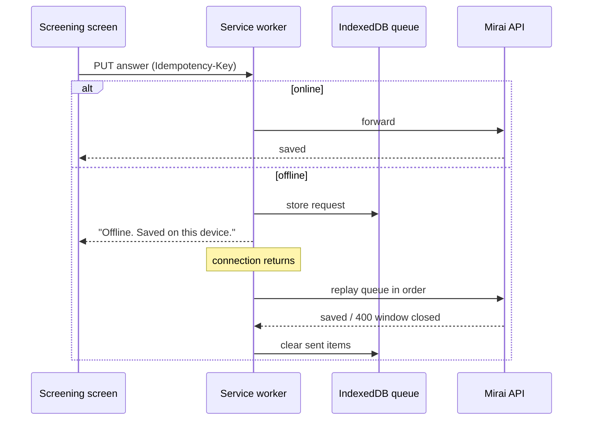

# Frontend

<p class="mi-lead">One Next.js Progressive Web App serves every role. It is mobile-first for teachers and parents, desktop-first for administrators, installable from a browser link and resilient to dropped connections.</p>

## Why a PWA

| Need from research | How the PWA meets it |
| --- | --- |
| Teachers on entry-level phones with full storage | No app store install; the shell is cached, data lives on the server |
| Teachers switch mobile data off in class | Service-worker queue stores answers and replays them later |
| 81% of surveyed parents prefer a browser link | Parents open an invitation link and use the same app |
| One small team | One codebase for four roles, mobile and desktop layouts |

## Stack

| Concern | Choice |
| --- | --- |
| Framework | Next.js (React, TypeScript) |
| Installability | Web app manifest + service worker (Workbox) |
| Offline queue | IndexedDB + background sync, with idempotency keys |
| Styling | Design tokens from the [Style Guide](style-guide.md); Quicksand typeface |
| Data fetching | Typed API client generated from the backend OpenAPI |
| Testing | Unit tests for components; Playwright or Cypress for journeys |

## Navigation by role

=== "Teacher (mobile)"

    Bottom navigation: **Home · Students · Cases · To Do · Account**

    | Screen | Purpose |
    | --- | --- |
    | Home | Greeting, counts (students, open cases, active IEPs, unapproved IEPs), *Needs your attention*, latest actions |
    | Students | Class list with search, filters (All, Needs my action, Active IEP) and status chips; **+ Add student** |
    | Student journey | Case started, teacher screening, parent screening, plan made and approved, six-week check |
    | Screening | One question per screen with progress; autosave |
    | IEP | Draft banner, plan, short-term goals, approval status, Approve / Regenerate |
    | Six-week check | Locked until the unlock date; then -2 to 2 per question |
    | To Do | IEPs to review, evaluations and cases to start, parents to re-invite |
    | Account | Profile, change password, sign out |

=== "Parent (mobile)"

    | Screen | Purpose |
    | --- | --- |
    | Invitation | "You're invited", accept and set a password |
    | Screening | Same flow as the teacher, non-clinical wording |
    | Report | Domain bands in plain language, disclaimer, recommendations |
    | Plan | Approved IEP (read-only) and home activities |
    | Professionals | Directory filtered by specialty and location, with a cost-transparency note |
    | Six-week check | Same scale as the teacher |

=== "School administrator (desktop)"

    Sidebar: **Dashboard · Teachers · Cases · Audit Log · School Profile · Logout**

    | Screen | Purpose |
    | --- | --- |
    | Dashboard | Active cases, teachers, six-week checks due; students on IEP by grade; IEP approval time |
    | Teachers | Search, status filter, *Review plan* for pending approvals, **Add a teacher**, revoke access |
    | Cases | Student, teacher, where the case is (status) |
    | Audit Log | When, who, what happened, about; filters by action, person and period |
    | School Profile | Classes, teachers, students, parents, active cases; school and class details |

=== "System administrator (desktop)"

    Sidebar: **Dashboard · Schools · Professionals**

    | Screen | Purpose |
    | --- | --- |
    | Dashboard | Students screened, schools onboarded, experts onboarded; AI output quality; screening stats |
    | Schools | List, onboard a school with its first administrator |
    | Professionals | Add, edit and deactivate directory entries |

## Offline behaviour



Rules:

- The queue holds **only** screening and evaluation answers, never identity fields.
- Replays are in order and idempotent; the server ignores duplicates.
- A queued answer that arrives after the 7-day window is rejected and the user is told.
- The queue and cached API responses are cleared on sign-out and on session expiry, to protect shared school devices.

## Suggested project structure

```text
mirai-frontend/
├── app/
│   ├── (auth)/              # sign-in, first sign-in, verify, invitation
│   ├── teacher/             # home, students, cases, todo, account
│   ├── parent/              # screening, report, plan, professionals
│   ├── school-admin/        # dashboard, teachers, cases, audit-log, profile
│   └── system-admin/        # dashboard, schools, professionals
├── components/              # buttons, cards, chips, question card, scale
├── lib/
│   ├── api/                 # generated client + auth refresh
│   ├── offline/             # queue, idempotency keys
│   └── copy/                # teacher and parent wording sets
├── public/
│   ├── manifest.webmanifest
│   └── icons/
└── service-worker.ts
```

<span class="mi-verify">confirm against repo</span>

## Configuration

| Variable | Purpose |
| --- | --- |
| `NEXT_PUBLIC_API_URL` | Base URL of the Mirai API, for example `http://localhost:8000/api/v1` |
| `NEXT_PUBLIC_RECAPTCHA_SITE_KEY` | reCAPTCHA v3 site key |
| `NEXT_PUBLIC_AFFILIATION_LABEL` | Optional institutional or regulatory affiliation marker shown on sign-in and parent screens |

## Content rules

These are product requirements, not style suggestions.

- **Every result screen carries the disclaimer:** *"Mirai is a screening tool. It never gives a diagnosis."*
- **AI drafts are labelled:** *"This is a draft made by AI. Read it with care. It is not a diagnosis."*
- **Parent wording is non-clinical and non-deficit.** No condition names as labels for the child.
- **Cost is never presented as resolved** after the referral export.
- **Flagged status is never visible** in lists, search or badges to anyone outside the child's teacher, parent and school administrator.
- **Language:** English for the first release; Kiswahili is planned for a later release.

## Accessibility

- Minimum 44 × 44 px touch targets; the primary action sits at the bottom of the screen on mobile.
- Text contrast meets WCAG AA against the cream background; never rely on colour alone (levels always have a text label).
- Form errors appear in a dedicated error area next to the field, in plain words ("Email or password is not correct.").
- All images and icons have text alternatives; focus is visible on every control.

## In this section

- [Screens](screens.md): the hi-fi screens for each role
- [Style Guide](style-guide.md): colours, typography, iconography, buttons and voice
