# Screens

The hi-fi prototype screens designed by Team Prism. Click any screen to enlarge it. Names and numbers in the screens are synthetic.

## Device mockups

<figure markdown>

<figcaption>Teacher home, desktop layout</figcaption>
</figure>
<figure markdown>

<figcaption>System administrator dashboard</figcaption>
</figure>
<figure markdown>

<figcaption>Teacher sign-in and parent invitation</figcaption>
</figure>
<figure markdown>

<figcaption>Parent screening question</figcaption>
</figure>

## Teacher (mobile)

<figure markdown>
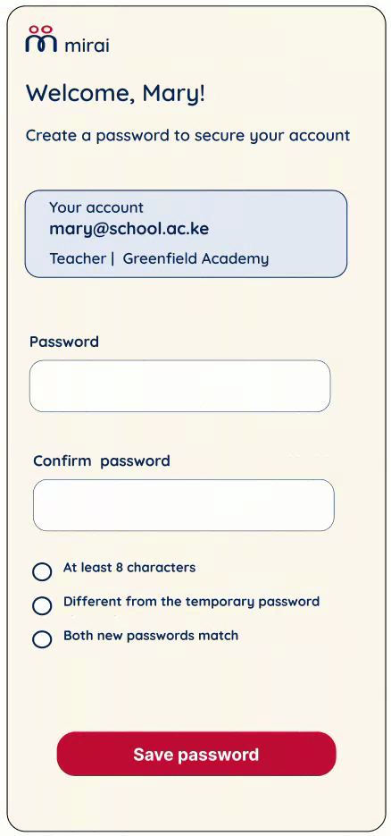
<figcaption>First sign-in</figcaption>
</figure>
<figure markdown>
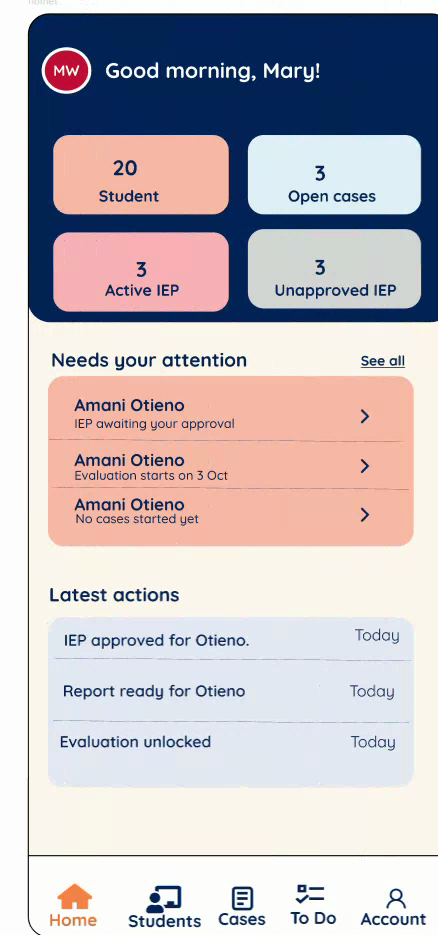
<figcaption>Home</figcaption>
</figure>
<figure markdown>
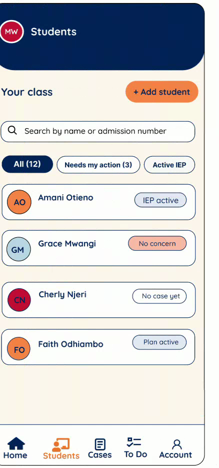
<figcaption>Students</figcaption>
</figure>
<figure markdown>
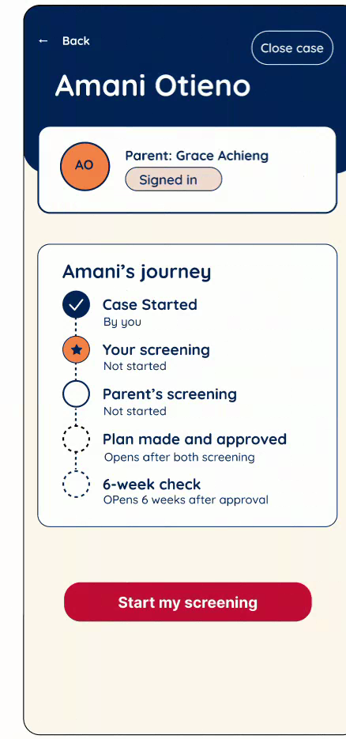
<figcaption>Student journey</figcaption>
</figure>
<figure markdown>
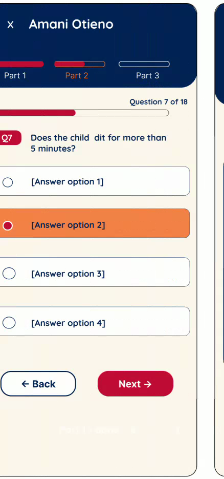
<figcaption>Screening question</figcaption>
</figure>
<figure markdown>
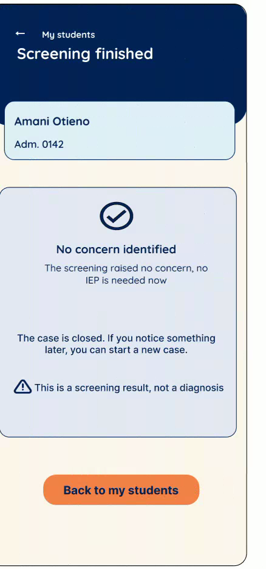
<figcaption>No concern identified</figcaption>
</figure>
<figure markdown>
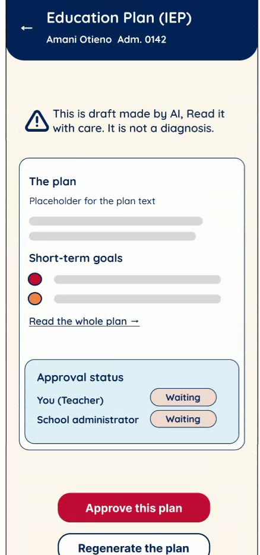
<figcaption>IEP review and approval</figcaption>
</figure>
<figure markdown>
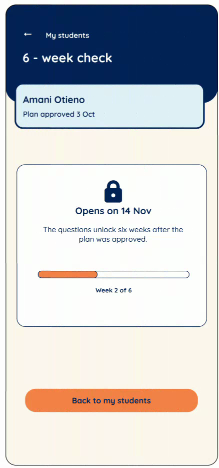
<figcaption>Six-week check, locked</figcaption>
</figure>
<figure markdown>
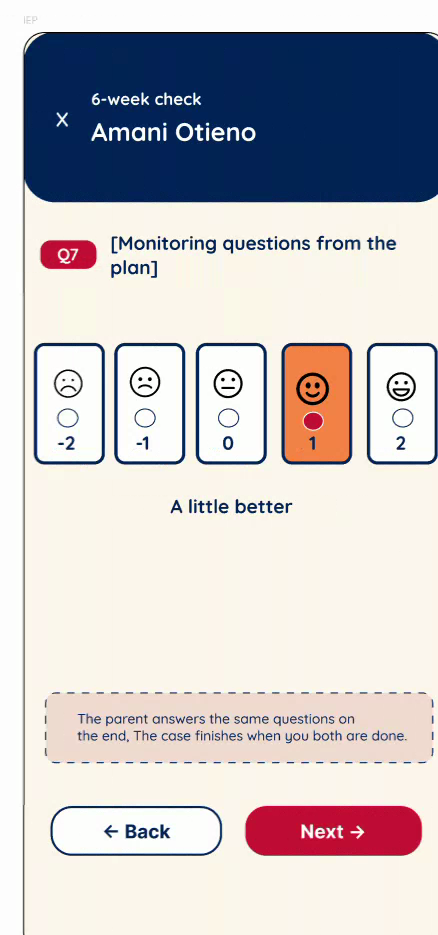
<figcaption>Six-week check, open</figcaption>
</figure>
<figure markdown>
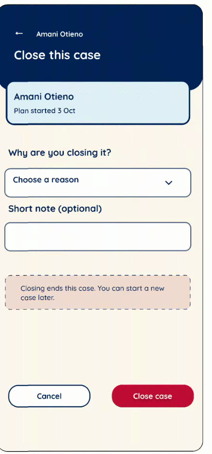
<figcaption>Close a case early</figcaption>
</figure>
<figure markdown>
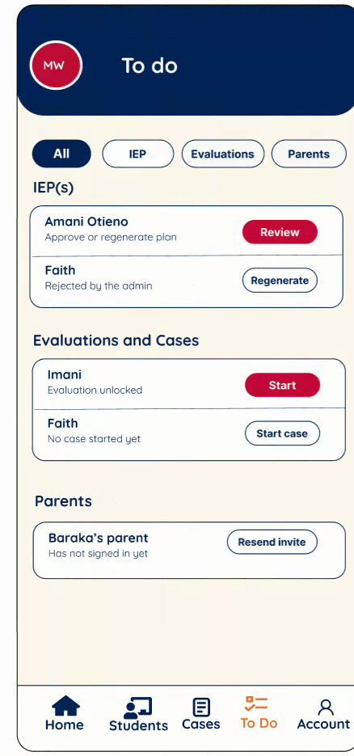
<figcaption>To do</figcaption>
</figure>
<figure markdown>
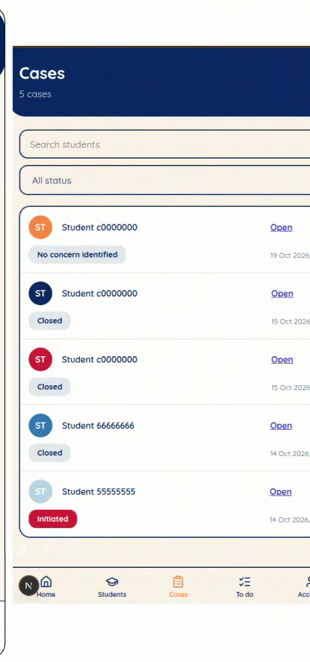
<figcaption>Cases</figcaption>
</figure>
<figure markdown>
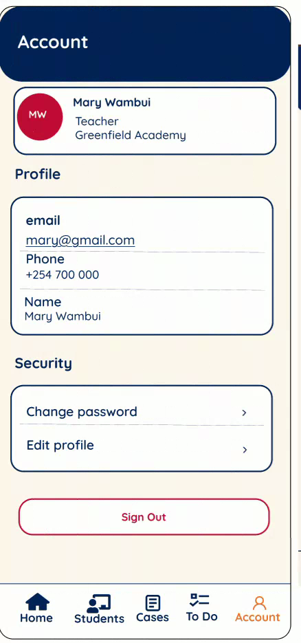
<figcaption>Account</figcaption>
</figure>

## School administrator (desktop)

<figure markdown>
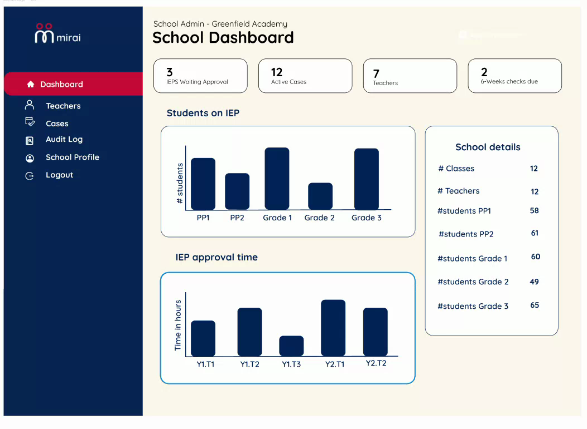
<figcaption>School dashboard</figcaption>
</figure>
<figure markdown>
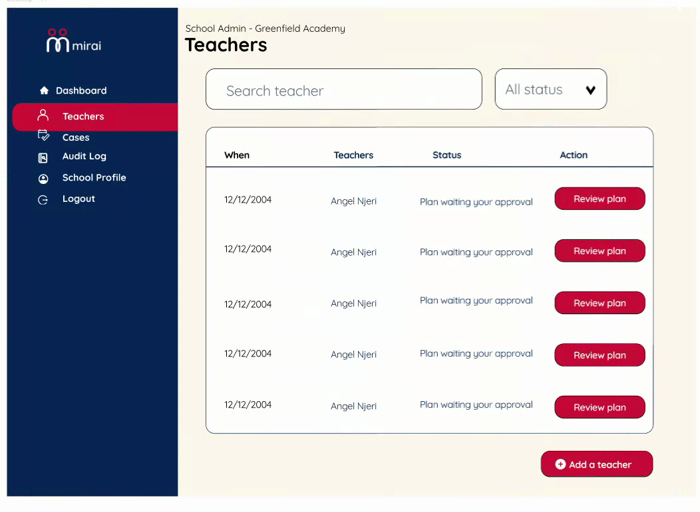
<figcaption>Teachers and pending approvals</figcaption>
</figure>
<figure markdown>
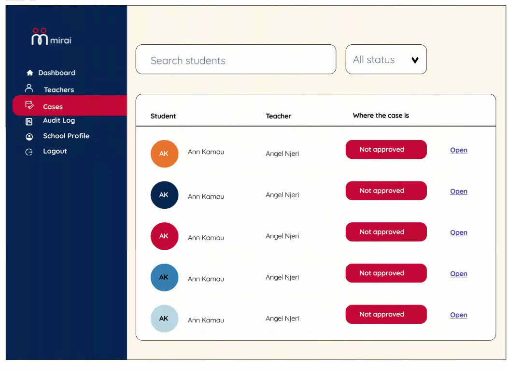
<figcaption>Cases</figcaption>
</figure>
<figure markdown>
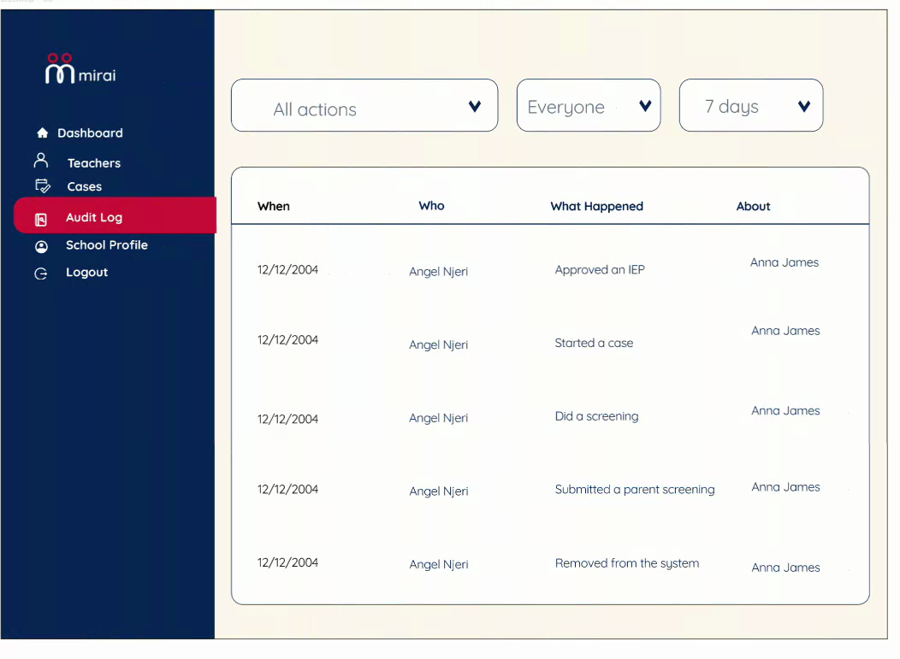
<figcaption>Audit log</figcaption>
</figure>
<figure markdown>
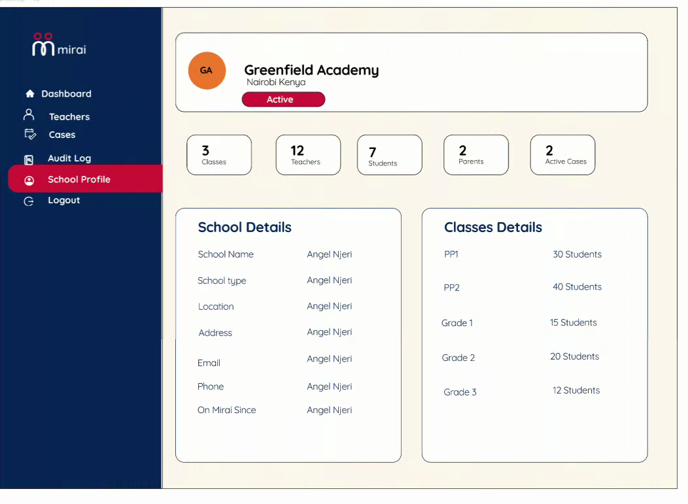
<figcaption>School profile</figcaption>
</figure>

## Screen notes

| Screen | Behaviour worth knowing |
| --- | --- |
| Sign-in | Teachers cannot sign themselves up. The screen says to ask the school administrator for an account. |
| First sign-in | Password rules shown live: at least 8 characters, different from the temporary password, both entries match. |
| Add a student | Age comes from the date of birth; Mirai is for ages 4 to 9. Duplicate admission numbers in the same school are rejected. |
| Student journey | The plan unlocks only when both screenings are done. |
| Screening | Answers save as you go, even if the network drops. |
| IEP | Approving opens a confirmation ("Approve the plan for Cheryl Njeri?"). The plan starts when both teacher and school administrator approve. |
| Six-week check | The parent answers the same questions separately. The case finishes when both are done. |
| Close a case | Closing ends the case; a new case can be started later. |
| Audit log | Shows actions and records, never children's answers. |
