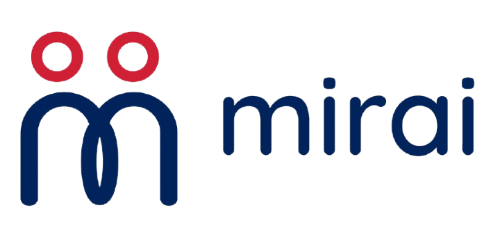
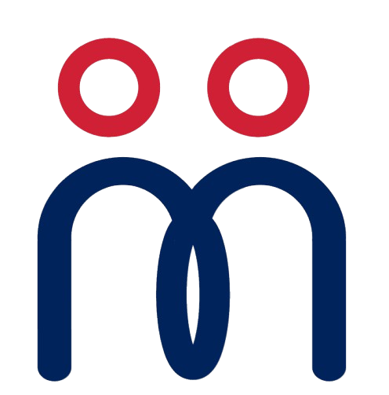
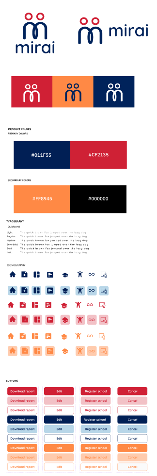

# Style Guide

<p class="mi-lead">Mirai's visual language is warm, calm and trustworthy: deep navy for confidence, red and orange for warmth and action, a soft cream canvas, and the rounded Quicksand typeface.</p>

## Logo

<div class="mi-grid mi-grid--2" markdown>

<div class="mi-card" markdown>
{ width="500"}

**Horizontal lock-up.** Use in headers, documents and the web app sidebar.
</div>

<div class="mi-card" markdown>
<div style="display:flex;gap:1.2rem;align-items:center;flex-wrap:wrap" markdown>
{ width="180" }


<span style="background:#011F55;border-radius:14px;padding:12px;display:inline-block" markdown>{ width="150" }</span>
</div>

**The mark.** Two figures standing side by side, drawn as one continuous line that forms the *m*. Use alone for app icons and favicons.
</div>

</div>

| Do | Don't |
| --- | --- |
| Use navy body with red heads on light backgrounds | Recolour the heads to navy or the body to red |
| Use the white body with orange heads on navy | Place the navy logo on navy or busy photos |
| Keep clear space of at least one head-height around the logo | Stretch, rotate, outline or add shadows |

The SVG files in `docs/assets/brand/` are vector redraws of the style-guide logo for this site. Use the design team's master files for print.

## Colour

### Brand colours

<div class="mi-swatches" markdown>
<div class="mi-swatch"><div class="mi-swatch__chip" style="background:#011F55">Navy</div><div class="mi-swatch__meta"><strong>#011F55</strong>Primary · headers, sidebars, primary text on light</div></div>
<div class="mi-swatch"><div class="mi-swatch__chip" style="background:#CF2135">Red</div><div class="mi-swatch__meta"><strong>#CF2135</strong>Primary · main actions, active navigation, the logo heads</div></div>
<div class="mi-swatch"><div class="mi-swatch__chip" style="background:#FF8945">Orange</div><div class="mi-swatch__meta"><strong>#FF8945</strong>Secondary · highlights, progress, secondary actions</div></div>
<div class="mi-swatch"><div class="mi-swatch__chip" style="background:#000000">Black</div><div class="mi-swatch__meta"><strong>#000000</strong>Secondary · reserved for small print and icons on light</div></div>
</div>

### UI support colours

These tints appear across the hi-fi screens (cards, chips, banners). Values below are the tokens used on this site to match them. <span class="mi-verify">confirm with design</span>

<div class="mi-swatches" markdown>
<div class="mi-swatch"><div class="mi-swatch__chip" style="background:#FDF6EE;color:#011F55">Cream</div><div class="mi-swatch__meta"><strong>#FDF6EE</strong>App canvas behind cards</div></div>
<div class="mi-swatch"><div class="mi-swatch__chip" style="background:#F8C3B0;color:#011F55">Peach</div><div class="mi-swatch__meta"><strong>#F8C3B0</strong>"Needs your attention" and count cards</div></div>
<div class="mi-swatch"><div class="mi-swatch__chip" style="background:#DBE7F7;color:#011F55">Sky</div><div class="mi-swatch__meta"><strong>#DBE7F7</strong>Latest actions, info cards, selected rows</div></div>
<div class="mi-swatch"><div class="mi-swatch__chip" style="background:#F9D9DC;color:#CF2135">Red tint</div><div class="mi-swatch__meta"><strong>#F9D9DC</strong>Soft buttons, warnings, Elevated chip</div></div>
<div class="mi-swatch"><div class="mi-swatch__chip" style="background:#FFE3D2;color:#A24713">Orange tint</div><div class="mi-swatch__meta"><strong>#FFE3D2</strong>Notice boxes, Medium chip</div></div>
</div>

### Status colours

| Meaning | Chip | Rule |
| --- | --- | --- |
| Low | <span class="mi-badge mi-badge--low">Low</span> | Calm green tint; never celebratory |
| Medium | <span class="mi-badge mi-badge--medium">Medium</span> | Orange tint |
| Elevated | <span class="mi-badge mi-badge--elevated">Elevated</span> | Red tint; always paired with "not a diagnosis" |
| Neutral info | <span class="mi-badge mi-badge--navy">Plan active</span> | Sky tint |

Never use colour alone: every chip carries a word.

## Typography

**Quicksand** is Mirai's only typeface. Its rounded terminals keep the product friendly for parents while staying clear on small screens.

<div class="mi-type">
<div><span>Light 300</span><span style="font-weight:300">The quick brown fox jumped over the lazy dog</span></div>
<div><span>Regular 400</span><span style="font-weight:400">The quick brown fox jumped over the lazy dog</span></div>
<div><span>Medium 500</span><span style="font-weight:500">The quick brown fox jumped over the lazy dog</span></div>
<div><span>Semi-bold 600</span><span style="font-weight:600">The quick brown fox jumped over the lazy dog</span></div>
<div><span>Bold 700</span><span style="font-weight:700">The quick brown fox jumped over the lazy dog</span></div>
</div>

| Use | Weight | Mobile size | Desktop size |
| --- | --- | --- | --- |
| Screen title ("Good morning, Mary!") | Bold | 24 px | 28 px |
| Section heading ("Needs your attention") | Semi-bold | 18 px | 20 px |
| Question text | Semi-bold | 18 px | 20 px |
| Body | Regular / Medium | 16 px | 16 px |
| Labels, chips, captions | Semi-bold | 12 to 14 px | 12 to 14 px |

<span class="mi-verify">sizes to confirm with design</span>

## Iconography

Rounded, filled icons in a single colour, shown plain or on a soft tinted tile. Icons come in navy, red and orange, each with a tinted-tile variant.

| Icon | Used for |
| --- | --- |
| :material-home: Home | Home tab |
| :material-file-document-plus: Add document | Create a case or plan |
| :material-view-dashboard: Dashboard | Admin dashboards |
| :material-text-box: Document | Reports and IEPs |
| :material-school: Graduation cap | Schools and classes |
| :material-human-handsup: Person | Students and people |
| :material-infinity: Infinity | Neurodiversity, continuity of the record |
| :material-export: Export | Referral packet export |

## Buttons

Three styles, each in red, navy and orange: **solid** for the main action, **tint** for secondary actions, **outline** for tertiary actions and Cancel.

<div class="mi-card" markdown>
<span class="mi-btn mi-btn--red">Download report</span><span class="mi-btn mi-btn--red-soft">Edit</span><span class="mi-btn mi-btn--red-ghost">Cancel</span><br>
<span class="mi-btn mi-btn--navy">Register school</span><span class="mi-btn mi-btn--navy-soft">Edit</span><span class="mi-btn mi-btn--navy-ghost">Cancel</span><br>
<span class="mi-btn mi-btn--orange">Back to my students</span><span class="mi-btn mi-btn--orange-soft">Edit</span><span class="mi-btn mi-btn--orange-ghost">Cancel</span>
</div>

| Rule | Detail |
| --- | --- |
| Shape | Fully rounded pill |
| One primary per screen | The red solid button is the one thing to do next ("Save password", "Approve this plan", "Next") |
| Placement on mobile | Primary action at the bottom; Back on the left, Next on the right |
| Destructive actions | Use a confirmation pop-up ("Close case", "Approve the plan for ...?") |

## Components

| Component | Description |
| --- | --- |
| Count card | Rounded tile with a large number and a label (Students, Open cases, Active IEP, Unapproved IEP) |
| Attention list | Peach panel listing children who need action, each row with a chevron |
| Question card | Navy header with child name and progress bar; one question; answer options as full-width rows |
| Rating scale | Five face tiles from -2 to 2 with the selected tile in orange and a text label below ("A little better") |
| Notice box | Dashed orange-tint box for guidance ("Closing ends this case. You can start a new case later.") |
| Status chip | Small rounded label for case state (No concern identified, Closed, Initiated, Plan active) |
| Disclaimer line | Warning icon + "Mirai is a screening tool. It never gives a diagnosis." on sign-in and result screens |
| Circle motif | Red filled and orange outlined circles decorating navy headers |

## Voice and tone

| Principle | Example |
| --- | --- |
| Warm and plain | "Good morning, Mary!" not "Welcome, User" |
| Observations, not labels | "Your answers show some signs worth a closer look in reading" not "Your child may have dyslexia" |
| Say what happens next | "The plan unlocks when your screening and the parent's are done." |
| Reassure without overpromising | "This is a screening result, not a diagnosis." |
| Honest about cost | "Some next steps outside school may have a cost." |
| Short sentences | One idea per sentence; no jargon in parent screens |

## Design tokens

```css
:root {
  /* brand */
  --mirai-navy: #011f55;
  --mirai-red: #cf2135;
  --mirai-orange: #ff8945;
  --mirai-black: #000000;

  /* ui support */
  --mirai-cream: #fdf6ee;
  --mirai-peach: #f8c3b0;
  --mirai-sky: #dbe7f7;
  --mirai-red-tint: #f9d9dc;
  --mirai-orange-tint: #ffe3d2;

  /* type */
  --mirai-font: "Quicksand", system-ui, sans-serif;

  /* shape */
  --mirai-radius-card: 14px;
  --mirai-radius-pill: 999px;
}
```

## Original style guide

{ .zoomable .mi-w-sm }
