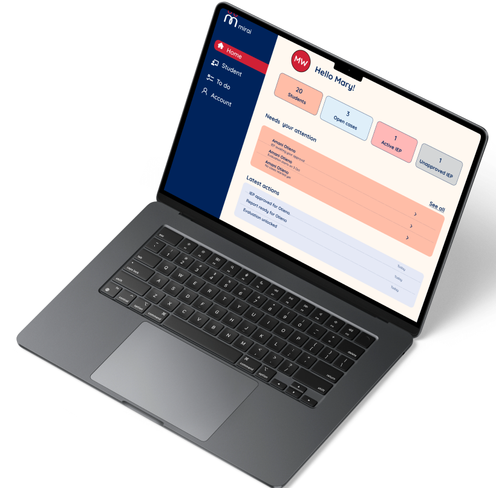
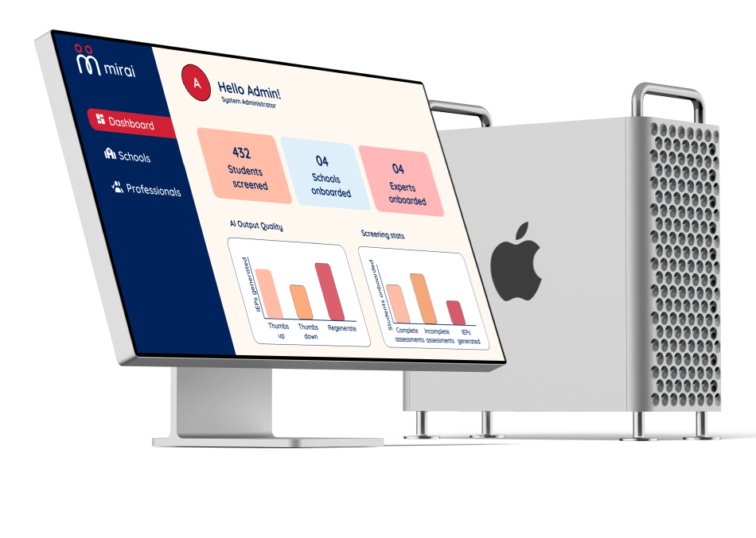
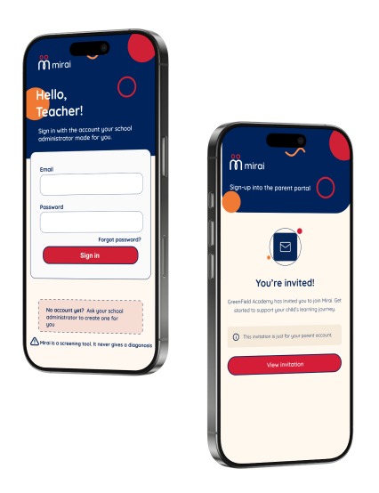
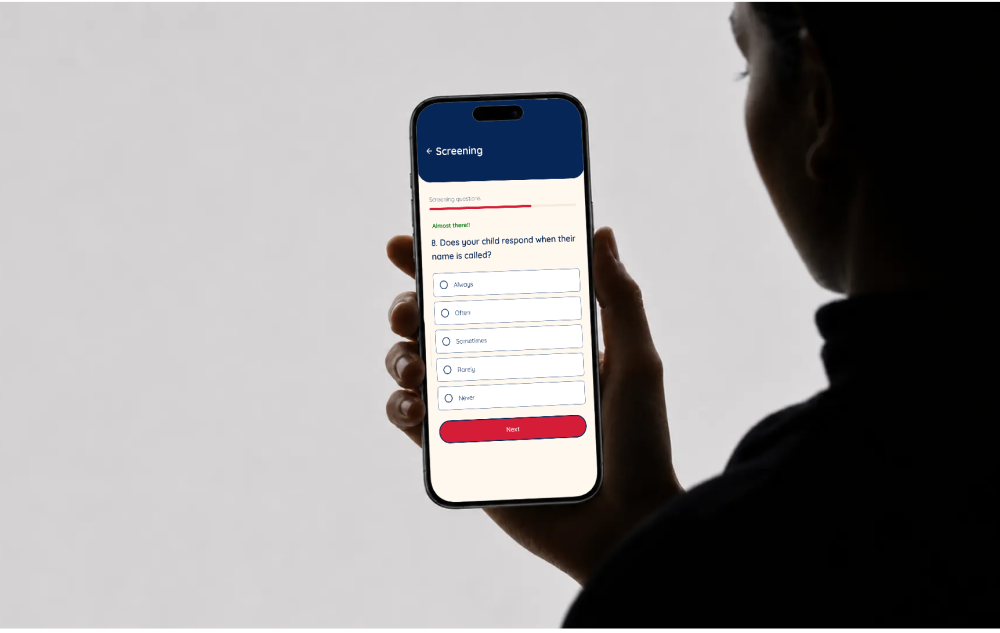
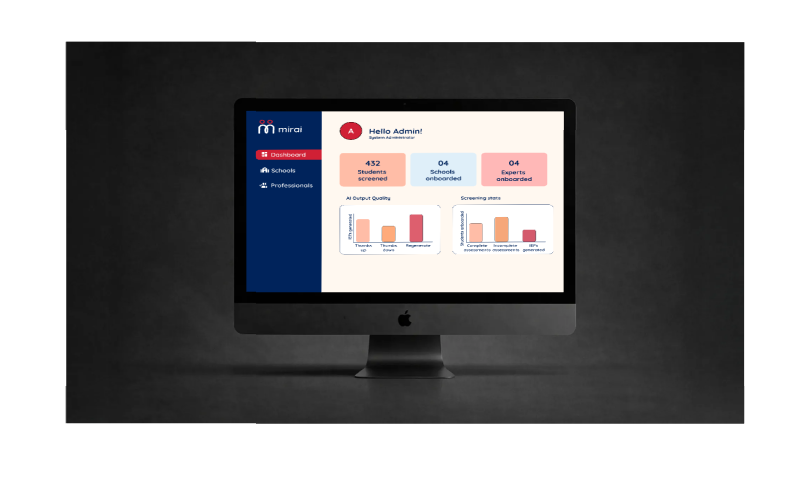

{ .mi-hero__logo }

<h1>Notice early. Support sooner.</h1>

:material-shield-check-outline: A screening support tool. It never gives a diagnosis.

Mirai is a mobile-first Progressive Web App that turns what Grade&nbsp;1 to Grade&nbsp;3 teachers and parents already notice into a structured, non-diagnostic record, so a child can reach support while intervention still works best.

[Start here](start-here/index.md){ .md-button .md-button--primary }
[See the architecture](architecture/index.md){ .md-button }

<strong>34.9 months</strong>average gap in Kenya between a caregiver's first concern and a formal diagnosis

<strong>~100,000</strong>Nairobi children estimated to be living with a neurodevelopmental difference, most in private schools

<strong>3 domains</strong>Autism, ADHD and Dyslexia, scored independently so one concern is never diluted by another

<strong>0 diagnoses</strong>Mirai documents and triangulates observations. Clinical labels are out of scope by design

<h2 class="mi-home-h">How a case moves through Mirai</h2>

Every case starts with something a teacher noticed in class. Mirai gives that observation a structure, a second perspective and a next step.

#### Notice

A whitelisted teacher registers the child and opens a case. The child's age selects the screening instruments.

#### Screen

Teacher and parent each answer the same age-gated questions, one at a time, inside a 7-day window.

#### Score

A deterministic engine scores Autism, ADHD and Dyslexia from 0.00 to 3.00. No AI touches the numbers.

#### Support

An Elevated result unlocks an AI-drafted, KICD-grounded IEP that the teacher and school administrator must both approve.

#### Follow up

Six weeks after approval, teacher and parent rate progress on the plan's goals and the record carries forward.

<h2 class="mi-home-h">One platform, four roles</h2>

<figure markdown>

<figcaption>Parents answer from their own phone, in plain non-clinical language</figcaption>
</figure>
<figure markdown>

<figcaption>Teachers see who needs attention, open cases and review IEP drafts</figcaption>
</figure>
<figure markdown>

<figcaption>Administrators onboard schools and watch aggregate, non-identifying metrics</figcaption>
</figure>

<h2 class="mi-home-h">What Mirai does</h2>

:material-account-child-outline:
### Age-gated intake
Ages 4 to 5 route to CAST and the ADHD Rating Scale IV Preschool Version. Ages 6 to 9 route to CAST, SNAP-IV and the CLDQ-R Dyslexia Subscale.

:material-account-multiple-check-outline:
### Two perspectives per case
One teacher screening and one parent screening per case, driven by a finite state machine so question order is fixed and auditable.

:material-calculator-variant-outline:
### Deterministic scoring
Fixed, published formulas produce Low, Medium or Elevated per domain. A case escalates if any single domain is Elevated.

:material-file-document-edit-outline:
### Curriculum-grounded IEPs
Gemini with a File Search Store drafts an editable plan from KICD inclusive education guidelines. Humans approve before it is used.

:material-home-heart:
### Home activities and referral help
Parents get domain-matched home activities, a report they control, and a directory of psychologists and psychiatrists they may choose to contact.

:material-shield-lock-outline:
### Privacy by design
Strict role-based access, tenant isolation per school, staff MFA, field-level encryption and an append-only audit log aligned to the Kenya Data Protection Act, 2019.

:material-hand-heart-outline:

**Mirai never labels a child.** It structures what adults already observe, keeps a flagged child's status visible only to the people who must act on it, and leaves every referral decision with the family.

<h2 class="mi-home-h">Find your way</h2>

:material-compass-outline:
### [Start Here](start-here/index.md)
What Mirai is, the problem it solves, who it serves and the impact it aims for.

:material-sitemap-outline:
### [Architecture](architecture/index.md)
System layers, data flows, the case lifecycle and the data model.

:material-function-variant:
### [Scoring Engine](backend/scoring-engine.md)
Age gating, the intake state machine, the domain formula and discrepancy handling.

:material-security:
### [Security](security/index.md)
Access control, privacy, compliance and the threat model.

