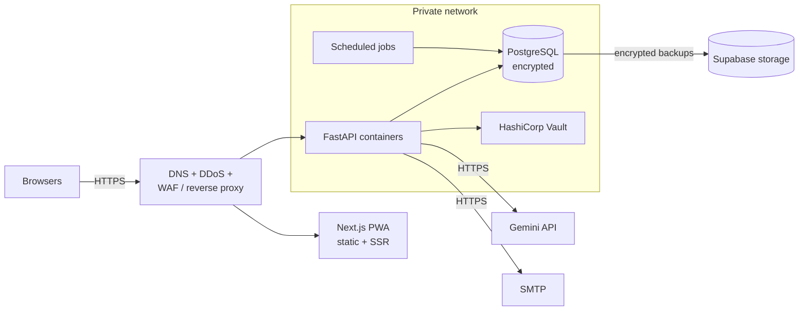
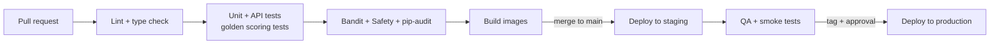

# Platform

How Mirai is hosted, deployed, configured and kept recoverable, within a cost envelope set by a low annual per-school subscription.

!!! warning "Target platform"

    This page describes the platform Mirai is designed to run on. Hosting is not chosen yet ([Q-10](../reference/decision-log.md#open-questions)). What exists today, with the exact commands and settings, is on [Deployment](deployment.md); items marked *Planned* are listed on [Implementation Status](../reference/implementation-status.md#planned).

## Environments

| Environment | Purpose | Data | Notes |
| --- | --- | --- | --- |
| **Local** | Day-to-day development | Synthetic only | Docker PostgreSQL or a local install; Gemini mocked by default |
| **CI** | Automated tests and scans on every push and pull request | Synthetic only | No secrets beyond test keys |
| **Staging** | Release candidates, QA, penetration tests | Synthetic or anonymised | Mirrors production configuration |
| **Production** | Schools and families | Real | Separate containers and network from staging and development |

Production and staging never share databases, buckets, keys or networks.

## Topology

| Component | Hosting |
| --- | --- |
| PWA | Static and server-rendered Next.js behind the edge |
| API and jobs | Containerised FastAPI in an isolated private network (VPC) |
| Database | Managed PostgreSQL with encryption at rest |
| Backups | *Planned:* Supabase storage, encrypted, restricted access |
| Secrets | *Planned:* HashiCorp Vault. Today: environment variables |
| Provider and region | Not chosen yet ([Q-10](../reference/decision-log.md#open-questions)). The security requirements ask for hosting within the East Africa geographic boundary, and any cross-border processing (including AI endpoints) must be reviewed against the Kenya Data Protection Act transfer conditions.

## CI/CD

*Today:* the backend README describes three GitHub Actions workflows: `pr-checks.yml` (PR requirements, lint and format), `ci.yml` (pytest and coverage) and `deploy.yml` (on push to `main`: re-run CI, deploy to Heroku, check `/health`). The workflow files were not in the copy reviewed for these docs. The pipeline below, with security scans and staging, is the *planned* target.

| Gate | Rule |
| --- | --- |
| Tests | All unit, API and scoring golden tests pass |
| SAST | Bandit on every pull request; high-severity findings block the merge; `debug=True` in production config blocks the merge |
| Dependencies | pip-audit and Safety; any CVE with CVSS above 7.0 fails the build |
| Code review | At least one reviewer; database code must use the ORM, no string-built SQL |
| Migrations | Alembic migrations run before the new API version receives traffic |
| Production release | Tagged release, product-owner sign-off, QA exit criteria met |

### This documentation site

The docs live in this repository and are built by `.github/workflows/docs.yml`:

- On every push to `main` and on pull requests: `mkdocs build --strict`.
- On `main`: the built site is published to GitHub Pages at `https://akirachix.github.io/prism-technical-documentation/`.

One-time setup: in the repository's **Settings → Pages**, set **Source** to **GitHub Actions**.

## Secrets and configuration

- *Today:* secrets are environment variables (see [Deployment](deployment.md#api-settings-for-production)). *Planned:* all secrets live in **HashiCorp Vault** and are injected at container start.
- Nothing secret is committed.
- *Planned:* field-encryption keys are versioned (`key_version`) so they can be rotated without re-encrypting everything at once.
- *Planned:* production disables Swagger / ReDoc. Today `/docs` and `/redoc` are served in every environment (`main.py`).

## Backups and recovery

*Planned.* No backup job exists yet.

| Rule | Value |
| --- | --- |
| Frequency | Automated daily database backups |
| Encryption | Encrypted at rest |
| Location | Supabase storage, separate from the primary database |
| Retention | Rolling, expiring after 30 days (requirements allow up to 35) |
| Access | Named platform administrators only; every access logged |
| Testing | Quarterly restore drill into an isolated environment |
| Alignment | Backup expiry must not keep data longer than the [retention schedule](../security/privacy-compliance.md#data-retention) allows |

## Monitoring and logging

*Planned.* Today the API logs to standard output (`logging.basicConfig` in `main.py`) and exposes `GET /health`.

| Signal | What is watched |
| --- | --- |
| Health | API uptime, latency and error rates per endpoint |
| Jobs | Intake-window closer, evaluation unlocker and cleanup job runs |
| AI | Generation latency, failures, regeneration rate |
| Security | Failed logins, lockouts, `403`/`404` spikes, rate-limit hits |
| Integrity | Scoring runs complete and golden checks pass after each deploy |

Application logs carry request ids and user UUIDs, never names, dates of birth or answers. System administrators can monitor health and scoring integrity without seeing any child's content.

## Cost and scaling

The business model (KSh 15,000 to 30,000 per school per year, break-even around 100 to 150 schools) means infrastructure cost must grow **linearly** with schools onboarded.

| Choice | Effect on cost |
| --- | --- |
| One shared-schema PostgreSQL for all schools | No per-tenant database overhead |
| Managed File Search instead of a vector database | No retrieval infrastructure to run |
| AI only on Elevated cases | Model spend scales with flagged cases, not with all screenings |
| Deterministic scoring in-process | No compute beyond normal API requests |
| PWA, no native apps | No app store fees or second codebase |
