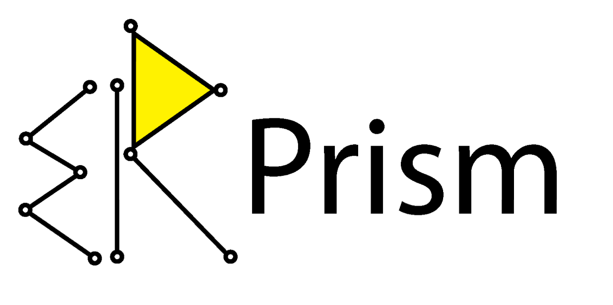

# Team Prism

{ .mi-w-sm }

Team Prism built Mirai as its final project in the **AkiraChix codeHive 2026** cohort.

{ .mi-w-sm }

**Mirai** is the product. Team Prism is the team.

## Members

| Name | codeHive ID |
| --- | --- |
| Stacey Nduta | 2026011 |
| Andy Laique | 2026021 |
| Stacy Cherenge | 2026026 |
| Mary Macharia | 2026057 |
| Phillipine Giramata | 2026066 |

## Supervisors

| Name | Supervised |
| --- | --- |
| Caroline Mutua | Product Requirements Document |
| James Mwai | Technical Requirements and Data Models |

## Workstreams

| Workstream | Deliverables |
| --- | --- |
| UX Research | Field research plan, interview guide, transcripts and analysis, literature review, research report |
| Product Management | PRD, foundation metrics, personas, feature prioritisation (MoSCoW, RICE), metrics, competitor analysis |
| Backend | Technical Requirements, data models, API |
| Security | Security and privacy requirements, AppSec, threat model, compliance notes |
| QA | Discovery and test strategy, test case workbooks |
| Presentation and Design | Style guide, wireframes, hi-fi prototypes, presentation deck |

Owners for each workstream are recorded in the team workspace. add owners
