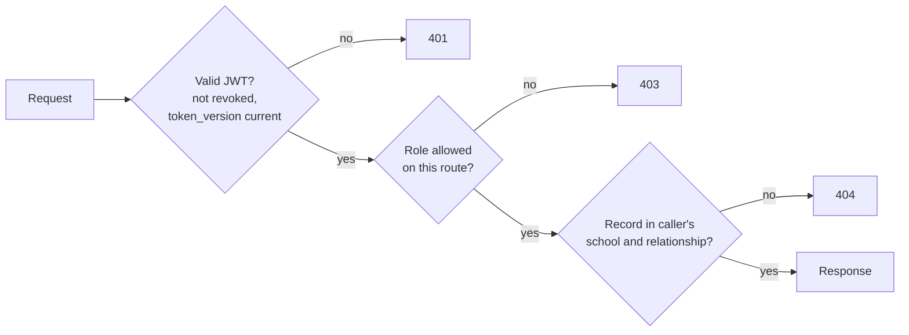

# Access Control

Four roles with non-overlapping privileges, every query scoped to a school, and a hard rule that a flagged child's status is visible only to the people who must act on it.

## The visibility rule

> No feature may make a flagged child's status visible to anyone other than the child's own **teacher**, the child's **parent**, the **school administrator** (for IEP approval and the student report) and, after the parent exports, the **receiving clinical body**.

This is a **hard access-control requirement, not a configuration default**. It reflects the research finding that the participating school already supports children discreetly, without marking them as different.

## Role matrix

| Resource | Teacher | Parent | School admin | System admin |
| --- | --- | --- | --- | --- |
| Schools | Own (read) | | Own (read, update) | All (create, update, deactivate) |
| Teacher accounts | Self | | Create, view, revoke (own school) | Create first school admin |
| Parent accounts | Create, re-invite (for own students) | Self | View (own school) | |
| Students | Own class (create, read) | Own children (read) | Own school (read, list) | |
| Cases | Own class (open, read, close) | Own children (read status) | Own school (read status) | |
| Own screening answers | Write while window is open | Write while window is open | | |
| Other informant's answers | **No** | **No** | **No** | **No** |
| Domain scores | Status and levels | Through the report | Three scores, while an IEP awaits their approval | |
| Report | Open ([Q-06](../reference/decision-log.md#open-questions)) | Own child | Open ([Q-06](../reference/decision-log.md#open-questions)) | |
| IEP draft | Create, edit (initiating teacher), submit, approve, reject | | Approve, reject (own school) | |
| Approved IEP | Read | Read | Read | |
| Referral packet export | **No** | **Own child only** | **No** | **No** |
| Home activities and professionals | Read | Read | | Manage directory and templates |
| Evaluation | Answer | Answer | | |
| Longitudinal record | Any currently whitelisted teacher at the school | Own child | | |
| Audit log | | | Own school | All |
| Platform metrics | | | School aggregates | Platform aggregates |
| Question bank, interpretations, templates | | | | Manage |

!!! note "Report visibility: open point"

    The data model says only the parent can open the report. The Technical Requirements and the QA strategy say the school administrator can view reports of students in their own school. Until resolved, implement the stricter rule (parent only) and track it in the [Decision Log](../reference/decision-log.md). Today the report route has no access check at all; see [Security gaps](../reference/implementation-status.md#security-gaps).

## How it is enforced

| Layer | Mechanism |
| --- | --- |
| Route | `get_current_user` or `require_roles(...)` dependency (`dependencies.py`). **45 routes have none yet** ([Security gaps](../reference/implementation-status.md#security-gaps)) |
| Tenant | Services compare the record's school with the signed-in user's school (`user.school_id`, loaded from the database; the token carries no school) |
| Relationship | Parents: `student.parent_id` must match (`services/case.py`, `_parent_owns`). Teachers: checked in the student and AI services |
| Projection | *Planned:* separate response models per role |
| Database | Partial unique index for one unfinished case; audit rows cannot be changed through the application; check constraint tying `SYSTEM_ADMIN` to a null school and every other role to a school (`models/user.py`) |
| IDs | Random UUIDs in paths. *Planned:* out-of-scope records return `404` (today some return `403`) |

## Tenant isolation

- One shared schema; `school_id` on `user`, `student` and `case`.
- Every other record is reached **through the student**, so a correct student filter scopes everything below it.
- Cross-school checks are covered in some suites (`tests/test_users.py`, `tests/test_student.py`, `tests/test_audit_log.py`). A test that every endpoint refuses another school's data (SEC-08) is *planned*.
- *Planned:* deactivating a school (`is_active = false`) blocks sign-in for all of its users.

## Anti-admission and anti-disciplinary firewall

| Control | Detail |
| --- | --- |
| No admissions or discipline features | Mirai has no workflow, export or report designed for admission, placement or discipline decisions |
| No automated actions | No score or flag triggers an administrative action; every downstream step needs a human, parent-consented decision |
| Transfer protection | A record is never visible during a school-transfer or admissions process unless the parent exports it |
| Admin limits | School administrators cannot open raw answers or download raw observation logs |
| Aggregates only | Institutional metrics cannot be de-aggregated to an individual child |

## Staff lifecycle

1. **Joiner:** the school administrator creates the teacher with a temporary password; first sign-in forces a new password and TOTP setup.
2. **Mover:** students are reassigned to another teacher; the record stays with the student.
3. **Leaver:** the school administrator revokes access. `is_active = false`, `token_version` is raised, all sessions end immediately. The roster is reassigned within 30 days; after that, the account's personal details are deleted and only the pseudonymous UUID remains in audit logs.
