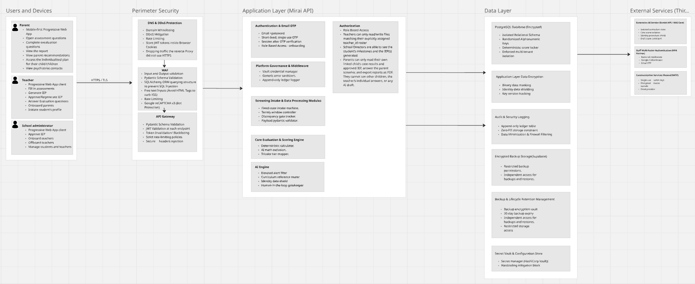

# Security

Mirai handles observations about young children, which Team Prism classifies as special-category data. Security is designed in at every layer, and the strongest controls protect against misuse by insiders as much as attacks from outside.

## Principles

#### Least privilege, enforced in code
Each role sees only what its job needs. Rules live in backend dependencies and response models, not in the UI.

#### Purpose limitation
Mirai data must never be used for admissions, discipline, grade repetition or exclusion: the anti-admission and anti-disciplinary firewall.

#### Determinism protects integrity
Scores are computed only on the server, by code with no AI dependency. Clients cannot submit or alter a score.

#### Nothing leaves without the parent
No automatic sharing with clinics, government or school systems. The referral packet leaves only when the parent exports it.

#### Data minimisation
Only the answers the active instruments need. No free-text journaling, audio, video or location tracking.

#### Everything is traceable
An append-only audit log records who did what to which record, without storing personal content.

## Layered controls

{ .zoomable }

| Layer | Controls |
| --- | --- |
| **Perimeter** | *Planned:* domain whitelisting, DDoS mitigation, plain-HTTP traffic dropped, reCAPTCHA v3. *Today:* rate limits on sign-in, MFA, refresh, reset and parent invitations (`routers/auth.py`, `routers/student.py`) |
| **Validation** | Pydantic schemas with unknown fields rejected on sign-in; SQLAlchemy ORM (no string-built SQL) |
| **API** | JWT validation on routes that declare it (**45 routes do not yet**, see [Security gaps](../reference/implementation-status.md#security-gaps)); token revocation and `token_version`; secure headers on every response, CSP and HSTS in production (`main.py`) |
| **Application** | Email + password, TOTP for every role, role guards (`dependencies.py`), parent-to-child ownership checks in services. *Planned:* secrets from Vault |
| **Data** | PostgreSQL, random UUID keys, TOTP secrets encrypted, audit rows cannot be changed through the application. *Planned:* field encryption with key versioning, encrypted backups |
| **External** | Gemini File Search store holds curriculum only; AI output saved as a draft and rejected if it contains a personal name (`services/ai.py`); single-use email tokens |

## Authentication

| Control | Detail |
| --- | --- |
| Account creation | Top-down only; no public sign-up |
| Passwords | Argon2 (`argon2-cffi`, `core/security.py`); minimum 8 characters; must differ from the temporary password |
| Second factor | Authenticator-app TOTP for every role, enrolled at first sign-in and verified server-side (`services/auth.py`). *Planned:* reCAPTCHA v3 on sign-in |
| Parents | Same staged sign-in as staff, including TOTP; access limited to their own children (`services/case.py`, `_parent_owns`) |
| Replay protection | Each TOTP time-step accepted once (`last_totp_step`) |
| Lockout | 5 failures lock the account for 15 minutes |
| Resets | Single-use, short-lived tokens; staff credential resets go through administrators |

## Sessions

| Control | Detail |
| --- | --- |
| Token storage | Access and refresh tokens are kept in browser storage (`localStorage`, or `sessionStorage` when "remember me" is off) and sent as a bearer header (`prism-frontend/lib/session.ts`). *Planned:* `HttpOnly`, `Secure`, `SameSite=Strict` cookies |
| Lifetimes | Access token 15 minutes, refresh token 7 days, step token 10 minutes (`core/config.py`) |
| Idle and absolute timeouts | *Planned:* 15 minutes idle and 8 hours absolute for staff, 30 minutes idle for parents |
| Revocation | `revoked_token` table checked on every authenticated request; `token_version` raised on password change, reset or staff revocation |
| Shared devices | Session cleared from browser storage on sign-out |

## Encryption

| Data | Protection |
| --- | --- |
| In transit | TLS 1.3 everywhere; clear-text connections rejected |
| At rest | Depends on the database host, which is not chosen yet ([Q-10](../reference/decision-log.md#open-questions)) |
| TOTP secrets | Encrypted in the application with Fernet; key from `MFA_ENCRYPTION_KEY` (`core/security.py`) |
| Identity fields | *Planned:* child name, date of birth, parent phone and parent email encrypted before storage (`BYTEA`), keys from Vault, `key_version` for rotation. Stored as plain columns today (`models/student.py`) |
| Referral packet | *Planned:* de-identified and encrypted before download |
| Backups | *Planned:* encrypted, restricted, logged access |

## Audit logging

What is recorded today:

- **`audit_log` table:** parent consent at invitation acceptance and invitation resends (`services/student.py`). Each row has the timestamp, acting user and role, action, resource type and id, school, IP address and short details.
- **Application log:** sign-in, failed sign-in, lockout and other authentication events are written to the server log by `services/audit.py`, not to the table.
- **Immutable:** rows cannot be updated or deleted through the application (`models/audit_log.py`). A database-level permission that enforces the same is *planned*.
- **Readable by:** school administrators for their own school; the system administrator for all (`services/audit_log.py`).

*Planned:* one `audit_log` row for every creation, view of child data, update, submission, approval, rejection, generation and export, never containing names, dates of birth, screening answers or plan text; 12-month retention.

## Security testing

| Activity | When | Scope |
| --- | --- | --- |
| Peer code review | Every merge | ORM-only database access; no concatenated SQL; scoping on every route |
| SAST (Bandit) and dependency scans (Safety, pip-audit) | Every pull request | Block on high severity or CVSS above 7.0 |
| DAST (OWASP ZAP or Burp Suite) | Before release | Fuzz inputs; confirm validation errors leak no stack traces |
| API security tests | Before release | IDOR attempts (teacher token + another teacher's student id), token manipulation |
| Access control and tenant isolation | Before release | Every role, privilege escalation, cross-school access |
| Auth and sessions | Before release | MFA, reset, timeout and token invalidation bypass or replay |
| Exports, offline cache, AI path | Before release | Packet exposure, IndexedDB residue, AI cannot reach identity data or scores |
| Penetration test | Before production, after every major release, at least yearly | Staging with synthetic data, by a tester who did not write the code |

Critical and High findings must be fixed and retested before release.

## In this section

- [Access Control](access-control.md): the role matrix and the rules behind it
- [Privacy and Compliance](privacy-compliance.md): Kenyan law, retention and data subject rights
- [Threat Model](threat-model.md): assets, adversaries, threats and the OWASP Top 10 mapping
