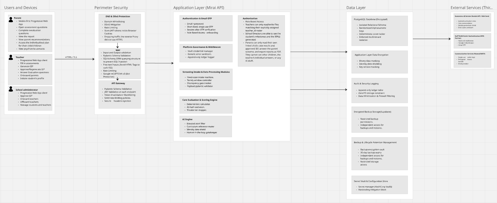

# Security

Mirai handles observations about young children, which Team Prism classifies as special-category data. Security is designed in at every layer, and the strongest controls protect against misuse by insiders as much as attacks from outside.

## Principles

#### Least privilege, enforced in code
Each role sees only what its job needs. Rules live in backend dependencies and response models, not in the UI.

#### Purpose limitation
Mirai data must never be used for admissions, discipline, grade repetition or exclusion: the anti-admission and anti-disciplinary firewall.

#### Determinism protects integrity
Scores are computed only on the server, by code with no AI dependency. Clients cannot submit or alter a score.

#### Nothing leaves without the parent
No automatic sharing with clinics, government or school systems. The referral packet leaves only when the parent exports it.

#### Data minimisation
Only the answers the active instruments need. No free-text journaling, audio, video or location tracking.

#### Everything is traceable
An append-only audit log records who did what to which record, without storing personal content.

## Layered controls

{ .zoomable }

| Layer | Controls |
| --- | --- |
| **Perimeter** | Domain whitelisting, DDoS mitigation, rate limiting, plain-HTTP traffic dropped, reCAPTCHA v3 |
| **WAF** | Input and output validation, Pydantic schemas, SQLAlchemy ORM (no string-built SQL), HTML stripped from free text, rate limiting |
| **API gateway** | JWT validation at every endpoint, token invalidation and blacklist, strict rate limits, secure headers (CSP, HSTS, `X-Content-Type-Options`, `Referrer-Policy`) |
| **Application** | Email + password, single-use OTP, TOTP for staff, RBAC, school scoping, sanitised errors, vault-backed credentials, append-only audit logger |
| **Data** | Encrypted PostgreSQL, random UUID keys, application-layer field encryption with key versioning, zero-PII audit rows, encrypted backups, Vault secrets |
| **External** | Gemini store holds curriculum only, draft-state constraint on AI output, single-use email tokens over TLS |

## Authentication

| Control | Detail |
| --- | --- |
| Account creation | Top-down only; no public sign-up |
| Passwords | Argon2id or bcrypt; minimum 8 characters; must differ from the temporary password |
| Staff MFA | Email verification, reCAPTCHA v3 on sign-in and sensitive actions, Google Authenticator TOTP verified server-side |
| Parents | Password plus a verified relationship to their own child; second factor confirm |
| Replay protection | Each TOTP time-step accepted once (`last_totp_step`) |
| Lockout | 5 failures lock the account for 15 minutes |
| Resets | Single-use, short-lived tokens; staff credential resets go through administrators |

## Sessions

| Control | Detail |
| --- | --- |
| Cookies | `HttpOnly`, `Secure`, `SameSite=Strict` |
| Idle timeout | 15 minutes for staff, 30 minutes for parents; forms autosave first |
| Absolute timeout | 8 hours for staff |
| Revocation | `revoked_token` table checked on every request; `token_version` raised on password change, reset or staff revocation |
| Shared devices | Offline queue and cached data cleared on sign-out and expiry |

## Encryption

| Data | Protection |
| --- | --- |
| In transit | TLS 1.3 everywhere; clear-text connections rejected |
| At rest | Database and disk encryption |
| Identity fields | Child name, date of birth, parent phone and parent email encrypted in the application before storage (`BYTEA`), keys from Vault, `key_version` for rotation |
| Referral packet | De-identified and encrypted before download |
| Backups | Encrypted, restricted, logged access |

!!! warning "Reviewer note on the encryption algorithm"

    The security requirements describe field and backup encryption as "RSA-256". RSA is an asymmetric algorithm used for key exchange and signatures, not for encrypting database fields, and "256" is a symmetric key length. The recommended implementation is **AES-256-GCM** (authenticated symmetric encryption) for fields and backups, with keys held in Vault. Please confirm and update the requirements document. Logged in the [Decision Log](../reference/decision-log.md).

## Audit logging

Every sign-in, sign-out, creation, view of child data, update, submission, approval, rejection, generation and export writes one row to `audit_log`:

- **Captured:** timestamp, acting user and role, action, entity type and id, school, IP address, short non-personal details (for example old and new case status).
- **Never captured:** names, dates of birth, screening answers or plan text.
- **Immutable:** the API's database role can insert but not update or delete.
- **Readable by:** school administrators for their own school; the system administrator for all.
- **Retention:** 12 months.

## Security testing

| Activity | When | Scope |
| --- | --- | --- |
| Peer code review | Every merge | ORM-only database access; no concatenated SQL; scoping on every route |
| SAST (Bandit) and dependency scans (Safety, pip-audit) | Every pull request | Block on high severity or CVSS above 7.0 |
| DAST (OWASP ZAP or Burp Suite) | Before release | Fuzz inputs; confirm validation errors leak no stack traces |
| API security tests | Before release | IDOR attempts (teacher token + another teacher's student id), token manipulation |
| Access control and tenant isolation | Before release | Every role, privilege escalation, cross-school access |
| Auth and sessions | Before release | MFA, reset, timeout and token invalidation bypass or replay |
| Exports, offline cache, AI path | Before release | Packet exposure, IndexedDB residue, AI cannot reach identity data or scores |
| Penetration test | Before production, after every major release, at least yearly | Staging with synthetic data, by a tester who did not write the code |

Critical and High findings must be fixed and retested before release.

## In this section

- [Access Control](access-control.md): the role matrix and the rules behind it
- [Privacy and Compliance](privacy-compliance.md): Kenyan law, retention and data subject rights
- [Threat Model](threat-model.md): assets, adversaries, threats and the OWASP Top 10 mapping
