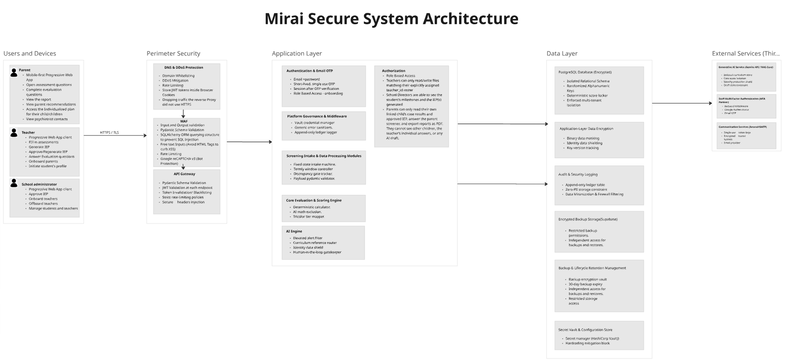

# Documentation Guide

<p class="mi-lead">How the Mirai docs are organised, the writing conventions we follow and how to get a change merged.</p>

## How the docs are organised

| Section | Read it when you want to... |
| --- | --- |
| [Start Here](index.md) | understand what Mirai is, why it exists and who uses it |
| [Architecture](../architecture/index.md) | see how the system fits together, how a case moves and how data is stored |
| [Backend](../backend/index.md) | work on the FastAPI service, the scoring engine or the API |
| [AI](../ai/index.md) | work on IEP, home-activity or evaluation-question generation |
| [Frontend](../frontend/index.md) | work on the PWA, screens or the visual design |
| [Platform](../platform/index.md) | deploy, configure environments, manage secrets or backups |
| [Security](../security/index.md) | check access rules, privacy obligations or the threat model |
| [Developer Guide](../developer-guide/index.md) | set up a machine, follow the workflow or run the tests |
| [Reference](../reference/index.md) | look up a term, a decision or who owns what |

## Sources of truth

This site summarises and connects Team Prism's working documents. When something here disagrees with code, **the code wins**, and the page should be fixed. When documents disagree with each other, the conflict is recorded in the [Decision Log](../reference/decision-log.md) until the team resolves it.

| Topic | Primary source |
| --- | --- |
| Product scope, personas, features | Team Prism PRD (25 Sep 2026) |
| Functional and non-functional requirements | Team Prism Technical Requirements (1 Oct 2026) |
| Tables, fields, constraints | Team Prism Data Models (12 Oct 2026) and the Data Models updates |
| Security, privacy, retention | Security and Privacy Requirements, AppSec, Threat Modelling, Compliance Notes (Oct 2026) |
| Test strategy and open decisions | QA Discovery and Test Strategy (Oct 2026) |
| Architecture diagrams | Mirai System Architecture and Secure System Architecture diagrams |
| User flows and screens | Prism user flows (FigJam), mirAI teacher wireframes and hi-fi prototypes |
| Brand | Mirai style guide |

## Writing conventions

**Voice.** Plain, direct English. Short sentences. Write for a new developer on their first week.

**Product language.** The same non-diagnostic rules that apply in the product apply here:

| Write | Avoid |
| --- | --- |
| "an Elevated result in the ADHD domain" | "the child has ADHD" |
| "screening", "observation", "concern" | "diagnosis", "disorder" (except when quoting a source) |
| "support plan", "IEP" | "treatment plan" |
| "professional directory" | "referral to a doctor" |

**Names.** *Mirai* is the product. *Team Prism* is the team. Use *school administrator* for the school-level role and *system administrator* for the Mirai operator. Use the status names exactly as they appear in the data model, in code font: `IEP_PENDING_APPROVAL`.

**Unconfirmed facts.** If a value is still an open decision, add it to the [Decision Log](../reference/decision-log.md) and link the entry (for example "open, see Q-08"). If a feature is designed but not built, mark it *Planned* and list it on [Implementation Status](../reference/implementation-status.md). Do not leave "confirm" badges in published pages.

**No secrets, no real children.** Never paste credentials, tokens, real names, admission numbers or real screening answers. Use synthetic examples like *Amani Otieno, Adm. 0142*.

## Formatting toolkit

The site uses Material for MkDocs. These are the building blocks we use most.

=== "Admonitions"

    ```markdown
    !!! warning "Mirai is not a diagnostic tool"

        Body text, indented four spaces.
    ```

=== "Diagrams"

    ````markdown
    ```mermaid
    flowchart LR
        A[Teacher screening] --> B[Parent screening] --> C[[Scoring]]
    ```
    ````

=== "Zoomable images"

    ```markdown
    { .zoomable }
    ```

    Images with the `zoomable` class open full screen on click.

=== "Badges"

    ```html
    <span class="mi-badge mi-badge--elevated">Elevated</span>
    ```

Keep images in `docs/assets/<section>/` with lowercase, hyphenated names.

## Contribution workflow

1. Create a branch: `git checkout -b docs/<short-topic>`.
2. Make one focused change.
3. Preview locally with `mkdocs serve` and open <http://127.0.0.1:8000>.
4. Run `mkdocs build --strict`. Warnings fail the build, including broken links.
5. Run `git diff --check` to catch whitespace problems.
6. Commit with a clear message, for example `docs(security): add retention table`.
7. Push and open a pull request against `main`. CI runs the strict build on every push and pull request.

## Review checklist

- [ ] Facts match the source documents or the code.
- [ ] No diagnostic language about children.
- [ ] No secrets, personal data or real student information.
- [ ] New pages are added to `nav` in `mkdocs.yml`.
- [ ] Links and images resolve (`mkdocs build --strict` passes).
- [ ] Open questions are badged and logged in the decision log.
