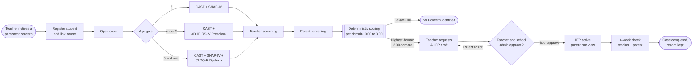

# Overview

Mirai is a pre-referral observation and documentation platform for early childhood learning variance in Nairobi's mid-tier and low-cost private schools. It is built by Team Prism.

## What is Mirai?

Mirai connects **early childhood classroom teachers**, **parents and caregivers**, **school administrators** and, through a parent-controlled export, **external clinical specialists**, all through one shared Progressive Web App (PWA).

Every case begins with a specific, teacher-observed concern. Mirai's job is to **document, triangulate and structure** that observation into something a family and a school can act on:

1. The teacher and the parent each complete a short, age-appropriate screening for the same child.
2. A **deterministic scoring engine**, kept structurally separate from any AI, produces a Low, Medium or Elevated result for each of three independent domains: **Autism**, **ADHD** and **Dyslexia**.
3. An Elevated result unlocks an **AI-drafted, curriculum-aligned Individualised Education Programme (IEP)** for the teacher, **home activities** for the parent, a **report** the parent controls and a **directory of professionals** the family may choose to contact.
4. Six weeks after the IEP is approved, teacher and parent rate the child's progress, and the outcome is appended to a record that survives staff turnover.

!!! warning "Mirai is not a diagnostic tool"

    Mirai never assigns a clinical label. Scores and alerts mean *"this observation deserves attention"*, not *"this child has a condition"*. Every screen that shows a result repeats this, and every generated document is checked for diagnostic language. See [Privacy and Compliance](../security/privacy-compliance.md).

## The name

*Mirai* (未来) is the Japanese word for *future*, which fits a product about catching a learning difference during the years when support changes outcomes the most. **Team Prism** is the team; **Mirai** is the product. Older drafts used working names such as *KEVIN* and *Daraja*; they all refer to this product.

## What Mirai is, and what it is not

| Mirai **is** | Mirai **is not** |
| --- | --- |
| A structured, low-burden way for a teacher to document a persistent concern | A diagnostic engine or a replacement for a psychologist or psychiatrist |
| A two-informant record (teacher and parent) scored per domain | A single blended "risk score" for a child |
| A source of an editable, KICD-grounded support plan that humans approve | An AI that decides what happens to a child |
| A family-controlled route to a referral packet and a list of professionals | A mandatory referral to one specific provider |
| A longitudinal record that outlives a teacher's tenure | A tool for admissions, discipline or grade placement decisions |
| Paid for by schools through an annual subscription | Something parents are ever billed for |

## Who uses Mirai

:material-human-male-board:
### Teacher
Registers students in their class, opens cases, completes the teacher screening, edits and approves IEP drafts, and completes the six-week check. Onboards parents.

:material-human-female-boy:
### Parent or caregiver
Accepts an invitation, completes the parent screening in plain language, reads their own child's report and approved plan, gets home activities and controls the referral export.

:material-school-outline:
### School administrator
The school director or headteacher. Creates teacher accounts, revokes access when staff leave, gives the second approval on IEPs and reads their school's audit log.

:material-cog-outline:
### System administrator
The Mirai operator. Onboards schools, issues the first school administrator credential, maintains the professional directory and reference data, and sees platform-level metrics only.

More detail, including personas and jobs to be done, is in [Users and Personas](users-and-personas.md).

## How Mirai works

The full state machine, with every status and transition, is documented in [Case Lifecycle](../architecture/case-lifecycle.md).

## Design principles

These principles come straight from Team Prism's field research and are treated as hard requirements, not preferences.

#### Determinism over generation
Scores and alerts come from fixed formulas on the server. A given set of answers always produces the same result. Generative AI is only used *after* a result exists, and can never change it.

#### Discreet by default
The participating school already supports children without marking them as different. Mirai preserves that: a flagged status is visible only to the child's teacher, parent, the school administrator for approval, and whoever the parent exports to.

#### Humans approve, always
No AI draft becomes part of a child's record until the teacher and the school administrator both approve it. Rejections and regenerations are limited and logged.

#### Built for real devices
Teachers use entry-level Android phones and switch data off to save money. The PWA needs no app store install, works on intermittent connections and syncs when it can.

#### Swappable instruments
The cultural validity of Western screening tools is an open question. The instrument layer sits behind an interface so a Kenya-validated instrument can replace one without a rewrite.

#### Honest about cost
A free first consultation does not mean the pathway is free. Parent-facing messaging never presents cost as resolved after the referral export.

## Technology at a glance

| Layer | Technology |
| --- | --- |
| Client | Next.js PWA for teachers and parents (mobile-first); Next.js dashboard for administrators; service worker with offline page |
| API | Python, FastAPI, Pydantic validation, JWT sessions, TOTP MFA |
| Data | PostgreSQL (shared schema), SQLAlchemy ORM, Alembic migrations |
| AI | Gemini API with a managed File Search Store holding KICD inclusive-education guidance |
| Email | SMTP for invitations and password resets |
| Secrets and backups | Environment variables today; Vault and encrypted backups *planned* ([Implementation Status](../reference/implementation-status.md)) |

The details of each layer live under [Architecture](../architecture/index.md), [Backend](../backend/index.md), [AI](../ai/index.md), [Frontend](../frontend/index.md) and [Platform](../platform/index.md).

## Where to go next

- New to the project? Read [Problem and Impact](problem-and-impact.md) for the *why*.
- Building features? Go to [Developer Guide](../developer-guide/index.md) and [Setup](../developer-guide/setup.md).
- Reviewing security or privacy? Start at [Security](../security/index.md).
- Writing docs? Read the [Documentation Guide](documentation-guide.md).
